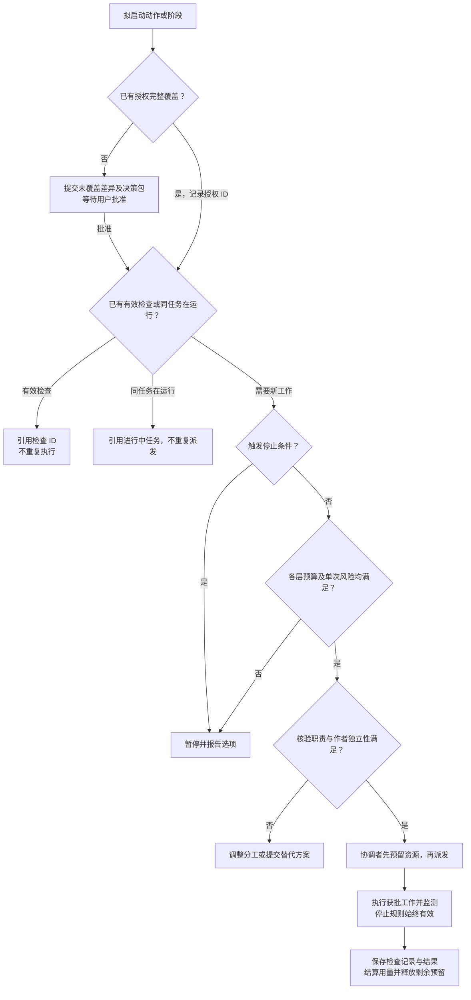

# 跨阶段控制：授权、门槛、检查复用与任务启动

v0.8：用户批准的跨阶段修订。六阶段的科学目标与人类决策权不变。本文规定共用控制语义，阶段文档保留各自额外门槛；阶段计划引用记录 ID，不反复复制同一批准或核验内容。配置提供索引，模板提供记录结构。新记录用于新项目，已有项目不因模板升级自动重新审批或核验；仅补齐实际缺失的信息。

## 1. 提前识别交付约束

- Step 1：记录接收方、已知必交成果、期限、标准、来源与未确认要求。只问缺口，不要求提前知道全部细节。
- Step 2：把影响研究设计的要求关联到协议、方法、输入和验收标准。未知且可能影响核心设计的要求按重大未决选择处理，不伪装为轻微问题。
- Step 5：根据已知交付要求综合与定稿，记录变更和未决差异。
- Step 6：核对最新要求与已有成果的差异，完成适配与归档，不将要求发现全部推迟至此阶段。

新要求可能造成上游返工时，提出最小受影响范围、理由和预算，由用户决定；不静默扩大研究目标。

## 2. 授权复用与一次性决策包

使用 [授权记录](../templates/authorization-record.yaml)。授权必须关联用户决定原文／记录、批准者、准确计划版本、阶段／动作、范围、预算、预期产出、修正边界及条件。旧模板的 `next_stage_explicitly_included` 仅为摘要，不足以独立证明下一阶段已授权。

开始阶段或动作前，先比对已有授权：仍有效、未撤销、条件满足，且覆盖该版本、范围、动作和预算时直接引用执行，不重复询问。只有未覆盖差异申请批准；说明哪些已有授权保持有效、哪些必须暂停。新版本只有在原授权明确允许的非实质修改边界内才可复用，并记录变更映射。实际对外提交仍须对应修改后的准确版本和具体动作，不能仅凭旧版授权推断。

把同一决定需要的方法选择、有限测试、标准、预算、审查和备用安排组织成一个可审阅决策包；用户可选择某方案并一并批准其明确计划。不把校准时“一次一个选择题”理解为执行时拆分每个字段审批。用户未批准、沉默或等待超时不是授权。

下列决定保留给用户：研究目标／方向，实质方法或结论边界变化，质量标准变更，未授权范围／预算扩展，规定的人类阶段选择与定稿／收尾，以及实际对外提交。跨阶段合并批准仍须满足阶段规定的时点：例如正式执行须在 Step 3 结果呈现后由用户决定，不能用尚未出现的结果提前替代该决定。

## 3. 质量、完成与授权分开

每项门槛记录对象、适用条件及依据。`applicability` 为 `applicable / not_applicable / undetermined`，与 `verdict`（`pending / pass / fail / not_verifiable`）分开。

- 适用且强制的门槛必须通过，才能把相应对象标为已核验。`undetermined` 不能算通过。
- `not_applicable` 必须根据已批准范围／完成标准给出理由；不能把失败、缺少证据、资源不足改标为不适用。改变范围／标准来使门槛不适用，须先由用户批准。
- 决策材料齐备、工作完成、证据核验、用户授权分别记录。材料可以完整披露科学不确定性，但不能将有缺陷的材料标为就绪。
- 局部实质问题阻止相关部分完成；其他已通过且无依赖影响的部分可单独接受。例外引用用户决定，仍保持原核验状态；各阶段重大问题的阻断规则继续有效。
- Step 6 选择 `materials_ready` 且不实际提交时，提交授权门槛不适用于当前收尾；必须记录尚未提交。以后发生提交动作时，该授权门槛重新适用。

Step 3 每条继续路径都必须满足：本批通过、有有效进展、无停止条件且后续已授权。一般速率告警只增加通知，不豁免批次质量门槛。

## 4. 统一检查记录与局部失效

使用项目级 [检查登记表](../templates/check-registry.yaml)。`check_id` 对应准确对象／版本／部分、方法、标准、证据或运行记录、核验者、独立性、结果、适用输入／假设／用途／依赖、允许用途及失效原因。证据台账继续记录主张与来源，并通过检查 ID 引用核验，不复制成多份检查结果。

每次复用记录引用原检查 ID、目标对象／版本、适用性比对、比对者和结论。不重新执行原检查。文件发生非实质变化时可把已有检查映射到未受影响部分，不一律作废整个文件；用途或关键依赖变更时不能仅因文件未变而复用。

仅在原检查有效、覆盖当前要求／用途且独立性要求满足时可作为通过证据。失效、失败或不可核验的记录保留历史，不能充当当前通过。只新增缺口或受影响检查，先确认授权。失效沿明确依赖传播，未受影响检查保持有效；旧检查被新检查替代时保留关联。

## 5. 启动前预算与重复任务检查

每个任务、审查、修正或重试使用 [启动检查记录](../templates/task-launch.yaml)，在工具调用／任务派发之前：

1. 检查授权和输入版本，以及可复用检查；已有有效结果则引用，不启动重复工作。同一目标／输入／方法／范围已有任务运行时，引用或等待其结果，不重复派发。
2. 检查是否触发停止条件；停止条件优先于剩余预算。
3. 按每个受约束资源维度检查：`已耗用量 + 进行中任务剩余预留 + 新任务预留 + 停止／保存／报告保留额度 <= 获批限额`。项目、阶段、工作项／agent 子预算分别满足才可启动。
4. 先登记唯一任务 ID 和预留，再派发。共享资源由协调者串行处理预留，或由支持原子操作的运行时处理；不能让并行任务各自读取同一余额后分别批准自己。
5. 已耗与未耗预留分开，完成后用实际值或标注的估算结算并释放剩余预留，不双计。跨阶段、回退、重启保留项目累计用量；后续独立授权的预算明确关联，不自动清零。
6. 时间预算区分累计执行时间与经过时间。累计时间可按任务汇总；经过时间按时钟及预计最晚完成时间判断，不能错误地相加并行任务时长。

缺少遥测时，按用户批准的保守估算和单次上限记账；不能无限启动后再估。不可中断调用须在派发前说明限制，采用获批小批次／超时或调用上限。如果仍无法合理限制风险，不启动该任务，提交选项由用户决定。估算不是测量值，不宣称硬限额已被技术强制。

## 6. 按产物分配职责与独立性

使用 [角色分配表](../templates/role-assignments.yaml)，记录产物／部分及版本、职责、agent、作者／实质贡献者、核验者、审查范围和停止条件。

| 职责 | 可合并与边界 |
| --- | --- |
| 协调者 | 可承担产出工作，但其编写的计划、摘要或其他产物须由未参与编写者核验；不代替用户选择研究方向 |
| 产出者／方法专家 | 可合并；方法专家参与设计后不能独立验收该设计 |
| 独立核验者 | 不验收自己编写或实质修复的部分；提供问题与修复条件不算代写，直接编写修复则需要另一个核验者检查受影响部分 |
| 质疑者 | 可与独立核验者合并职责，前提是未参与该对象产出并记录两种审查结果；若参与产出，其意见可保留但不能标作独立审查 |
| 桌面演练／读者适用性 | 是按需分配的职责，不默认各新增一个 agent；桌面演练仍须由未参与设计者承担，适用性审阅遵守其获批独立性要求 |

核验者负责要求与证据，质疑者负责解释边界和竞争解释，适用性审阅负责读者用途；互相引用检查记录，不重复事实核验。每项审查有明确范围、预算和完成条件。已解决异议只有在新证据、相关版本变化或原检查错误时才重开，并记录原因。无法满足独立性时说明限制，按既有规则与用户约定替代，不虚构独立审查。

## 共用启动流程

本文和模板是规范，不是运行时控制器；[小型案例走查](control-walkthrough.md)使用虚构输入检查决策路径，不代表真实研究或实时资源控制已验证。

复用记录不能解除暂停。可继续只读查阅，但新增工作或阶段推进仍须满足停止与恢复规则。旧 CSV 行可暂留空 verification_check_ids 待映射，不能从空引用推断检查通过。
