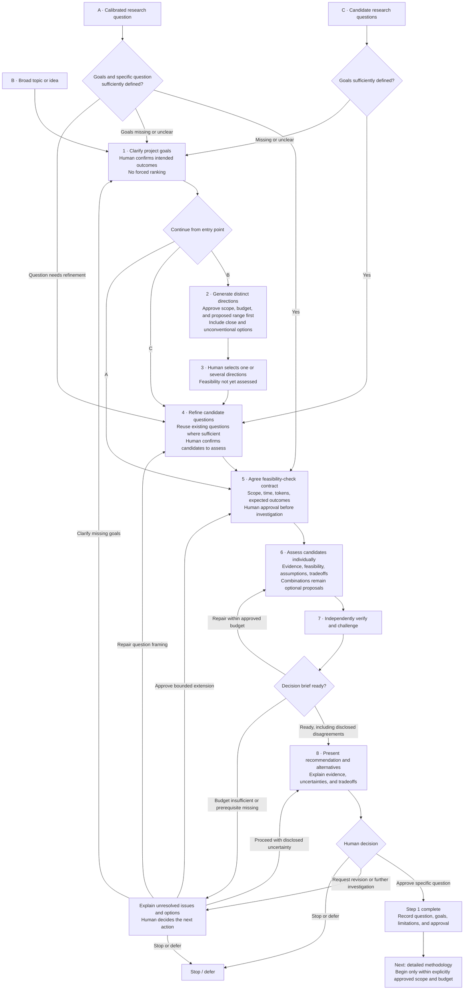

# Step 1 — Define and select a research question

Status: calibrated with the human on 2026-10-27. This is reusable policy, not a claim that any particular project's Step 1 has passed. Detailed methodology belongs to Step 2, whose details remain uncalibrated.

## Objective and entry routing

End with a human-approved specific research question, accepted goals, documented evidence limits, and explicit authorization boundaries. Use one shared sequence, entering according to input readiness:

- B: a broad topic enters goal clarification and direction generation.
- C: candidate questions enter refinement/comparison; check goal sufficiency and revisit clarification only if necessary. Do not automatically regenerate directions.
- A: an already calibrated question enters the feasibility contract phase; check prerequisites without redoing completed framing.

Return only to the phase needed to repair a missing prerequisite or a human-requested revision. Preserve the entry point after goal clarification. C may include proposed synthesis questions; combinations are options, not automatic scope changes.

## Goals and options

Allow multiple goals without forced ranking. Describe desired outcome, beneficiary/context, observable evidence of success, and boundaries in project-specific terms, not just labels such as novelty or publication. Ask for priorities only when an actual decision requires resolving a tradeoff.

Agents actively propose additional outcomes and explain why they matter, but keep accepted goals, proposed outcomes, and rejected/deferred options separate. Only the human may adopt proposed goals.

For brainstorming, propose a range of meaningfully distinct directions and explain why that coverage is useful within the budget; obtain approval. Include close-to-original and unconventional options connected to accepted goals. Do not fill a quota with redundant options. Explain if fewer useful options emerge.

Present goal alignment and tentative tradeoffs before feasibility checks, explicitly marking feasibility as not yet assessed. The human first selects one or multiple directions. Refine those into questions and obtain approval for a bounded feasibility investigation. Assess selected options individually first. Suggest combinations where useful, explaining added value, complexity, and tradeoffs; seek approval before expanding investigation scope.

## Agent responsibilities and conduct

| Role | Step 1 responsibility | Principles and reactions |
| --- | --- | --- |
| Coordinator | Route entry, clarify goals, propose budgets, maintain approvals, assemble recommendations and alternatives | Respect human intent and bounded authority; preserve dissent; ask priorities only when a decision requires them |
| Researcher / producer | Develop distinct options; assess selected candidates; inspect sources; identify critical claims; self-check and repair | Prefer traceable evidence to plausible prose; update on contrary evidence; label uncertainty and offer alternatives |
| Verifier | Check exact brief version, sources, evidence labels, goal approval, and compliance with the agreed contract | Distinguish failed evidence checks from interpretive disagreement; never turn an exception into verified evidence |
| Challenger | Test assumptions, option diversity, hidden priorities, recommendation sensitivity, and overlooked critical dependencies | Constructive skepticism; explain material objections and retire resolved ones; do not demand consensus or endless review |
| Methods specialist, when needed | Preliminary checks of data/method/resource requirements and assumptions | Explain limits and verification needs; do not perform detailed methodology design prematurely |

The researcher flags decision-critical claims; the challenger checks for omissions; the verifier checks their support. The human can add claims for verification. The coordinator handles any resulting budget change.

## Budget contract and bounded work cycle

Before brainstorming or preliminary evidence investigation, agents propose a project-complexity-based budget and explain the rationale. Include estimated time, estimated tokens, investigation scope, exclusions, expected resolution, likely residual uncertainty, and verification effort. The human approves before work starts.

Track estimates and measured actual usage separately; mark unavailable telemetry. Do not claim exact token enforcement without support. Proposed iteration counts and checkpoint percentages in the base configuration remain unapproved defaults until adopted in a project contract.

Produce → self-check → independently verify/challenge → diagnose → repair → verify again within authorized limits. Budget exhaustion is not a quality pass. If insufficient, pause and explain unresolved questions, their decision consequences, usage, and options: bounded extension, narrower scope, alternative approach, proceeding with disclosed uncertainty, or stopping. Obtain approval before extension or scope expansion.

When a missing input or flawed earlier assumption causes trouble, propose the smallest upstream repair. Preserve previous versions, mark affected downstream claims stale, and revalidate them. Do not automatically repeat all earlier phases.

## Evidence policy

- Claims about existing research and data availability require directly inspected sources. A catalog entry may establish that a dataset is advertised, but not that usable access, coverage, or entitlement is verified.
- Abstract-level findings are allowed for orientation, explicitly labeled; they do not establish full-text review.
- Research claims driving a recommendation require full-text verification of relevant passages and limitations. Mark a claim decision-critical whenever changing/removing it could alter the recommendation; explain the affected decision and sensitivity. The human may designate additional verification targets.
- If full text is unavailable, identify the unverified claim, uncertainty, decision impact, and alternatives. Let the human decide on further investigation or proceeding; the claim stays unverified.
- Methodological feasibility may use clearly labeled inference, with assumptions, uncertainty, and required future verification.
- Preserve claim-level provenance and permitted-use limits. Never substitute agent agreement for evidence or imply that an unsuccessful search proves absence.

## Two distinct gates

### Gate 1: decision readiness

The independent verifier checks that:

1. Goals are specific enough to compare options and reflect human-confirmed intent; proposed outcomes have not been silently adopted.
2. Relevant candidates and their goal alignment are clear; investigation covers only the approved set/scope, and combinations remain proposals unless accepted.
3. The preliminary assessment is bounded, evidence-backed where required, and explicit about unresolved support, inferences, and assumptions.
4. Decision-critical claims are identified with their impact, evidence level, locators, verification outcome, and any human-requested checks.
5. Recommendation, alternatives, tradeoffs, and uncertainties are accurately represented without silently ranking goals.
6. Unresolved disagreement includes each position's evidence, assumptions, and consequence for the recommendation. Consensus is not a requirement.
7. Budget reporting separates estimates, actuals, and unavailable measures; outstanding work and next-step options are visible.

A brief can be ready for an informed decision while a scientific claim remains unverified. Readiness requires honest disclosure, not a finding that the project is feasible. A defective or misleading brief must be repaired; a human-authorized evidence exception never changes that claim's verification status.

### Gate 2: human selection and authorization

The human selects, revises, defers, rejects, or approves the specific research question. Record accepted goals, supporting evidence, assumptions, unresolved claims/disagreements, and exceptions. Approval does not imply agent consensus or complete evidence.

Approval may also authorize Step 2 only when its scope, time/token budget, and expected outcomes are explicitly included. Otherwise request separate authorization. Approval of a direction is never unlimited permission.

## Outputs

Use the project brief, stage contract, evidence ledger, verification report, decision brief, and decision log templates. Record the entry phase and missing-prerequisite repairs so another session can resume without restarting framing.
