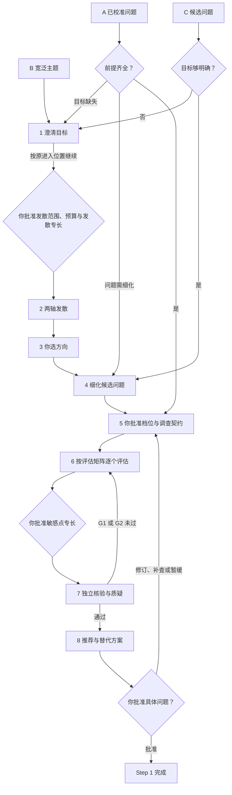

# Step 1 — 定义与选择研究问题

状态：已由用户于 2026-10-27 校准；v0.9 调整门槛与团队层；v0.9.3 精简。本文是可复用规则，不代表具体项目已通过 Step 1。

本文只写 Step 1 特有的内容。谁落槌、预算与停止、证据复用、核验独立性等通用规则见[人机分工](division-of-labor.md)、[共享控制](shared-controls.md)和[门槛、档位与运行期条件](gates.md)，与本文冲突时以人机分工为准。

## 产出与边界

结束时应有：你批准的具体研究问题、已接受的目标、证据局限和明确的授权边界。

详细方法设计属于 Step 2。本阶段的方法专家只做初步检查（数据、方法、资源与假设），说明局限与待验证事项，不提前开展详细设计。

## 从哪里进入

同一流程，按输入成熟度进入不同位置：

- **B 宽泛主题**：从目标澄清和发散开始。
- **C 候选问题**：从细化与比较开始；先检查目标是否足够明确，缺失时才回到澄清，不自动重新发散，但 AI 必须提出"值不值得补一轮发散"，说明理由与成本，由你决定。C 可包含综合问题提案，组合只是选项，不自动改变范围。
- **A 已校准问题**：从可行性契约开始；检查前提，不重复已完成的问题定义。

只在缺少前提或你要求修订时返回前面的位置；目标澄清后仍按原进入位置继续。

图里每个"你"的节点都按[人机分工](division-of-labor.md)给四件套；修订、暂缓、停止随时可以，不在图中逐一画出。

## 本阶段特有规则

### 目标

- 允许多个目标并存，不强制排序。用项目特定的期望成果、受益者／背景、可观察的成功证据与边界来描述，不停留于"创新""发表"这类标签。只在某个具体决定需要取舍时才请你排序。
- AI 主动建议其他成果并说明价值。已接受、提议、拒绝、暂缓分开记录；只有你可以把建议纳入目标。

### 发散与选择

- 头脑风暴前提出发散范围、预算和发散专长，由你批准；采用圆桌时，轮数一并批准。这是 G3 的第一个授权点。
- 按[发散与评估](divergence-and-appraisal.md)的两条轴发散：八个算子找不同方向，五类扩展从已选方向长出下一个问题。逐项交代覆盖度，不凑数量；"有实质差异"按对象、结果、对比、能回答的决定四项判定。每个方向标明提出者，淘汰的方向连同理由留在[方向记录](../templates/direction-log.md)里。可以采用全程圆桌：各专长从一开始就在同一场讨论里互相接话，发言顺序轮换、每位每轮按分配的算子提方向、质疑者每轮报告是否趋同；核验者不上桌。见[发散与评估](divergence-and-appraisal.md)第 8 节。
- 可行性检查前先展示目标匹配与初步取舍，并标明**可行性尚未评估**。你先选一个或多个方向，再细化问题、批准有限调查。
- 先分别评估。组合只是提案：说明新增价值、复杂度与取舍，扩展调查范围前先批准。

### 评估

用[评估矩阵](../templates/appraisal-matrix.md)：所有候选先填同一组论证底座（A1–A8），再按同一组维度评分。每个分数必须指回底座条目并标证据级别，否则无效；不计算加权总分，按公开的判定规则排序，并写出敏感性。

### 证据规则

其他阶段都沿用这里的证据规则。

- 既有研究与数据可用性主张需要直接查阅的来源。目录条目只能证明数据被列出，不能证明实际可获取、覆盖适用或有使用权限。
- 摘要级发现可用于了解方向，但须明确标记，不能冒充全文审阅。
- 驱动推荐的研究主张须核验全文相关段落及其局限。改变或删除某条主张可能改变推荐时，它就是决策关键主张，要说明受影响的决定和敏感性；你可以增加核验目标。
- 全文不可得时，说明未核验的主张、不确定性、对决定的影响与替代方案。你可以决定继续，但该主张仍保持未核验。
- 方法可行性允许明确标注的推断，列出假设、不确定性和后续核验要求。
- 保留逐项来源与允许用途边界。不以智能体共识代替证据，不把"没检索到"当作"不存在"。
- 分工：研究者标记决策关键主张，质疑者检查有没有遗漏，独立核验者检查支持证据。

## 质量门槛

### G1 材料就绪

另含跨阶段清单项「决策材料可用」（lite），见[门槛、档位与运行期条件](gates.md)第 7 节。最低档位标在括号里。

1. **决策材料就绪**（lite）。目标足以比较选项且由 principal 确认，没有擅自采纳新增成果；候选与目标匹配清楚，只调查获批集合与范围，未接受的组合保持提案状态；初步评估有边界，明确标出未获支持的内容、推断和假设；关键主张列明影响、证据级别、来源定位、核验结果与追加检查；推荐、替代方案、取舍与不确定性如实展示，不擅自给目标排序；分歧列明各方证据、假设及推荐影响，不要求共识；预算报告区分估算、实测与不可用测量，并展示未完成工作与后续选项。
2. **发散覆盖度已交代**（lite）。[方向记录](../templates/direction-log.md)的覆盖表里，八个算子与五类扩展每一项都有交代：产出了哪些方向、试过但未产出，或未试及理由；每个方向标明提出者；淘汰的方向连同理由保留。只数方向个数不算交代。见[发散与评估](divergence-and-appraisal.md)第 2–4 节。**只在实际发散时适用**：A、C 入口未发散时记为 `not_applicable`，理由引用初始化时批准的进入方式。

材料可供知情决定，不等于每个科学主张都已核验，**也不等于项目可行**。

### G2 独立核验完成

| 清单项 | 条件 | 最低档位 |
| --- | --- | --- |
| 评估可比且分数可追溯 | 所有候选填同一组论证底座（A1–A8）、用同一组评分维度；每个参与排序的分数都指回底座条目并标证据级别；判定按公开规则得出，并写出敏感性。见[发散与评估](divergence-and-appraisal.md)第 5 节 | lite |

核验者同时检查上面 G1 清单项的底层来源、证据标记、目标批准记录与契约遵循，并区分**证据检查失败**和**解释上的分歧**——后者不算核验不通过。质疑者在本阶段重点检查：假设、选项是否真的多样、有没有隐含的优先级、推荐对哪条证据最敏感、有没有遗漏的关键依赖。

### G3 人类授权

| 授权点 | 批准什么 | 时点 |
| --- | --- | --- |
| 发散范围、预算与发散专长 | 发散范围、时间／token 预算、圆桌轮数，以及发散用的[项目专长](agents.md)（从研究问题的组成推导） | 第 2 步之前；A、C 入口未发散时不适用 |
| 档位与可行性检查契约 | 项目档位、调查范围、时间／token 预算、预期产出 | 第 5 步，调查前 |
| 敏感点专长 | 按评估矩阵的敏感性派的[项目专长](agents.md)，用于第 7 步核验 | 第 6 步之后、第 7 步之前 |
| 具体研究问题 | 选择、修订、暂缓、拒绝或批准具体问题 | 第 8 步之后 |
| 下一阶段授权（可选合并） | Step 2 的范围、时间／token 预算与预期产出 | 与上一条一并或单独 |

批准具体问题时，记录目标、支持证据、假设、未核验主张、分歧和例外。批准不代表共识，也不代表证据完整；方向批准不是无限权限；只有授权明确写了 Step 2 的范围、预算与预期产出，才算一并授权下一阶段。

## 交付

决策摘要（以四件套开头）、项目说明、阶段契约（填 `profile`，每条验收标准填 `gate` 与 `tier`）、方向记录、评估矩阵、证据台账、核验报告、决策记录；团队项目加任务分配表。记录进入位置与补齐的前提，后续会话可以续接而不重新定义问题。
