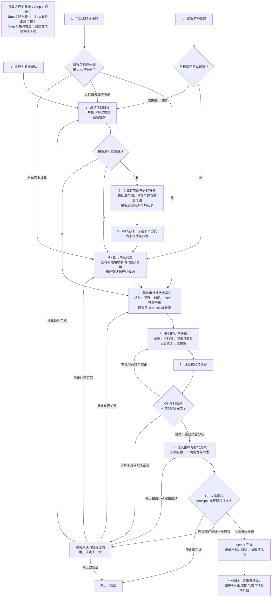

# Step 1 — 定义与选择研究问题

状态：已由用户于 2026-10-27 校准；2026-10-31 按 v0.9 调整门槛组织方式并加入团队层。本文是可复用规则，不代表具体项目已通过 Step 1。详细方法设计属于 Step 2；当前 Steps 1–6 已校准。

门槛不再逐条列举，统一为三类：G1 材料就绪、G2 独立核验完成、G3 人类授权。清单项按项目档位（`lite` / `standard` / `strict`）裁剪，定义与映射见[门槛、档位与运行期条件](gates.md)。人员角色、授权矩阵与任务单元见[团队研究](teamwork.md)。

## 目标与进入位置

本阶段结束时应有用户批准的具体研究问题、已接受目标、证据局限和明确授权边界。使用同一流程，根据输入成熟度进入不同位置：

- B：宽泛主题从目标澄清和方向生成开始。
- C：候选问题从细化／比较开始；先检查目标是否足够明确，只有缺失时才回到澄清，不自动重新生成方向。
- A：已校准问题从可行性契约开始；检查前提，不重复已完成的问题定义。

仅返回修复缺失前提或用户要求修订所需的位置。目标澄清后仍按原进入位置继续。C 可包含综合问题提案；组合是选项，不自动改变范围。

## 目标与选项

允许多个目标并存，不强制排序。用项目特定的期望成果、受益者／背景、可观察成功证据与边界描述目标，不停留于“创新”“发表”等标签。只有具体决定需要解决取舍时才请用户确定优先级。

智能体主动建议其他成果并说明价值，但分开记录已接受、提议、拒绝和暂缓的成果。只有用户可以把建议纳入目标。

头脑风暴前提出有实质差异的方向数量范围，解释预算内这种覆盖为何有用并取得批准。包含贴近原想法与非常规的选项，说明与已接受目标的关系；不凑固定数量，不以重复选项填充。若有用选项较少，应说明原因。

可行性检查前先展示目标匹配与初步取舍，并明确标记可行性尚未评估。用户先选一个或多个方向，再细化问题并批准有限调查。先分别评估；有价值时建议组合，说明新增价值、复杂度与取舍，扩展调查范围前先获批准。

## 角色责任与行为

| 角色 | Step 1 责任 | 原则与反应 |
| --- | --- | --- |
| 协调者 | 确定进入位置、澄清目标、提出预算、维护批准记录、组织推荐与替代方案 | 尊重人类意图和有限授权；保留分歧；仅在决定需要时询问优先级 |
| 研究者／产出者 | 生成有区别的选项、评估候选、检查来源、识别关键主张、自查修正 | 重视可追溯证据；根据反证修订；标注不确定性并提供替代方案 |
| 独立核验者 | 检查准确版本、来源、证据标记、目标批准与契约遵循 | 区分证据检查失败和解释分歧；不把例外当作已核验证据 |
| 质疑者 | 检查假设、选项多样性、隐含优先级、推荐敏感性与遗漏的关键依赖 | 建设性质疑；说明实质异议并撤销已解决异议；不强求共识或无限审查 |
| 方法专家（按需） | 初步检查数据、方法、资源要求与假设 | 说明局限与待验证事项，不提前开展详细设计 |
| 人员角色 | principal 选定档位、批准各授权点、拆分任务单元；collaborator 负责单元并自查；reviewer 承担 G2 | 人的决定不可由智能体代填；自批重合须记录为例外 |

研究者标记决策关键主张，质疑者检查遗漏，独立核验者检查支持证据。principal 可以增加核验目标，协调者处理相应预算变更。人员角色定义见[团队研究](teamwork.md)第 1 节。

## 预算契约与有限工作循环

头脑风暴或初步证据调查前，按项目复杂度提出预算并解释理由。包含预计时间、token、调查范围、排除项、预计解决事项、可能残余不确定性与核验工作，并按档位说明核验广度。开始前由 principal 批准。

分别记录估算、测量实际用量和不可用遥测。无工具支持时不声称精确执行 token 限额。配置中的轮数和检查点百分比只是初始提案，须在项目契约中采用才生效。

产出 → 自查 → 独立核验／质疑 → 诊断 → 修正 → 再核验，始终受授权限制。预算耗尽不是质量通过。预算不足时暂停，解释未决问题、决策影响、用量和选项：有限扩展、缩小范围、替代方法、带已披露不确定性继续或停止。扩预算或范围前先批准。

缺失输入或上游假设错误时，提出最小上游修复。保留旧版本，标记受影响下游主张失效并重新核验，不自动重做全部前序步骤。

## 证据规则

- 既有研究与数据可用性主张需要直接检查的来源。目录条目只能证明数据被列出，不能自动证明实际可获取、覆盖适用或有使用权限。
- 摘要级发现可用于方向了解，但须明确标记，不能冒充全文审阅。
- 驱动推荐的研究主张须核验全文相关段落及局限。如果改变或删除主张可能改变推荐，就标为决策关键，说明受影响决定和敏感性；principal 可增加核验目标。
- 全文不可用时，说明未核验主张、不确定性、决策影响与替代方案。principal 决定继续调查或推进，主张仍保持未核验。
- 方法可行性允许明确标注的推断，列出假设、不确定性和后续核验要求。
- 保留逐项来源和允许用途边界。不以智能体共识代替证据，不把未检索到当作不存在的证明。

## 三类门槛在 Step 1 的落地

通用定义见[门槛、档位与运行期条件](gates.md)。本阶段的具体内容如下。

### G1 材料就绪

另含跨阶段清单项「决策材料可用」（lite），见[门槛、档位与运行期条件](gates.md)第 7 节。

独立核验者检查以下清单项。最低档位标在括号里：未达该档位的项目按 `not_applicable` 处理，并须给出基于获批范围的理由。

1. **决策材料就绪**（lite）。目标足以比较选项且由 principal 确认，没有擅自采纳新增成果；候选与目标匹配清楚，只调查获批集合与范围，未接受的组合保持提案状态；初步评估有边界，明确标出未获支持的内容、推断和假设；关键主张列明影响、证据级别、来源定位、核验结果与追加检查；推荐、替代方案、取舍与不确定性如实展示，不擅自给目标排序；分歧列明各方证据、假设及推荐影响，不要求共识；预算报告区分估算、实测与不可用测量，并展示未完成工作与后续选项。

材料可供知情决定，不等于每个科学主张均已核验，也不等于项目可行。就绪要求诚实披露；有缺陷或误导性的摘要须修复。principal 接受证据例外不改变该主张的核验状态。

### G2 独立核验完成

Step 1 的核验对象是上述清单项本身：核验者检查底层来源、证据标记、目标批准记录与契约遵循，逐项记 `pass` / `fail` / `not_verifiable` 并附检查 ID。

- 核验者不验收自己编写的内容。轻量档可由组内未参与该产物产出的另一人承担；标准档及以上按[角色分配表](../templates/role-assignments.yaml)的独立性要求。
- 决策关键主张的全文核验要求在三档都成立。全文不可得时记 `not_verifiable`，说明受影响的决定与替代方案；`not_verifiable` 不算通过。
- 质疑者检查假设、选项多样性、隐含优先级与遗漏依赖，保留实质异议。

### G3 人类授权

本阶段的授权点（三档全部适用）：

| 授权点 | 批准什么 | 时点 |
| --- | --- | --- |
| 档位与可行性检查契约 | 项目档位、调查范围、时间／token 预算、预期产出 | 第 5 步，调查前 |
| 具体研究问题 | 选择、修订、暂缓、拒绝或批准具体问题 | 第 8 步之后 |
| 下一阶段授权（可选合并） | Step 2 的范围、时间／token 预算与预期产出 | 与上一条一并或单独 |

principal 或授权矩阵指定的批准人作出决定。记录目标、支持证据、假设、未核验主张、分歧和例外。批准不代表共识或证据完整；方向批准不是无限权限。只有授权明确包含 Step 2 范围、预算与预期产出时才一并授权下一阶段，否则另行取得。

两人及以下的小组里 principal 兼任任务单元负责人时，自批重合必须记录，且 G2 仍须由另一人承担，见[团队研究](teamwork.md)第 2 节。

### 本阶段的人员与任务分配

principal 在阶段契约里选定档位、填写授权矩阵，并把本阶段工作拆成任务单元：目标、允许输入输出、可写产物、验收标准、负责人、期限、预算份额、依赖。可写产物互斥，验收标准必须指向上面某条清单项。启动前走预算准入。模板见[任务分配表](../templates/work-assignment.yaml)。

## 交付

使用项目说明、阶段契约、证据台账、核验报告、决策摘要、决策日志和任务分配表模板。阶段契约须填 `profile`，每条验收标准须填 `gate` 与 `tier`。记录进入位置与缺失前提修复，使后续会话可以续接而不重新定义问题。

## 跨阶段控制（v0.8）

遵循[共享控制](shared-controls.md)：复用匹配的明确授权，仅对未覆盖的变更申请批准。统一门槛适用性、检查 ID、派发前预算预留和按产物划分的角色独立性。复用检查不能解除暂停或授权新工作。人机分工见[人机分工](division-of-labor.md)，与本文冲突时以它为准。门槛与档位见[门槛、档位与运行期条件](gates.md)，人员与任务分配见[团队研究](teamwork.md)。
