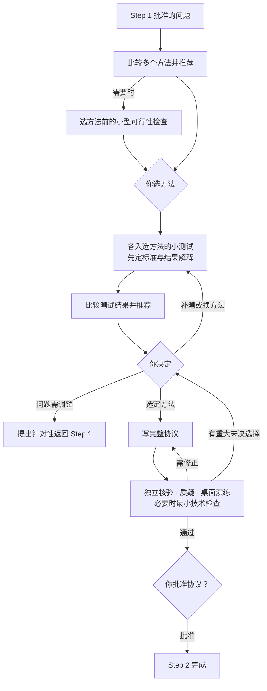

# Step 2 — 方法比较、有限测试与可执行研究协议

状态：已由用户校准并批准保存；v0.9 调整门槛与团队层；v0.9.3 精简。本文是可复用规则，不代表任何具体研究已获测试或实施授权。

本文只写 Step 2 特有的内容。通用规则见[人机分工](division-of-labor.md)、[共享控制](shared-controls.md)和[门槛、档位与运行期条件](gates.md)；证据规则沿用 [Step 1](step-1.md)。

## 产出与边界

输入是 Step 1 批准的研究问题、目标、约束、证据与已知局限。输出是经过独立审查、由你批准的可执行研究协议。

- **协议批准不是实施授权。**只有批准明确写了实施的范围、预算和预期产出，才能进入实施。
- **协议定稿不是结论被证实。**
- **和 Step 3 的边界**：Step 2 完成意味着"协议已定稿，可以实施"，不意味着实现已经验证。Step 2 的小测试只解决方法选择、假设或协议设计上的不确定性；Step 3 检查实际实现、接口衔接和端到端行为。最小技术检查不是每次都要新跑的配额。

## 本阶段特有规则

### 方法比较与选择

1. 在获批预算内提出多个方法，逐项说明：能和不能对研究问题建立哪些结论、这些结论依赖的假设、怎么检查、假设失败的后果、可行性与取舍。给出有依据的推荐，选择权在你。
2. 你先选出一个或多个方法。选之前如有必要，可以提出一个小型可行性检查，须写明目标、范围、预算和结果怎么解释，经你批准后才做。
3. 对入选方法**分别**开展小测试，不直接做完整设计或完整实施。
4. 测试前先定共享评估标准和必要的方法专属检查，说明适切性与可比性限制。
5. **每项测试事先规定**：正面、负面、不确定的结果各自会怎样影响推荐，以及它不能建立什么结论。出现意外结果照实报告，不事后包装成预设解释。
6. 比较测试结果并推荐下一步。组合要说明新增价值、复杂度与取舍，并区分**预期收益**与**已验证收益**。
7. 你选定方法或组合、批准详细设计的范围与预算后，才开始详细设计。

### 全部候选都不达标时

先分析是方法缺陷、数据限制、测试不足，还是研究问题本身难以回答，再提出补充测试、替代方法或回到 Step 1 的建议。**不降低标准，也不凭有限的失败断言问题无法回答。**

有限测试的证据动摇了研究问题的可回答性时，暂停相关方法开发，提出针对性返回 Step 1：证据表明了什么、哪些假设失败或仍不确定、问题可以怎么改及代价。你批准前不改问题或范围。

### 有限测试证据能证明什么

协议写明有限测试的证据可以用于哪些可行性判断、调试或设计选择，以及**在它影响了方法选择之后不能独立证明什么**。按项目提出新的验证数据或其他独立验证措施，并说明残余限制。

### 看到结果后改标准

必须版本化：保留原标准和原结果，说明为什么改、对解释有什么影响，经你批准后才应用或补测；修订后的分析明确标为**事后变更**。

### 协议必须包含

数据要求、可执行程序、假设检查、评估标准、有限测试与最终验证的隔离、停止规则、**预批准备用方案**（假设检查失败时可用什么、什么情况必须暂停、什么情况返回前序阶段）、预算、依赖版本和授权边界。

备用方案只能在授权边界内使用并记录，在下一个检查点报告；出现意外后果立即告诉你。

### 协议审查

四部分：独立核验者查完整性与可复现性；质疑者查设计能否支持预期结论、竞争解释与验证隔离；**未参与设计的人做桌面演练**，按协议推演输入、程序、分支与结果记录，找出歧义（不实际开展研究）；必要时做获批的最小技术检查，它只检查设计可行性，不承担端到端验证。

修正后复查修改部分和受影响的依赖；**改变核心方法或结论边界时整体复审。**

修正与回路不自动授权新测试或预算扩张：新增试运行须另获批准，或已明确包含在已有批准中；只需复查受影响部分时，不重跑未受影响的试运行。

## 质量门槛

最低档位以下的项目按 `not_applicable` 处理，须给出基于获批范围的理由。

### G1 材料就绪

另含跨阶段清单项「决策材料可用」（lite），见[门槛、档位与运行期条件](gates.md)第 7 节。

| 清单项 | 条件 | 最低档位 |
| --- | --- | --- |
| 方法比较就绪 | 每种方法的推论能力与限制、假设、可行性和取舍明确；推荐有依据 | lite |

### G2 独立核验完成

| 清单项 | 条件 | 最低档位 |
| --- | --- | --- |
| 协议定稿就绪 | 完整程序和检查已指定；规则获批；独立审查、桌面演练和必要技术检查完成（可复用有效证据）；无重大未决选择 | lite |

**重大未决选择**（可能实质改变结果、解释或有效性）即使已披露也阻止 G2 通过。允许不同解释共存，不等于允许重大设计缺口通过。轻微问题可随协议提交，但须记录影响、允许处理范围、负责人和解决时点，并经批准人接受；影响不明或涉及核心结果的风险不能默认归为轻微。

桌面演练的独立性：严格档必须由未参与设计者独立承担；标准档可由符合独立性要求的核验者兼任；轻量档可由组内未参与设计的另一人承担。

### G3 人类授权

| 授权点 | 批准什么 | 适用 |
| --- | --- | --- |
| 小测试获准执行 | 共享与专属标准、可比性限制、结果解释、范围与预算 | 做该动作时（三档同样适用） |
| 详细设计获准启动 | 方案选择，以及详细设计的范围、预算与预期产出 | 全档 |
| 实施获准启动 | 实施范围、预算、预期产出 | 全档 |

「实施获准启动」就是 Step 3 的启动授权，不在 Step 3 再记一次。批准协议时可以一并提交 Step 3 的范围、预算、预期产出和通过标准，由你决定是否合并批准；正式执行仍须在 Step 3 结果汇报后由你决定。

### 任务单元

方法比较、各方法的小测试、协议编写可以拆成并行单元。每个方法的测试报告各自独立，不能两人同时写同一份比较表。

## 交付

决策摘要（以四件套开头）：推荐及理由、关键假设、风险、未决问题、替代方案、异议与待批准事项。附可追溯、可执行的完整协议。

模板：[方法比较](../templates/method-comparison.md)、[有限测试计划与报告](../templates/pilot-check.md)、[研究协议](../templates/research-protocol.md)。把有效证据和小测试产物连同版本、输入、假设与适用范围交给 Step 3 复用。
