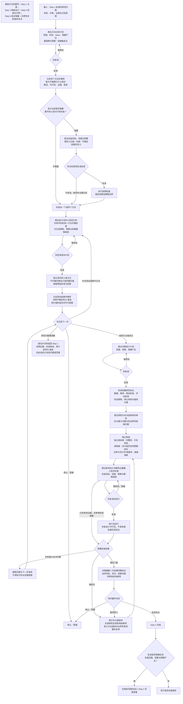

# Step 2 — 方法比较、有限测试与可执行研究协议

状态：已由用户校准并批准保存。本文是可复用工作流规则，不代表任何具体研究已获测试或实施授权。Step 3 已校准，详见 [Step 3](step-3.md)；Step 4 已校准，Step 6 已校准。

## 目标与输入

输入是 Step 1 批准的具体研究问题、目标、约束、证据与已知局限。输出是经过独立审查、由用户批准的可执行研究协议。协议批准与正式实施授权分别记录；只有批准明确包含实施范围、预算和预期产出时，才能进入已授权的实施工作。

沿用 Step 1 的直接来源、决策关键性、全文核验、推断标注和人类最终决策规则。协议定稿就绪不是科学结论已被证实。

## 完整流程图

所有回路均受授权范围与停止条件约束。修正回路不自动授权新测试；只需复查受影响部分时，不重复未受影响的试运行。用户可在任何审批点停止或暂缓，图中的修改回路不要求无限修订。

## 方法比较、选择和有限测试

1. 在获批预算内提出多个方法，逐项说明能和不能对研究问题建立哪些结论、这些结论依赖的假设、检查方式、假设失败的后果、可行性及取舍。给出有依据的推荐，最终选择属于用户。
2. 用户先选出一个或多个方法。必要时可在选择前提出小型可行性检查，但须明确目标、范围、预算和结果解释并先获批准。
3. 对入选方法分别提出并开展获批的小测试，不直接完成整个方法设计或完整实施。
4. 测试前提出共享评估标准及必要的方法专属检查，解释适切性与可比性限制，并取得批准。
5. 每项测试预定义正面、负面和不确定结果如何影响推荐，以及不能建立的结论。报告意外结果，不事后伪装为预设解释。
6. 比较测试结果、推荐下一步，并披露不确定性。组合须解释新增价值、复杂度与取舍；区分预期收益与已验证收益。扩展范围或预算前先获批准。
7. 用户选择方法或组合，并批准详细设计的范围、预算和预期产出后，才开始详细设计。

如果全部候选均未达标，先分析方法缺陷、数据限制、测试不足或研究问题的可回答性，再提出补充测试、替代方法或回到 Step 1 的建议。解释依据与 取舍，由用户决定；不自动降低标准，不根据有限失败断言问题不可回答。

若 有限测试 证据动摇研究问题的可回答性，暂停相关方法开发，提出针对性返回 Step 1：证据表明什么、哪些假设失败或仍不确定、可选问题修订及代价。批准前不得改变问题或范围；批准后保留版本并复查受影响的下游工作。

## 角色、职责与反应

| 角色 | 责任 | 工作原则与反应 |
| --- | --- | --- |
| 协调者 | 组织比较、预算、检查点、审批记录、依赖关系、摘要和推荐 | 尊重有限授权；不强求共识；出现停滞先诊断并告知，触及停止条件则暂停 |
| 研究者／产出者 | 整理来源、在获批范围内执行测试、保留结果、编写和修正交付物 | 区分证据和推断；不选择性隐藏失败；不在看到结果后静默修改标准 |
| 方法专家 | 比较方法可建立的结论和假设；设计有限测试及完整协议 | 方法服务于问题；明确可比性与推论边界；组合必须说明复杂度代价 |
| 独立核验者 | 核查完整性、可复现性、标准遵循、证据及修正的依赖影响 | 不批准自己编写的产物；不把运行成功当作科学有效；重大未决问题阻止协议定稿就绪 |
| 质疑者 | 检查设计能否支持预期结论、竞争解释、假设及验证隔离 | 指出实质风险而非制造无休止异议；保留未解决分歧及其证据 |
| 独立演练审查者 | 未参与设计，依协议推演输入、程序、分支与结果记录，发现歧义 | 桌面演练不实际开展研究；可由符合独立性要求的 独立核验者 承担，不要求固定额外 智能体 |

## 证据复用和标准变更

协议明确 有限测试 证据可用于哪些可行性判断、调试或设计选择，以及在影响方法选择后不能独立证明什么。按项目提出新验证数据或其他独立验证措施，说明残余限制并由用户批准。

看到结果后修改标准需要版本化修订：保留原标准和原结果，解释变更原因及解释后果，先批准再应用或运行更多测试；修订分析明确标记其事后变更性质。

## 预算、检查点、停滞和备用方案

- 预算包含时间、token、调查/测试范围、预期解决事项及审查工作。区分估算、测量实际值和不可用测量。
- 智能体 根据项目提出主要里程碑及预算/进展触发检查点，说明用途并在开始前取得批准。
- 停滞时先自行诊断、在已批准方法/范围/预算内修正，同时提醒用户问题、修正方案及进展。
- 智能体 提出修正轮数、时间和 token 限额及可观察进展标准，解释原因并由用户批准。达到任一停止条件即暂停受影响工作，提交诊断和下一步选项；剩余总预算不取消该停止条件。
- 协议预定义假设检查失败时可用的预批准备用方案、必须暂停的情形和应返回前序阶段的情形，说明后果并先获批准。
- 预批准备用方案在授权边界内使用并记录，下个检查点报告。意外后果立即通知用户；超出批准范围或预算前暂停并请求决定。
- 任何新增试运行或预算扩张都须先获批准，不因修正或回路而自动获权。

## 完整协议与最终审查

协议包含数据要求、可执行程序、假设检查、评估标准、有限测试/最终验证隔离、停止规则、备用方案、预算、依赖版本和授权边界。

审查包括：独立 独立核验者 的完整性/可复现性检查；质疑者 对结论支持能力的检查；未参与设计 智能体 的桌面演练；明确提出并获批的最小技术试运行。技术试运行只检查设计可行性，不承担端到端实现验证或授权完整实施。

修正后复查修改部分及受影响依赖项；改变核心方法或结论边界时整体复审。保存原版本与检查记录，标明哪些证据已失效。新增试运行须另获批准或明确包含在已有批准中。

重大未决选择（可能实质改变结果、解释或有效性）阻止协议定稿就绪。轻微问题可随协议提交，但须记录影响、允许处理范围、负责人和解决时点，由用户批准。不能把核心风险或影响不明的问题默认归为轻微。

未解决异议必须呈现各方的证据、假设和推荐影响供用户决定。允许不同解释共存不等于允许重大设计缺口通过协议定稿就绪门槛。

## 质量门槛

| 门槛 | 条件 | 人类决定 |
| --- | --- | --- |
| 方法比较就绪 | 每种方法的推论能力/限制、假设、可行性和取舍明确；推荐有依据 | 选一个或多个，或补充信息 |
| 小测试获准执行 | 共享与专属标准、可比性限制、结果解释、范围与预算明确 | 批准计划 |
| 详细设计获准启动 | 独立结果已比较；组合预期与验证收益分开；不确定性明确 | 选方案，批准设计范围与预算 |
| 协议定稿就绪 | 完整程序和检查已指定；规则获批；独立审查、桌面演练和必要技术检查完成（可复用有效证据）；无重大未决选择 | 审批协议及轻微问题 |
| 实施获准启动 | 实施范围、预算、预期产出明确包含在授权中 | 一并或单独批准 |

## 交付格式与模板

先呈现决策摘要：推荐及理由、关键假设、风险、未决问题、替代方案、异议与待批准事项。附可追溯、可执行的完整协议。

使用 [方法比较](../templates/method-comparison.md)、[有限测试计划与报告](../templates/pilot-check.md)、[研究协议](../templates/research-protocol.md)，并复用阶段契约、证据、审查、决策及回退记录。工作流校准继续一次一个选择题。

## Step 2／3 边界澄清（后续校准，取代原笼统“执行就绪”表述）

Step 2 完成意味着“协议已定稿，可进入实施”，不意味着实现已经验证。Step 2 的小测试仅解决方法选择、假设或协议设计的不确定性；Step 3 检查实际实现、接口衔接和未覆盖的端到端行为。最小技术检查不是每次必须新跑的配额。

保留适用版本、输入、假设、依赖和范围记录，把有效证据和小测试产物交给 Step 3 复用。只有新增缺口或失效部分需要复查。协议审批时可以一并提交 Step 3 范围、预算、预期产出和通过标准供用户决定是否合并批准。正式执行仍须在 Step 3 结果汇报后由用户决定。

## 跨阶段控制（v0.8）

遵循[共享控制](shared-controls.md)：复用匹配的明确授权，仅对未覆盖的变更申请批准。统一门槛适用性、检查 ID、派发前预算预留和按产物划分的角色独立性。复用检查不能解除暂停或授权新工作。
