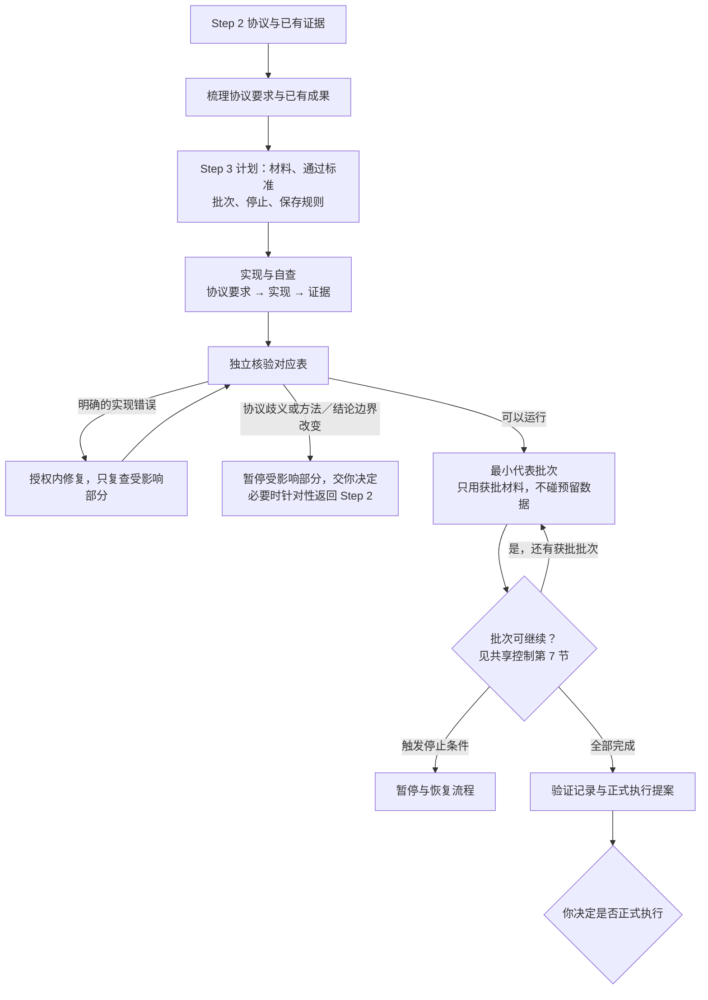

# Step 3 — 实施准备与小规模端到端验证

状态：用户已批准保存的可复用规则；v0.9 调整门槛与团队层；v0.9.3 精简。不是具体项目的运行授权。

本文只写 Step 3 特有的内容。通用规则见[人机分工](division-of-labor.md)、[共享控制](shared-controls.md)和[门槛、档位与运行期条件](gates.md)。**批次、速率、暂停、重试、保存与恢复的规则见[共享控制](shared-controls.md)第 7 节**——它们原在本文，现由 Step 3、4、6 共用。

## 产出与边界

| | Step 2 | Step 3 |
| --- | --- | --- |
| 核心问题 | 方法是否合理、协议是否明确 | 实现是否忠实于协议、完整流程能否跑通 |
| 小测试 | 解决影响方法选择或协议设计的问题 | 检查新实现、衔接及未覆盖的端到端行为 |
| 完成状态 | 协议已定稿，可进入实施 | 实现已验证，可申请正式执行 |

**验证通过不自动开始正式执行。**协议已定稿、实现已验证、正式执行已授权是三个不同状态，分别记录。验证成功只说明在已覆盖的条件下实现符合要求，不证明科学结论成立。

**不因进入新阶段重复测试。**Step 2 的证据和小测试产物在版本、输入条件、假设、依赖和适用范围仍有效时直接复用；检查适用性不等于重跑。新增检查必须指出具体的覆盖缺口或失效原因。证据失效时记录原因与影响范围；最小复查已在批准范围和预算内时可以做，否则先说明影响和方案由你批准。

## 本阶段特有规则

### 实现与核验

- 实现者自查。独立核验者核验"协议要求 → 实现位置或操作步骤 → 验证证据"的对应表，检查遗漏、偏差和未经批准的选择。
- 明确的实现错误可以在批准的修正范围与预算内修复，记录原因和验证结果。**可能影响结果的问题先告诉你。**
- **协议歧义、方法或结论边界改变**：暂停受影响部分，提交选项由你决定，不擅自修改协议。

### 材料与预留数据

合成与真实材料按项目组合，说明各自能验证什么、局限和证据复用风险；范围、预算和标准先获批准。**不得擅自访问或使用正式验证的预留数据。**

### 覆盖与可复现性

- 覆盖正常流程和决策关键的异常（如缺失输入、假设失败、停止规则与备用方案触发）。解释必要性，不追求穷尽，不重复已有的有效验证。
- 可复现性按项目定义：确定性流程要求一致；随机或人工流程提出误差范围、重复方式和记录要求，说明依据并由你批准。

### 第一次真实运行

Step 3 是项目第一次端到端运行：先跑最小代表批次，通过后才按计划继续。资源、速率与进展的监测、暂停和恢复按[共享控制](shared-controls.md)第 7 节执行；本阶段的具体轮数、时间／token 限额、进展标准和触发规则须按项目提出并获批。

## 质量门槛

最低档位以下的项目按 `not_applicable` 处理，须给出基于获批范围的理由。

### G1 材料就绪

另含跨阶段清单项「决策材料可用」（lite），见[门槛、档位与运行期条件](gates.md)第 7 节。

| 清单项 | 条件 | 最低档位 |
| --- | --- | --- |
| 决策材料齐备 | 如实报告通过、未通过、未解决项及风险；不能将未通过标为通过 | standard |

### G2 独立核验完成

| 清单项 | 条件 | 最低档位 |
| --- | --- | --- |
| 实现符合协议 | 自查和独立核验完成，对应表可追溯；协议歧义和方法变更不得擅自解决 | lite |
| 覆盖适当 | 正常与决策关键异常已覆盖或明确报告缺口；材料用途及预留数据隔离明确；无无理由重复验证 | standard |
| 可复现性 | 满足批准的一致性或误差／重复／记录要求，允许复用有效证据 | standard |

核验者不验收自己编写**或实质修复**的部分。

### G3 人类授权

| 授权点 | 批准什么 | 适用 |
| --- | --- | --- |
| 正式执行启动 | 正式执行的范围、规模、预算、检查点、停止规则及未解决问题处理 | 全档 |

本阶段的启动授权就是 Step 2 的「实施获准启动」，不在此重复记录；「正式执行启动」也是 Step 4 的启动授权，同样只记一次。

### 运行期条件：批次可继续

每批次判定，不在阶段末判定：达到本批通过标准、有有效进展、未触发暂停条件、后续仍在批准范围内。规则见[共享控制](shared-controls.md)第 7 节。

### 任务单元

实现、批次执行、对应表维护、核验可以拆成并行单元。运行记录、对应表、核验报告分别归属。预留数据的使用边界写进单元的 `allowed_inputs`，未经授权不得取用。

## 交付

决策摘要（以四件套开头）＋完整验证记录：是否建议正式执行、通过／未通过项、风险、协议对应表、复用证据与新增检查的理由、完整资源记录、正式执行计划。

模板：[Step 3 计划](../templates/step-3-plan.yaml)、[Step 3 验证记录](../templates/step-3-report.md)。它们是规则与模板，不是已实现的运行时监控器。
