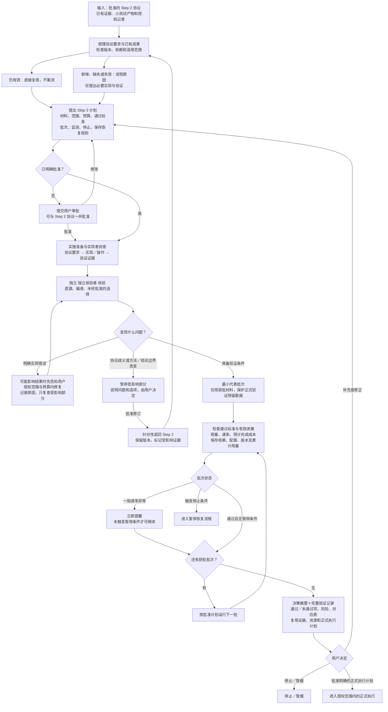
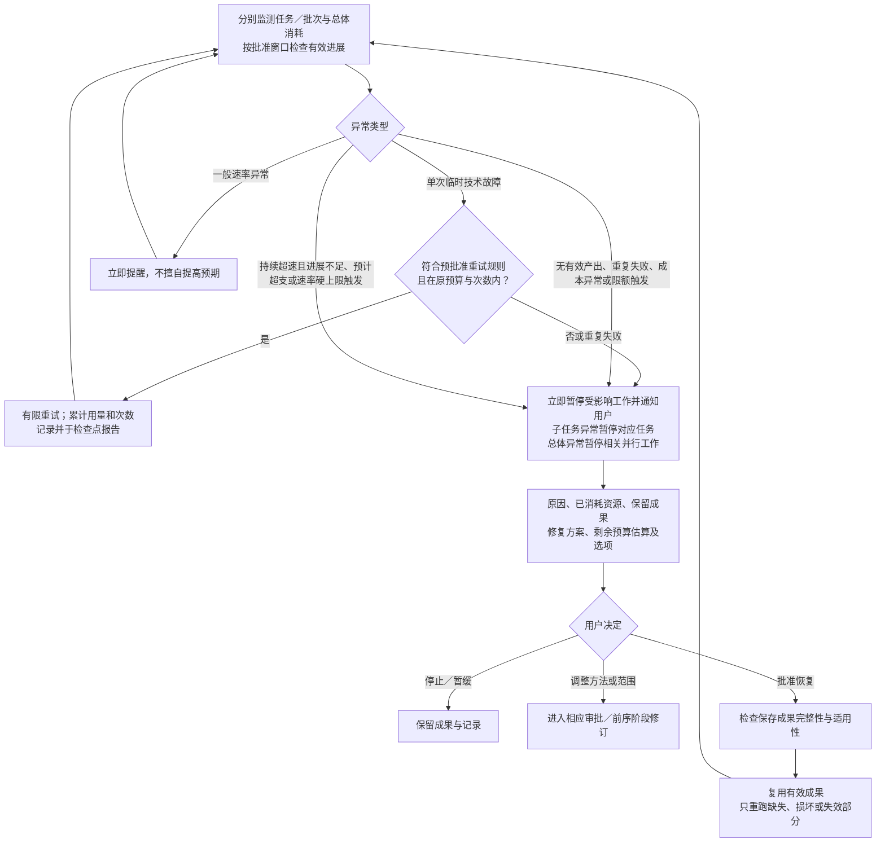

# Step 3 — 实施准备与小规模端到端验证

状态：用户已批准保存的可复用规则。不是具体项目的运行授权。Step 4 已校准，Step 6 尚待校准。

## Step 2／3 边界与有效证据复用

| | Step 2 | Step 3 |
| --- | --- | --- |
| 核心问题 | 方法是否合理、协议是否明确 | 实现是否忠实于协议、完整流程是否能运行 |
| 小测试 | 解决影响方法选择或协议设计的问题 | 检查新实现、衔接及未覆盖的端到端行为 |
| 完成状态 | 协议已定稿，可进入实施 | 实现已验证，可申请正式执行 |

不因进入新阶段重复测试。Step 2 的证据和小测试产物，在版本、输入条件、假设、依赖和适用范围仍有效时直接复用。检查适用性不等于重跑测试。新增检查必须指出具体覆盖缺口或失效原因。

若证据失效，记录原因与影响范围。最小复查已明确纳入批准范围和预算时可执行；否则先说明影响和方案，由用户批准。只复查受影响部分，不重验仍有效内容。协议审批时可以同时提出 Step 3 的范围、预算、通过标准，由用户决定是否一起批准；不要求重复审批已明确授权的工作。

## 主流程

## 资源监测与暂停恢复

监测贯穿实现、审查、运行、重试和修正，不只在批次末检查。暂停的执行能力取决于工具；不能中断调用时，应提前说明盲区和可能继续消耗的风险，提出更小批次或工具支持的运行限制供批准。不得宣称具备无法实现的实时保护。

## 实施与验证规则

- 实现者自查，独立 独立核验者 核验“协议要求 → 实现位置或操作步骤 → 验证证据”，检查遗漏、偏差和未经批准的选择。
- 明确实现错误可以在批准的修正范围/预算内修复，记录原因和验证结果。可能影响结果的问题先通知用户。
- 协议歧义、方法或结论边界改变须暂停受影响部分，提交选项由用户决定，不擅自修改协议。
- 合成和真实材料按项目组合。说明分别能验证什么、局限和证据复用风险；范围、预算和标准先获批准。不得擅自访问或使用正式验证预留数据。
- 覆盖正常流程及决策关键异常，例如缺失输入、假设失败、停止规则和备用方案触发；解释必要性，不追求穷尽，不重复已有有效验证。
- 可复现性按项目定义：确定性流程要求一致；随机或人工流程提出误差范围、重复方式和记录要求，说明依据并由用户批准。
- 验证成功仅说明已覆盖条件下实现/流程符合要求，不证明科学结论成立。

## 分批与资源控制规则

1. 智能体 提出批次范围、最小代表批次、通过标准、有效进展标准、停止阈值和理由，由用户批准。最小批次正常通过后按计划继续，无需逐批重复审批。
2. 有效进展须对应完成的有效验证项、可用结果或解决的缺陷。日志输出、进程存活和反复重试不是有效进展。
3. 无有效产出、重复失败、成本异常或限额触发立即暂停受影响工作并告知用户；按项目批准的窗口/阈值识别这些情形，不能等总预算耗尽。
4. 监测消耗速率、单位有效进展成本及预计完成成本。一般速率异常立即提醒；持续超速且进展不足、预计超支或速率硬上限触发立即暂停。基准、窗口、持续时间、阈值先获批准，区分短暂峰值与初始化开销，不擅自调高预期。
5. 使用总体限制和批次／智能体 子预算。分配与触发规则先获批准；分别监测并汇总并行用量，子任务异常暂停对应任务，总体异常暂停相关并行工作。不得擅自提高子预算。
6. 累计统计实现、审查、重试、修正、保存和恢复检查；采用清楚的任务/调用归属，避免漏算和重复计数，不因重启清零。区分测量实际值、估算和不可用测量。实际电耗仅在具备遥测时报告，不用 token 冒充电力测量。
7. 沿用 Step 2 自主诊断修正机制，但 Step 3 的具体轮数、时间/token 限额、进展标准和触发规则须按项目提出并获批。在授权内修正并同步进展；任何停止条件优先于继续修正。
8. 预批准备用方案在边界内使用并记录，检查点报告；意外后果立即通知，超出范围或预算前暂停并请求批准。

## 保存与恢复规则

- 保存点和开销先由用户批准：每批结束及关键耗时步骤后保存结果、配置、版本与累计资源记录。
- 资源、速率、进展异常或重复失败暂停后，提交原因、已消耗资源、保留成果、修复方案、剩余预算估算及选项，由用户批准才恢复。
- 单次临时技术故障仅可在预批准规则、原预算与次数内重试；记录并在检查点报告，不扩预算、不无限重试。
- 恢复前检查完整性与适用性，只重跑缺失、损坏或失效内容。暂停不自动扩大恢复范围，检查结果不能作为重复运行有效成果的借口。

## 角色责任

| 角色 | Step 3 责任 |
| --- | --- |
| 协调者 | 组织批准计划、证据复用、批次和预算分配；汇总用量；监测/通知/暂停/恢复；准备正式执行建议 |
| 产出者／实现者 | 忠实实现协议；自查和维护对应表；记录运行、错误、修复与保存成果；遵守预留数据边界 |
| 独立核验者 | 独立检查协议一致性、证据有效性、验证覆盖、通过标准和可复现性；不自证自批，不重复有效测试 |
| 方法专家／质疑者（按需） | 分析偏差是否涉及方法或结论边界；指出证据局限和结果风险；提出针对性前序审查，不擅改协议 |

## 质量门槛与最终交付

| 门槛 | 条件 |
| --- | --- |
| Step 3 获准启动 | 范围、材料、时间/token 预算、通过标准，以及批次/子预算/监测/停止/保存恢复规则获批；已有明确授权可复用 |
| 实现符合协议 | 自查和独立核验完成，对应表可追溯；协议歧义和方法变更不得擅自解决 |
| 覆盖适当 | 正常与决策关键异常已覆盖或明确报告缺口；材料用途及预留数据隔离明确；无无理由重复验证 |
| 批次可继续 | 达到本批通过标准、有有效进展、未触发暂停条件且后续仍在批准范围内 |
| 可复现性 | 满足批准的一致性或误差/重复/记录要求，允许复用有效证据 |
| 决策材料齐备 | 如实报告通过、未通过、未解决项及风险；不能将未通过标为通过 |
| 正式执行启动 | 用户明确批准范围、规模、预算、检查点、停止规则及未解决问题处理；验证通过不自动授权 |

最终提供决策摘要＋完整验证记录：是否建议正式执行、通过/未通过项、风险、协议对应表、复用证据及新增检查理由、完整资源记录、正式执行计划。协议已定稿、实现已验证、正式执行已授权是不同状态，分别记录。

使用 [Step 3 计划](../templates/step-3-plan.yaml) 与 [Step 3 验证记录](../templates/step-3-report.md)。这些文件是规则与模板，不是已实现的运行时监控器。
