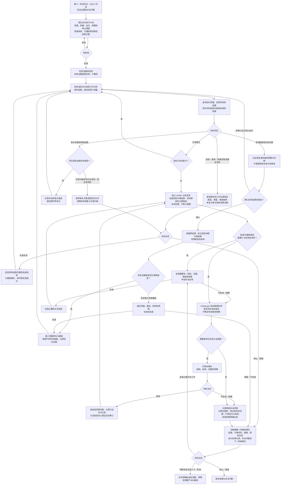

# Step 4 — 正式执行与预先规定的分析

状态：已由用户校准并批准保存。本文是可复用规则，不是具体研究运行的授权。Step 5 尚待校准。

## 目标与阶段边界

按批准协议完成正式执行和预先规定的分析，核查结果及当前表述的解释边界。全面综合讨论留到下一阶段。负面、不显著或不确定结果如实报告；结果是否理想不是执行质量的通过标准。

输入为批准的协议、Step 3 实现版本、有效验证证据、未决问题与正式执行授权。复用仍适用的证据，不因进入新阶段重复检查；有效性检查不等于重新运行原测试。

## 完整流程图

所有回路遵守批准范围、预算及停止规则，不自动授权新工作。提前停止仍可交付结果包，但须标明未完成工作。未确认错误不代表问题已解决，未决疑虑必须保留；触发停止条件仍须暂停。

## 正式执行与中间结果

- 执行与分析遵循批准协议。不因中间结果、效果方向或显著性改变方法、标准或停止条件。
- 额外探索或方法调整先说明理由、影响、范围、预算，经用户批准后开展。与原计划分析分开记录，保存原标准和原结果；方法调整走相应协议修订流程。
- 沿用 Step 3 分批、资源监测、保存和暂停恢复机制，但按正式执行规模重新提出批次、预算和停止阈值供批准；不能直接假定小规模阈值适用。
- 正常批次按计划继续。运行质量和资源指标可以持续监测；研究中间结果按预批准查看时间、指标、使用边界及处理规则查看。不要借质量监测绕过查看限制。
- 不默认封存全部研究结果。Agents 根据项目解释提前查看的具体风险，再提出规则由用户批准。
- 意外查看：符合预批准低影响规则时记录并继续，在检查点报告；可能影响方法选择或验证有效性时，暂停相关决策或受影响工作，说明影响与最小补救方案，让用户决定。不自动判定研究作废或重跑；不把已发生的查看抹去，不把影响不明默认归为低影响。

## 资源保护与复用

引用 [Step 3](step-3.md) 中总体与批次/agent 子预算、速率基准/窗口、有效进展、预计完成成本、有限修正/重试、备用方案、保存完整性和恢复审批规则。完整计入审查、重试、修正、保存与恢复成本，避免漏算或重复计数。所有具体限额按正式规模批准，不擅自上调基准或清零累计用量。

一般速率异常立即提醒；批准的暂停条件触发时暂停受影响工作并通知用户。资源/速率/进展异常或重复失败后的恢复须提交原因、已耗资源、保留成果、修复方案及剩余估算，先获批准。单次临时故障仅按预批准规则有限重试。说明实际监测与中断能力，不声称具备不存在的实时保护。

证据版本、输入条件、依赖、假设及范围仍有效时直接复用。复核不是默认重算。确认错误后保留原结果并标记受影响部分与依赖，说明错误和影响；明确获批的修复/重跑在原范围预算内执行，否则提交最小方案。影响确实广泛时可提出大范围重跑，由用户批准；保留不受影响结果。可能影响结果的问题先告知用户，不擅改协议。

## 分层复核与关键结果

执行前由 agents 根据协议提出关键结果清单及其他结果的抽查方案，解释理由并让用户批准。

独立 verifier 全面核查支撑主要结论的关键结果；其他结果按批准方案抽查。关键性依据对主要结论的影响，不依据结果是否理想。过程中发现其他结果有实质影响时，说明原因、补充复核范围与预算，先获批准再开展新增检查。抽查异常需扩大检查时同样先说明影响、范围、理由与预算并取得批准。复用有效证据，不重复检查。

## 解释边界与未解决问题

Challenger 检查结果是否支持当前表述、是否充分说明重要不确定性与竞争解释。仅使用获准查看的证据，不自动新增分析；补充分析先申请批准。全面综合讨论不在本阶段完成。

区分三种状态：执行是否完成；具体结果是否已核验；下一阶段是否获准启动。可能影响关键结果正确性或主要表述有效性的未决问题，阻止相关结果被标为已核验。其他局限明确记录。Agents 说明影响、补充工作选项与预算，用户选择继续核查、停止或带限定结论进入下一阶段。批准继续不把疑虑变成已通过。

## Agent 职责

| 角色 | 责任 |
| --- | --- |
| Coordinator | 维护协议版本、正式授权、分批资源计划和查看规则；组织异常处理、复核请求与结果包；区分三个状态 |
| Producer / executor | 按协议执行和分析，自查、保存版本及原始结果，如实报告负面/不确定结果和偏差；仅在授权内修复 |
| Independent verifier | 按获批清单核查关键结果及抽查其他结果；评估适用性、追踪错误依赖；不自证自批或重复有效检查 |
| Challenger | 检查当前表述的证据边界、不确定性与竞争解释；不绕过查看限制或自动开展额外分析 |
| Methods specialist（按需） | 解释偏差、错误及方法调整的影响，提出最小诊断或修订方案；无权以结果理想与否改变标准 |

## 质量门槛

| 门槛 | 条件 |
| --- | --- |
| 正式执行启动 | 协议/实现版本明确，正式规模批次/预算/监测/停止阈值、查看规则、关键结果清单与抽查方案已批准 |
| 执行分析符合协议 | 程序、标准和查看规则遵循协议，偏差留痕；负面、不显著、不确定结果不被隐去或当作改变标准的理由 |
| 适当复核 | 独立关键结果核查及批准的抽查完成，追加检查获批；复用有效证据 |
| 解释不越界 | 当前表述有支持，不确定性与竞争解释明确；只用获准证据，无擅自新分析 |
| 未决状态准确 | 有实质疑虑的相关结果不标已核验，其他局限明确保留 |
| 下一阶段获准启动 | 用户依据结果包决定补查、停止或带限定结论继续；继续有明确范围、预算、预期产出授权 |

## 最终交付

先呈现决策摘要：主要结果、不确定性、协议偏差、核验状态、未决问题和待决定事项。附完整可追溯结果、分层复核及解释边界记录、复用证据、执行与资源记录，以及下一阶段范围、预算、预期产出建议。使用 [执行与复核计划](../templates/step-4-plan.yaml) 和 [结果包](../templates/step-4-results.md)。
