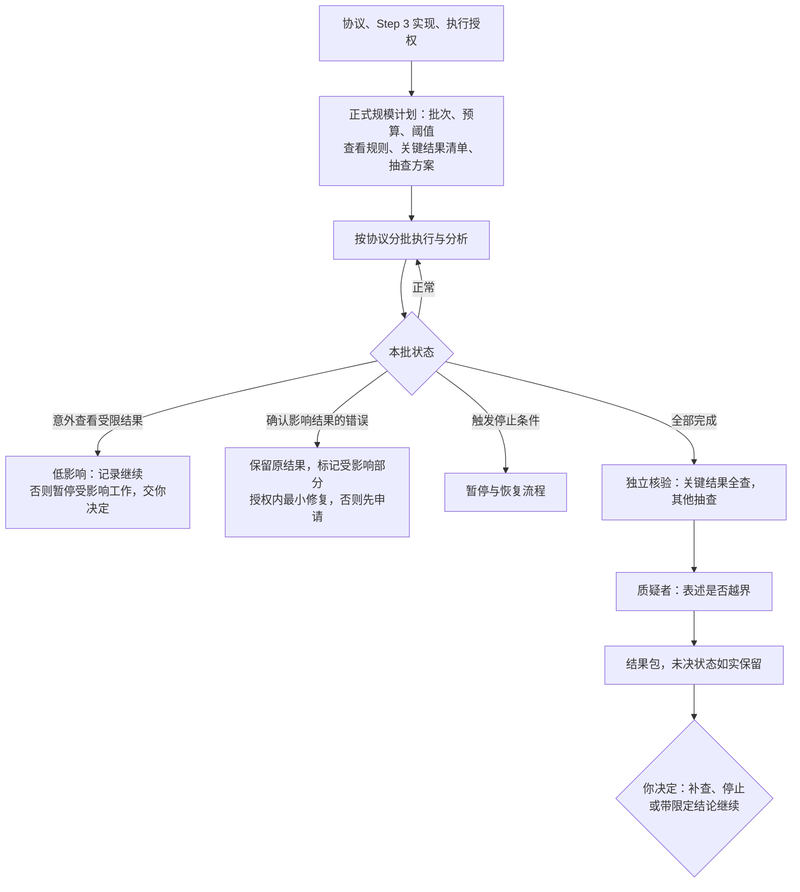

# Step 4 — 正式执行与预先规定的分析

状态：已由用户校准并批准保存；v0.9 调整门槛与团队层；v0.9.3 精简。本文是可复用规则，不是具体研究运行的授权。

本文只写 Step 4 特有的内容。通用规则见[人机分工](division-of-labor.md)、[共享控制](shared-controls.md)和[门槛、档位与运行期条件](gates.md)。批次、暂停与恢复按[共享控制](shared-controls.md)第 7 节执行。

## 产出与边界

按批准的协议完成正式执行和预先规定的分析，核查结果及当前表述的解释边界。**全面综合留到 Step 5。**

输入是批准的协议、Step 3 的实现版本、有效验证证据、未决问题与正式执行授权。仍适用的证据直接复用；有效性检查不等于重新运行原测试。

**负面、不显著或不确定的结果如实报告。结果是否理想，不是执行质量的通过标准。**

## 本阶段特有规则

### 执行与中间结果

- 执行与分析遵循批准的协议。**不因中间结果、效果方向或显著性改变方法、标准或停止条件。**
- 额外探索或方法调整，先说明理由、影响、范围、预算，经你批准后开展；与原计划的分析分开记录，保留原标准和原结果；方法调整走协议修订流程。
- **正式规模重新定数**：批次、预算和停止阈值按正式执行的规模重新提出，由你批准；不能直接假定 Step 3 的小规模阈值适用。
- 运行质量和资源指标可以持续监测；**研究的中间结果**只按预先批准的查看时间、指标、使用边界和处理规则查看。不得借质量监测绕过查看限制。
- 不默认封存全部结果。AI 按项目说明提前查看的具体风险，提出规则由你批准。
- **意外查看**：符合预批准的低影响规则时记录并继续，在检查点报告；可能影响方法选择或验证有效性时，暂停相关决策或受影响工作，说明影响与最小补救方案，由你决定。不自动判定研究作废或重跑；不抹去已经发生的查看；影响不明不默认归为低影响。

### 确认错误之后

保留原结果，标记受影响部分及其依赖，说明错误和影响。明确获批的修复／重跑在原范围与预算内执行，否则提交最小方案。影响确实广泛时可以提出大范围重跑，由你批准；不受影响的结果保留。不理想的结果本身不是错误；**未确认的错误也不代表问题已解决**，相关疑虑必须保留在未决问题里。

### 关键结果与分层复核

- 执行**之前**，AI 根据协议提出关键结果清单和其他结果的抽查方案，说明理由，由你批准。
- 独立核验者全面核查支撑主要结论的关键结果；其他结果按批准方案抽查。**关键性取决于对主要结论的影响，不取决于结果是否理想。**
- 过程中发现其他结果有实质影响，或抽查异常需要扩大检查时，先说明原因、范围与预算，获批后再查。

### 解释边界

质疑者只用获准查看的证据，检查结果是否支持当前表述、是否充分说明重要的不确定性与竞争解释；不自动新增分析，补充分析先申请。

区分三种状态：执行是否完成；具体结果是否已核验；下一阶段是否获准启动。可能影响关键结果正确性或主要表述有效性的疑虑，阻止相关结果被标为已核验。

## 质量门槛

最低档位以下的项目按 `not_applicable` 处理，须给出基于获批范围的理由。

### G1 材料就绪

另含跨阶段清单项「决策材料可用」（lite），见[门槛、档位与运行期条件](gates.md)第 7 节。

| 清单项 | 条件 | 最低档位 |
| --- | --- | --- |
| 未决状态准确 | 有实质疑虑的相关结果不标已核验，其他局限明确保留 | lite |

### G2 独立核验完成

| 清单项 | 条件 | 最低档位 |
| --- | --- | --- |
| 执行分析符合协议 | 程序、标准和查看规则遵循协议，偏差留痕；负面、不显著、不确定结果不被隐去或当作改变标准的理由 | lite |
| 适当复核 | 独立关键结果核查及批准的抽查完成，追加检查获批；复用有效证据 | lite |
| 解释不越界 | 当前表述有支持，不确定性与竞争解释明确；只用获准证据，无擅自新分析 | lite |

### G3 人类授权

| 授权点 | 批准什么 | 适用 |
| --- | --- | --- |
| 下一阶段获准启动 | 依据结果包决定补查、停止或带限定结论继续；继续须有明确范围、预算、预期产出 | 全档 |

本阶段的启动授权就是 Step 3 的「正式执行启动」；「下一阶段获准启动」同时是 Step 5 的启动授权。两者各只记一次。批准继续不把未解决的证据变成通过。

### 运行期条件：批次可继续

与 Step 3 相同，每批次判定，规则见[共享控制](shared-controls.md)第 7 节。

### 任务单元

执行、预先规定的分析、关键结果核验、质疑可以拆成并行单元。原始结果、分析输出、核验报告分别归属，**执行者不写自己的核验报告**。查看时间与指标的边界写进单元的 `allowed_inputs`。

## 交付

决策摘要（以四件套开头）：主要结果、不确定性、协议偏差、核验状态、未决问题和待决定事项。附完整可追溯结果、分层复核与解释边界记录、复用证据、执行与资源记录，以及下一阶段的范围、预算、预期产出建议。提前停止也可以交付结果包，但要标明未完成的工作。

模板：[执行与复核计划](../templates/step-4-plan.yaml)、[结果包](../templates/step-4-results.md)。

交给 [Step 5](step-5.md) 的是：准确版本的结果包、协议、证据及核验状态、未决问题、目标与用途。Step 5 只做跨结果综合与交付适用性审查，不重复有效的结果核验。
