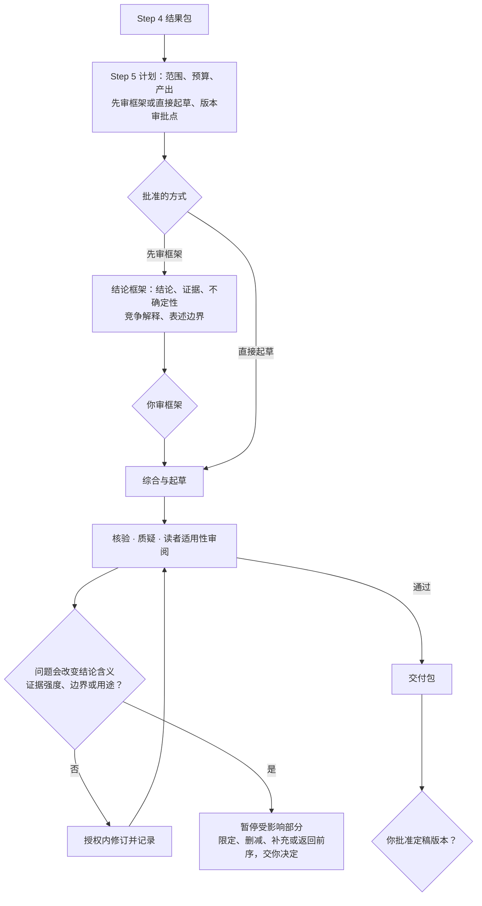

# Step 5 — 研究综合与交付定稿

状态：用户已校准并批准保存；v0.9 调整门槛与团队层；v0.9.3 精简。本文是可复用规则，不授权具体项目运行或对外发布。

本文只写 Step 5 特有的内容。通用规则见[人机分工](division-of-labor.md)、[共享控制](shared-controls.md)和[门槛、档位与运行期条件](gates.md)。

## 产出与边界

| | Step 4 | Step 5 |
| --- | --- | --- |
| 核心工作 | 正式执行、预先规定的分析、结果核验与当前表述的边界检查 | 跨结果综合、回答研究问题、形成适合目标读者的交付物 |
| 检查范围 | 关键结果全面核查，其他按方案抽查 | 只查新增的综合与表述、证据对应和交付适用性 |
| 证据 | 有效验证证据直接复用 | 不重复核验有效结果；新增分析或补查须先获授权 |

输入是 Step 4 的结果包、协议与版本、有效证据、核验状态、未决问题、项目目标和交付用途。**Step 4 的未决问题保留原状态；允许综合不等于结果已核验。**

**定稿不授权对外发布。**证据核验、内容定稿、对外发布授权分别记录。

## 本阶段特有规则

### 计划与版本

- 按结论的复杂度、争议程度和交付用途，建议**先审结论框架**或**直接起草**，说明成本和取舍，由你在计划里选。先审框架时呈现主要结论、证据、不确定性、竞争解释和表述边界；直接起草也要遵守这些要求。
- 计划写明**哪些版本必须交你审批、哪些可以在授权内连续修订**，并说明理由；同时提出审查范围与分工、修订轮数、有效进展标准和停止条件，一次批准。
- 写作的有效进展由项目定义，例如解决了实质审查问题、完成了可追溯的综合、达到了获批的交付要求。**不能用新增字数或修订次数来衡量。**

### 三种审查

- **独立核验者**：新增综合与表述的准确性、引用、与结果的对应以及重要局限；复用有效核验记录，不验收自己写的内容。
- **质疑者**：综合结论是否超出证据、竞争解释是否公平、是否回应了项目目标；保留有依据的分歧。
- **读者适用性审阅**：按获批用途检查结构、清晰度与用途匹配，不为了说服力夸大结论。这是一项职责，不默认多加一个固定智能体。

三种审查的范围、预算与理由先由你批准。独立审查不要求消除所有解释分歧。

### 按影响分级处理

- 不影响核心结论或交付用途的证据缺口，记为局限，可以继续综合。其他非实质问题记下影响、处理边界、负责人和解决时点，由你决定是否接受。
- **不改变结论含义、证据强度和适用边界**的修订，可以在批准的范围与预算内完成并记录。
- **会改变**主要结论、限定条件、证据强度、适用边界或交付用途的问题：暂停受影响部分，说明影响，提出限定结论、删减、补充分析或返回前序阶段的选项和预算，由你决定。
- 影响核心结论正确性、证据支持或交付用途的问题，阻止相关内容标为定稿。**不能靠换措辞把未决问题当作已解决。**
- 保留原版本、核验状态和依赖；批准的补充工作回到相应阶段做，只更新受影响内容。你允许继续或接受局限，不会把未核验变为通过。

### 暂停

达到任一批准的停止条件即暂停，说明用量、有效进展、未决问题、保留成果和下一步选项；剩余预算不取消停止条件。恢复的范围与剩余预算须明确授权，程序见[共享控制](shared-controls.md)第 7 节。

## 质量门槛

最低档位以下的项目按 `not_applicable` 处理，须给出基于获批范围的理由。

### G1 材料就绪

另含跨阶段清单项「决策材料可用」（lite），见[门槛、档位与运行期条件](gates.md)第 7 节。

| 清单项 | 条件 | 最低档位 |
| --- | --- | --- |
| 定稿材料齐备 | 摘要与完整交付包准确呈现审查结果、未决状态、修订与资源记录 | lite |
| 问题分级准确 | 实质问题阻止相关内容定稿；其他问题记录影响、边界、负责人、时点并由批准人决定接受与否 | standard |

### G2 独立核验完成

| 清单项 | 条件 | 最低档位 |
| --- | --- | --- |
| 证据与状态可追溯 | 结论对应来源或结果版本；复用有效证据；继承未决状态，不把未核验标为已核验 | lite |
| 综合与表述有支持 | 回应研究问题；证据强度、适用边界、不确定性与竞争解释明确；无未经批准的新分析 | lite |
| 交付适用 | 按获批范围审查结构、清晰度与用途匹配，不夸大结论 | standard |

### G3 人类授权

| 授权点 | 批准什么 | 适用 |
| --- | --- | --- |
| 修订权限明确 | 哪些版本须审批、哪些可在授权内连续修订，以及修订轮数与停止条件 | 全档 |
| 定稿与发布分离 | 准确交付版本及其限定条件 | 全档 |

本阶段的启动授权就是 Step 4 的「下一阶段获准启动」，不在此重复记录。

### 任务单元

综合起草、核验、质疑、适用性审阅可以拆成并行单元。交付物各章节分开归属，核验与质疑记录不写进交付物正文。

## 交付

决策摘要（以四件套开头）：主要结论、证据边界、审查状态、未决问题及待批事项。附交付物、结论—证据对应表、审查与修订记录、资源用量。

模板：[Step 5 计划](../templates/step-5-plan.yaml)、[Step 5 交付包](../templates/step-5-delivery.md)。实际提交和可选后续见 [Step 6](step-6.md)，须另行明确授权。
