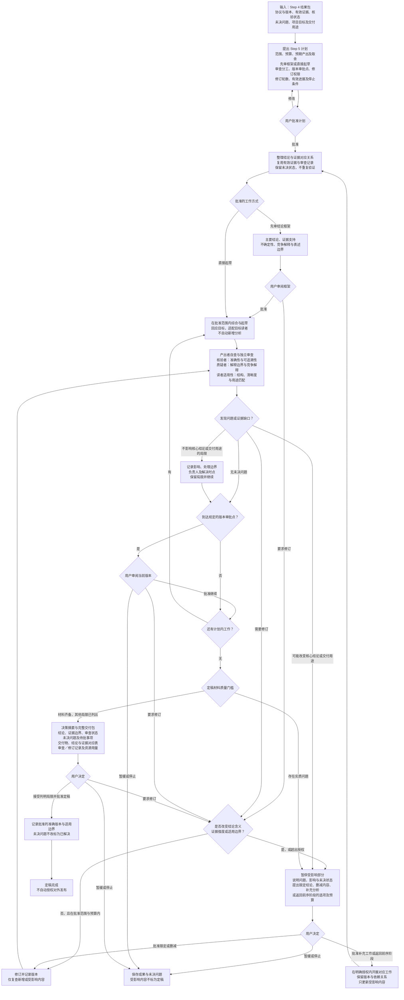
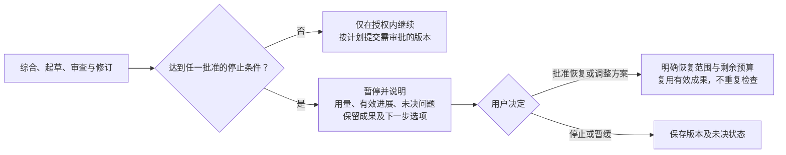

# Step 5 — 研究综合与交付定稿

状态：用户已校准并批准保存。本文是可复用规则，不授权具体项目运行或对外发布。Steps 1–5 已校准，Step 6 及后续阶段待校准。

## 目标与 Step 4／5 边界

基于已有结果完成综合与项目所需交付物，经用户批准后定稿。智能体按项目目标提出综合与交付方案，说明范围、预算、预期产出和取舍，由用户批准后开始。

| | Step 4 | Step 5 |
| --- | --- | --- |
| 核心工作 | 正式执行、预先规定的分析、结果核验与当前表述边界检查 | 跨结果综合、回答研究问题、形成适合目标读者的交付物 |
| 输入与输出 | 交付可追溯结果包，保留核验状态与未决问题 | 接收结果包，形成综合结论与交付包 |
| 检查范围 | 关键结果全面核查，其他按批准方案抽查 | 检查新增综合与表述、证据对应和交付适用性 |
| 证据复用 | 有效验证证据直接复用 | 不重复核验有效结果；新增分析或补查须先获授权 |

输入包含 Step 4 结果包、协议及版本、有效证据、核验状态、未决问题、项目目标和交付用途。Step 4 的未决问题保留原状态；允许综合不等于结果已核验。复用版本、输入、假设、依赖和适用范围仍有效的证据及审查记录；检查适用性不是重跑原检查。新缺口或失效部分先说明影响和最小补充方案，依授权开展，不自动新增分析或重复检查。

## 完整流程图

所有工作和回路受批准预算、修订轮数、有效进展与停止条件约束。箭头不自动授权新增分析、补查或预算扩展。图中未逐一展开的审批点均可停止或暂缓，不要求无限修订。

## 项目计划与版本审批

按结论复杂度、争议和交付用途，建议先审结论框架或直接起草，说明成本和取舍，在阶段计划中由用户批准。先审框架时呈现主要结论、证据、不确定性、竞争解释和表述边界；直接起草也须遵循这些要求。

计划明确哪些版本需用户审批、哪些可在授权内连续修订，说明理由。同时提出范围、时间／token 预算、预期产出、审查范围与分工、修订轮数、有效进展标准及停止条件，统一批准后执行。已有明确授权不重复申请。

## 审查责任与原则

| 角色／职责 | 工作与反应 | 存在理由 |
| --- | --- | --- |
| 协调者 | 提出计划、维护批准版本与证据依赖、跟踪预算和停止条件、组织分级处理与最终交付 | 防止范围失控，区分核验、定稿与发布授权 |
| 研究者／产出者 | 综合已有结果，忠实起草、自查并在授权内修订；保留局限和未决状态 | 形成可追溯、回应目标的交付物 |
| 独立核验者 | 检查新增综合与表述的准确性、引用、结果对应及重要局限；复用有效核验记录 | 防止综合时出现失真或遗漏；不验收自己编写的内容 |
| 质疑者 | 检查综合结论是否超出证据、竞争解释是否公平、是否回应项目目标；保留有依据的分歧 | 识别跨结果推论与表述越界；不自动开展新增分析 |
| 目标读者适用性审阅 | 按获批用途检查结构、清晰度与用途匹配，不为说服力夸大结论 | 确保交付物适合实际使用者 |

用户批准各项审查的范围、预算和理由。读者适用性是一项职责，不默认新增固定智能体；分工列入获批计划。只审新增综合与表述及受影响依赖，不重做仍有效的结果核验；补充分析或补查须先有授权。独立审查不要求消除所有解释分歧。

## 按影响分级处理

- 不影响核心结论或交付用途的证据缺口记录为局限，可继续综合。其他非实质问题记录影响、处理边界、负责人和解决时点，由用户决定是否接受。
- 可能改变核心结论或交付用途的缺口，暂停受影响部分，解释影响，提出限定结论、补充分析或返回前序阶段的选项及预算，由用户决定。
- 不改变结论含义、证据强度和适用边界的修订，可在批准范围和预算内完成并记录。实质改变主要结论、限定条件或交付用途时暂停受影响部分，说明理由、选项及预算，由用户决定。
- 影响核心结论正确性、证据支持或交付用途的问题阻止相关内容标为定稿。必要时提出删减内容或限定结论方案，须由用户决定；不能仅靠换措辞把未决问题当作解决。
- 保留原版本、核验状态和依赖。已批准的补充工作返回相应阶段执行，只更新受影响内容。用户允许继续或接受局限不把未核验变为通过、不把未决变为已解决。

## 贯穿全程的资源与暂停规则

达到任一批准停止条件即暂停，说明未决问题和下一步选项；剩余预算不取消其他停止条件。恢复或调整须明确授权范围与剩余预算。计入综合、起草、审查、修订与恢复成本，区分测量实际值、估算和不可用遥测，不声称不存在的精确控制。

有效进展由项目定义，例如解决实质审查问题、完成可追溯综合或达到获批交付要求，不能只用新增文字或修订次数衡量。通用模板不擅自确定项目阈值。

## 质量门槛

| 门槛 | 条件 |
| --- | --- |
| 启动获准 | 范围、预算、预期产出、取舍、工作方式、审查方案、版本审批点及停止条件已批准 |
| 证据与状态可追溯 | 结论对应来源或结果版本；复用有效证据；继承未决状态，不把未核验标为已核验 |
| 综合与表述有支持 | 回应研究问题；证据强度、适用边界、不确定性与竞争解释明确；无未经批准的新分析 |
| 交付适用 | 按获批范围审查结构、清晰度与用途匹配，不夸大结论 |
| 修订权限明确 | 非实质修订在授权内；实质变化暂停受影响部分，由用户决定 |
| 问题分级准确 | 实质问题阻止相关内容定稿；其他问题记录影响、边界、负责人、时点并由用户决定接受与否 |
| 定稿材料齐备 | 摘要与完整交付包准确呈现审查结果、未决状态、修订与资源记录 |
| 定稿与发布分离 | 用户批准准确交付版本及限定条件；不自动授权对外发布 |

## 最终交付与续接

先呈现主要结论、证据边界、审查状态、未决问题及待批准事项；附交付物、结论—证据对应表、审查及修订记录、资源用量。使用 [Step 5 计划](../templates/step-5-plan.yaml) 和 [Step 5 交付包](../templates/step-5-delivery.md)。

分别记录证据核验、内容定稿和对外发布授权。定稿批准对应准确版本、适用边界与已接受局限，不隐含发布许可。会话续接保留接受版本、未决问题、资源记录及下一行动。Step 6 范围待校准，不能据此自动开展发布或其他后续工作。
