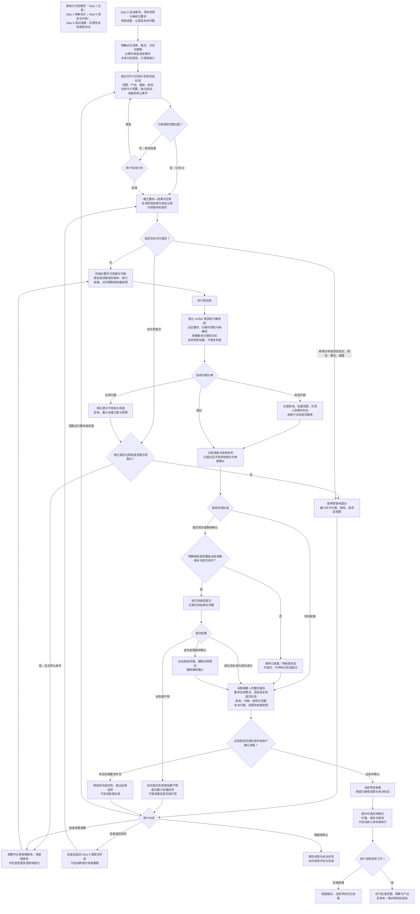
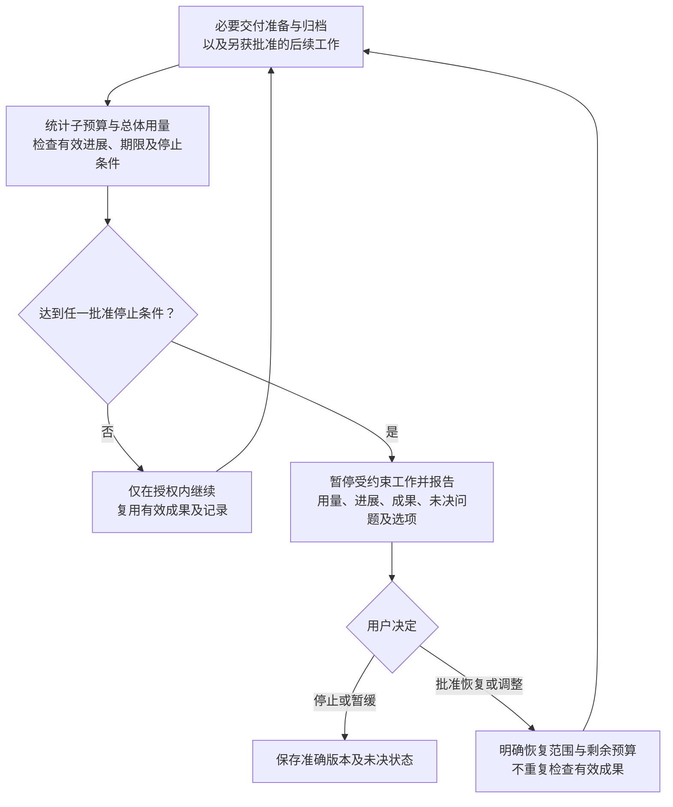

# Step 6 — 必要交付、归档与项目收尾

状态：已由用户校准并批准保存；2026-10-31 按 v0.9 调整门槛组织方式并加入团队层。本文为可复用规则，不授权具体项目运行、实际提交、发布或维护。主线是明确必交要求 → 完成必要交付与归档 → 按获批标准收尾；再提出可选后续建议。可选后续不阻碍当前项目收尾。

门槛统一为三类：G1 材料就绪、G2 独立核验完成、G3 人类授权；清单项按项目档位（`lite` / `standard` / `strict`）裁剪，定义与映射见[门槛、档位与运行期条件](gates.md)。人员角色、授权矩阵与任务单元见[团队研究](teamwork.md)。

## 目标与 Step 5／6 边界

Step 5 批准交付物的内容、结论边界和准确版本。Step 6 根据项目性质和接收方要求确定提交清单，完成必要适配、交付准备、获授权的实际提交与归档。

输入包含 Step 5 批准版本、项目性质和目标、接收方要求、材料限制、有效成果与审查记录、未决问题。先读已有信息，只澄清缺失项，不重新询问已明确事项。按接收方要求明确成果清单、格式、提交方式、截止时间与验收标准，建立要求—成果对应表。

复用版本、输入、假设、依赖与适用范围仍有效的成果和记录；检查适用性不等于重复运行。只检查新增、变更、失效或受影响部分，说明理由，不默认重做研究核验或新增分析。未决问题继承原状态。

## 完整流程图

所有工作与回路都受批准范围、预算和停止条件约束。图中审批点允许停止或暂缓，不要求无限修订。已准备不等于已授权，已授权不等于实际成功；图中的箭头不自动授权提交、分析、重跑或预算扩展。

## 必要交付与归档计划

智能体根据项目性质、接收方要求及材料限制，提出必交范围、预算、预期产出、理由和取舍，由用户批准。发布／提交前检查按渠道、受众和材料限制分级，提出检查项目、深度、预算及待决事项并取得批准；复用有效记录，不重做研究核验。

归档深度按未来复用和续接需求、保存成本及材料限制提出，明确范围、预算和验收标准，由用户批准。按获批深度保存准确版本、归档索引、数据／材料位置、访问限制、配置与环境依赖、运行／审查记录和恢复说明；这些是可按需求选择的项目，不强制每个项目采用最大归档清单，不默认重新运行验证。

提出以材料就绪、提交成功、接收确认或其他明确项目状态为完成标准，说明理由，由用户批准。未取得的状态如实保留。材料就绪可在未提交时成为获批收尾标准，但必须记录未提交；若要求接收确认，提交成功不足以完成。变更标准由用户决定，不能因为预算耗尽或等待太久而自动放宽。

## 交付差异、修订和问题分级

- 格式、排版、文件组织等不改变内容含义的调整，可在预批准范围和预算内完成并记录，保留原版本，只检查修改及受影响部分。
- 新增分析，或改变结论、限定条件、署名、材料披露范围时，暂停受影响部分，说明最小补齐方案、影响、选项和预算，由用户决定，必要时返回 Step 5 或更早阶段。超出授权的其他修正也先批准。
- 影响必交要求、归档可用性、发布／提交授权准确性或维护边界的问题，阻止相关部分标为完成。其他问题记录影响、处理范围、负责人和解决时点，由用户决定是否接受。
- 已通过且不受影响的部分可单独确认完成；局部问题不要求重查全部成果。保留未决状态，接受例外不改标为核验通过。

## 自查与独立核验

执行者自查后，由独立 verifier 按获批标准核验。智能体根据项目提出范围、深度、分工、理由与预算，由用户批准。覆盖必交要求满足情况、归档完整性／可用性／可续接性、准确版本与提交／发布授权对应，以及获批维护的范围、预算、期限和启动边界。

只审本阶段新增、变更或受影响内容，复用已有有效检查；核验者不验收自己编写的内容。计划、核验记录和最终交接都以准确版本为对象。

| 角色／职责 | 责任与反应 | 存在理由 |
| --- | --- | --- |
| 协调者 | 明确必交要求与收尾标准，提出计划、分工和预算，维护授权及实际状态；触发条件满足时暂停报告 | 使必要交付优先，不让可选后续占用收尾权限与预算 |
| 执行者 | 准备材料、整理归档、自查，仅执行明确获授权动作；记录版本、用量与实际结果 | 保证交付可追溯，不把意图当作完成 |
| 独立核验者 | 按获批范围检查要求、归档、授权与维护边界；复用有效记录，不自证自批 | 发现交接遗漏和授权／版本不一致 |
| 方法专家／质疑者（按需） | 判断差异是否影响结论、证据或方法，提出最小前序修复建议 | 防止交付适配悄然改变研究内容；不自动开展研究 |

## 实际提交与状态

实际提交或对外发布必须有明确授权，覆盖修改后的准确版本、具体动作、接收方／渠道及适用范围。已有明确且仍适用的授权可直接使用；材料准备、定稿或收尾标准获批不自动授予提交权限。

记录实际结果与凭据。失败或结果不明不能标成功，不擅自重复提交或扩权；先报告最小处理选项。接收确认只在获批范围、期限和预算内跟踪，不由提交成功推断。不得自动撤回或重新发布。

| 状态 | 所需依据 |
| --- | --- |
| 已准备 | 指定版本材料备妥；验收结果和未决项另行列明 |
| 已授权 | 用户明确批准对应版本、动作、范围和条件 |
| 已提交／已发布 | 实际成功记录或凭据；失败或结果不明不能算成功 |
| 已获接收确认 | 接收方的相应确认，不能从提交成功推断 |
| 当前项目已收尾 | 达到获批完成标准，并由用户确认 |
| 维护已启动 | 获批维护已实际开始；到期或暂停时更新状态 |

这些状态分别记录，不能互相替代或推断。

## 预算、停止和恢复

必要交付准备／发布准备、归档和获批维护按工作类型分别提出子预算、有效进展标准和停止条件，同时设置总体预算，由用户批准。子项触发条件暂停对应工作；总体触发条件暂停受其约束的工作。任一停止条件触发即暂停报告，剩余预算不抵消其他停止条件。

累计计入准备、自查、独立核验、修正、恢复及维护成本，清楚归属，避免漏算或重复计数。区分测量实际值、估算和不可用信息，说明监测／中断能力，不声称工具不具备的精确或实时控制。报告用量、进展、保留成果、未决问题与选项；恢复前明确批准范围与剩余预算，复用有效成果。

可选后续另行批准，不挤占必要交付预算，不成为当前收尾的额外门槛。

## 收尾后的可选建议与维护

当前项目按获批标准收尾后，再提出有边界的后续建议，如成果改写、其他渠道发布、扩展研究或维护，说明价值、成本和取舍。建议不自动成为项目目标，不自动调查、分析、监测或执行；用户选择后另行批准范围、预算与预期产出。拒绝或暂缓后续不影响已确认的收尾。

若选择维护，比较不维护、按需维护和有限定期维护，提出范围、触发条件、频率、期限、预算与停止规则供批准。计划批准不代表已启动，实际开始后才记录启动状态。

有限定期维护累计统计用量，到期停止；续期先批准，不因新一轮运行重置总预算。非实质维护可在预批准规则内完成并记录；可能影响结论、证据有效性、署名或披露范围时暂停受影响工作，说明影响、最小方案和预算，由用户决定。保留原版本，不自动重跑、撤回、重新发布、新增分析或重复有效检查。

## 质量门槛

通用定义见[门槛、档位与运行期条件](gates.md)。本阶段的清单项与授权点如下；最低档位以下的项目按 `not_applicable` 处理，并须给出基于获批范围的理由。

### G1 材料就绪

另含跨阶段清单项「决策材料可用」（lite），见[门槛、档位与运行期条件](gates.md)第 7 节。

| 清单项 | 条件 | 最低档位 |
| --- | --- | --- |
| 必交要求明确 | 按项目性质与接收方要求明确成果、格式、方式、期限及验收要求，只补缺失信息 | lite |
| 未决问题如实保留 | 实质问题阻止相关部分完成；其他问题列明影响、边界、负责人、时点供批准人接受 | lite |
| 收尾不受可选后续阻碍 | 摘要与完整交接包提交，按批准标准由批准人确认收尾；后续另行选择和授权 | standard |

### G2 独立核验完成

v0.8 的「独立核验完成」门槛就是 G2 本身，不再作为门槛下的条目重复一次。本阶段 G2 核验以下清单项：

| 清单项 | 条件 | 最低档位 |
| --- | --- | --- |
| 差异按影响处理 | 非实质调整在预批准范围内记录完成；新增分析或实质变化暂停并由批准人决定 | standard |
| 必要归档适用 | 深度、范围、预算与标准获批，满足相应可用性与续接要求 | standard |
| 有效成果复用 | 复用有效成果与记录；新增检查针对差异、失效或受影响部分，不重做有效检查 | strict |

自查后由未参与该产物产出者核验：覆盖必交要求的满足情况、归档完整性与可续接性、准确版本与提交／发布授权的对应，以及获批维护的范围、预算、期限与启动边界。核验范围、深度、分工与预算先批准。

### G3 人类授权

| 授权点 | 批准什么 | 适用 |
| --- | --- | --- |
| 计划与完成标准获批 | 范围、预算、产出、核验与停止规则，以及材料就绪／提交成功／接收确认等收尾标准 | 全档 |
| 提交明确授权 | 修改后的准确版本、具体动作、接收方渠道与范围 | 全档 |

准备完成或内容定稿**不替代**提交授权。提交失败或结果不明不标成功，也不擅自重复提交。维护的范围、触发、频率、期限、预算与停止规则单独批准；计划获批不代表维护已实际启动。

### 运行期条件：资源与期限受控

按准备、归档、获批维护分别判定：总体与子预算有效，停止规则有效，维护到期停止，续期先批准且累计用量不清零。

### 本阶段的任务单元

材料准备、归档整理、核验、提交动作可以拆成并行单元。**提交动作必须是单独的任务单元**，其 `g3_authorization_id` 指向「提交明确授权」，没有该授权不得启动。可写产物互斥：交接包各部分、归档索引、提交凭据分别归属。

## 最终交接

先呈现完成情况、验收状态、未决问题和待决定事项，附准确版本、要求—成果对应表、归档索引、授权记录、实际提交／发布结果及接收凭据（如有）、审查记录、资源用量和续接说明。分别记录各状态，由用户确认已完成部分、接受的局限及收尾或后续安排。使用 [Step 6 计划](../templates/step-6-plan.yaml) 和 [交接包](../templates/step-6-handoff.md)。

本阶段规则发布不创建任何自动维护任务，不授权具体项目提交或发布。通用六阶段主线已校准，具体项目的预算、阈值与授权仍须按项目确定。

## 跨阶段控制（v0.9）

遵循[共享控制](shared-controls.md)：复用匹配的明确授权，仅对未覆盖的变更申请批准。统一门槛适用性、检查 ID、派发前预算预留和按产物划分的角色独立性。复用检查不能解除暂停或授权新工作。人机分工见[人机分工](division-of-labor.md)，与本文冲突时以它为准。门槛与档位见[门槛、档位与运行期条件](gates.md)，人员与任务分配见[团队研究](teamwork.md)。

适用性澄清：获批收尾标准为 materials_ready 且当前不安排提交时，G3 的「提交明确授权」对本次收尾记为 `not_applicable` 并说明依据；这不授权之后的实际提交。维护相关清单项仅适用于选定的维护。必交要求或归档失败不得改记为不适用。
