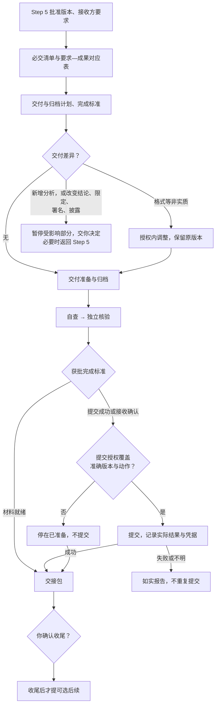

# Step 6 — 必要交付、归档与项目收尾

状态：已由用户校准并批准保存；v0.9 调整门槛与团队层；v0.9.3 精简。本文为可复用规则，不授权具体项目运行、实际提交、发布或维护。本阶段规则发布不创建任何自动维护任务。

本文只写 Step 6 特有的内容。通用规则见[人机分工](division-of-labor.md)、[共享控制](shared-controls.md)和[门槛、档位与运行期条件](gates.md)。

## 产出与边界

主线：明确必交要求 → 完成必要交付与归档 → 按获批标准收尾 → 再提出可选后续。**可选后续不阻碍当前项目收尾，也不挤占必要交付的预算。**

Step 5 批准交付物的内容、结论边界和准确版本；Step 6 按项目性质和接收方要求确定提交清单，完成必要的适配、交付准备、获授权的实际提交与归档。

输入是 Step 5 批准的版本、项目性质和目标、接收方要求、材料限制、有效成果与审查记录、未决问题。先读已有信息，只澄清缺失项。按接收方要求明确成果清单、格式、提交方式、截止时间与验收标准，建立**要求—成果对应表**。只检查新增、变更、失效或受影响的部分，不默认重做研究核验或新增分析；未决问题继承原状态。

## 本阶段特有规则

### 交付与归档计划

- AI 按项目性质、接收方要求和材料限制，提出必交范围、预算、预期产出、理由与取舍。**发布／提交前的检查按渠道、受众和材料限制分级**，提出检查项目、深度、预算和待决事项；复用有效记录，不重做研究核验。
- **归档深度**按未来复用与续接需求、保存成本和材料限制提出，明确范围、预算和验收标准。可按需保存：准确版本、归档索引、数据／材料位置、访问限制、配置与环境依赖、运行与审查记录、恢复说明。不强制每个项目用最大清单，不默认重跑验证。
- **完成标准**：以材料就绪、提交成功、接收确认或其他明确状态为准，说明理由，由你批准。材料就绪可以在未提交时成为收尾标准，但必须记录"未提交"；若要求接收确认，提交成功不足以完成。**不因预算耗尽或等待太久而自动放宽标准。**
- 准备、归档和获批维护**分别**设子预算、有效进展标准与停止条件，另设总体预算。子项触发暂停对应工作，总体触发暂停受其约束的工作。暂停与恢复按[共享控制](shared-controls.md)第 7 节。

### 交付差异与问题分级

- 格式、排版、文件组织等不改变内容含义的调整，可以在预批准的范围与预算内完成并记录，保留原版本，只检查修改部分。
- **新增分析，或改变结论、限定条件、署名、材料披露范围**：暂停受影响部分，说明最小补齐方案、影响、选项和预算，由你决定，必要时返回 Step 5 或更早。
- 影响必交要求、归档可用性、发布／提交授权准确性或维护边界的问题，阻止相关部分标为完成。其他问题记下影响、处理范围、负责人和解决时点，由你决定是否接受。已通过且不受影响的部分可以单独确认。

### 实际提交与六种状态

实际提交或对外发布必须有明确授权，覆盖**修改后的准确版本、具体动作、接收方／渠道和范围**。材料准备、定稿或收尾标准获批，都不自动授予提交权限。

记录实际结果与凭据。**失败或结果不明不能标为成功，不擅自重复提交，不自动撤回或重新发布。**接收确认只在获批的范围、期限和预算内跟踪。

| 状态 | 所需依据 |
| --- | --- |
| 已准备 | 指定版本材料备妥；验收结果和未决项另行列明 |
| 已授权 | 你明确批准对应版本、动作、范围和条件 |
| 已提交／已发布 | 实际成功记录或凭据；失败或结果不明不能算成功 |
| 已获接收确认 | 接收方的相应确认，不能从提交成功推断 |
| 当前项目已收尾 | 达到获批完成标准，并由你确认 |
| 维护已启动 | 获批维护已实际开始；到期或暂停时更新状态 |

六种状态分别记录，不能互相替代或推断。

### 收尾后的可选后续与维护

- 按获批标准收尾**之后**，再提出有边界的后续建议（成果改写、其他渠道发布、扩展研究或维护），说明价值、成本与取舍。建议不自动成为目标，不自动调查、分析、监测或执行；你选择后另行批准范围、预算与产出。拒绝或暂缓后续不影响已确认的收尾。
- 若选择维护：比较不维护、按需维护和有限定期维护，提出范围、触发条件、频率、期限、预算与停止规则。**计划获批不代表已启动**，实际开始后才记启动状态。
- 有限定期维护累计统计用量，**到期停止，续期先批准**，不因新一轮运行重置总预算。非实质维护可以在预批准规则内完成并记录；可能影响结论、证据有效性、署名或披露范围的维护问题，暂停受影响工作交你决定；保留原版本，不自动重跑、撤回、重新发布或新增分析。

## 质量门槛

最低档位以下的项目按 `not_applicable` 处理，须给出基于获批范围的理由。

### G1 材料就绪

另含跨阶段清单项「决策材料可用」（lite），见[门槛、档位与运行期条件](gates.md)第 7 节。

| 清单项 | 条件 | 最低档位 |
| --- | --- | --- |
| 必交要求明确 | 按项目性质与接收方要求明确成果、格式、方式、期限及验收要求，只补缺失信息 | lite |
| 未决问题如实保留 | 实质问题阻止相关部分完成；其他问题列明影响、边界、负责人、时点供批准人接受 | lite |
| 收尾不受可选后续阻碍 | 摘要与完整交接包提交，按批准标准由批准人确认收尾；后续另行选择和授权 | standard |

### G2 独立核验完成

v0.8 的「独立核验完成」门槛就是 G2 本身。本阶段 G2 核验以下清单项：

| 清单项 | 条件 | 最低档位 |
| --- | --- | --- |
| 差异按影响处理 | 非实质调整在预批准范围内记录完成；新增分析或实质变化暂停并由批准人决定 | standard |
| 必要归档适用 | 深度、范围、预算与标准获批，满足相应可用性与续接要求 | standard |
| 有效成果复用 | 复用有效成果与记录；新增检查针对差异、失效或受影响部分，不重做有效检查 | strict |

核验覆盖：必交要求的满足情况、归档的完整性与可续接性、准确版本与提交／发布授权的对应、获批维护的范围、预算、期限与启动边界。核验的范围、深度、分工与预算先批准。

### G3 人类授权

| 授权点 | 批准什么 | 适用 |
| --- | --- | --- |
| 计划与完成标准获批 | 范围、预算、产出、核验与停止规则，以及材料就绪／提交成功／接收确认等收尾标准 | 全档 |
| 提交明确授权 | 修改后的准确版本、具体动作、接收方渠道与范围 | 全档 |

获批收尾标准为 `materials_ready` 且不安排提交时，「提交明确授权」对本次收尾记为 `not_applicable` 并说明依据；这不授权之后的实际提交。维护相关清单项只适用于选定的维护。必交要求或归档失败不得改记为不适用。

### 运行期条件：资源与期限受控

按准备、归档、获批维护分别判定：总体与子预算有效，停止规则有效，维护到期停止，续期先批准且累计用量不清零。规则见[共享控制](shared-controls.md)第 7 节。

### 任务单元

材料准备、归档整理、核验、提交动作可以拆成并行单元。**提交动作必须是单独的任务单元**，其 `g3_authorization_id` 指向「提交明确授权」，没有该授权不得启动。交接包各部分、归档索引、提交凭据分别归属。

## 交付

决策摘要（以四件套开头）：完成情况、验收状态、未决问题和待决定事项。附准确版本、要求—成果对应表、归档索引、授权记录、实际提交／发布结果与接收凭据（如有）、审查记录、资源用量和续接说明。由你确认已完成的部分、接受的局限，以及收尾或后续安排。

模板：[Step 6 计划](../templates/step-6-plan.yaml)、[交接包](../templates/step-6-handoff.md)。
