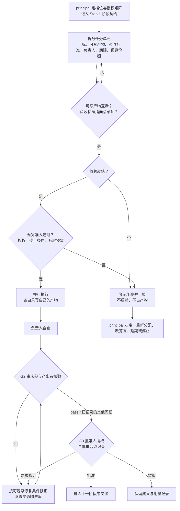

# 团队研究：人员、授权与任务分配

状态：v0.9 新增。由用户 2026-10-31 的方向决定引入（任务分配系统，中等深度）。未决假设：`principal` 为单一最终决策人；多人共同担任 principal 的情形留待后续决定。本文未纳入正式仲裁规则与贡献分类体系，它们属于更重的「完整协作治理」方向。

## 1. 人与智能体是两层

v0.8 只有一个人类「用户」和五个智能体角色。模板里的「角色分工及独立性」指智能体之间按产物划分，不涉及人。本文把人这一层显式化。智能体角色（coordinator / researcher / verifier / challenger / methods_specialist）及其独立性规则不变，见[共享控制](shared-controls.md)第 6 节。

| 人员角色 | 权限 | 边界 |
| --- | --- | --- |
| `principal` | 最终决策人：研究方向、质量标准、档位、预算、实际对外提交 | 这些权限不默认下放；委派须显式记录 |
| `approver` | 在 principal 明确授权的门槛类别与范围内批准 | 不能批准自己负责产出的任务单元 |
| `collaborator` | 负责任务单元，产出并自查 | 不能批准自己的产物，不能改动已冻结的契约 |
| `reviewer` | 对指定产物承担 G2 核验或质疑职责 | 不验收自己编写或实质修复的部分 |
| `observer` | 只读查阅 | 其意见不构成授权 |

一个人可以兼任多个角色。但对**同一产物**，G2 与 G3 不能由同一人承担（轻量档例外见第 2 节末）。

## 2. 授权矩阵

principal 在 Step 1 填写授权矩阵：按「门槛类别 × 范围」指定批准人，记入[授权记录](../templates/authorization-record.yaml)。

- G3 的默认批准人是 principal。委派必须写明门槛类别、范围、预算上限和期限。
- **不可委派的决定**（继承[共享控制](shared-controls.md)第 2 节）：研究目标与方向、实质方法或结论边界变化、质量标准变更、未授权的范围或预算扩展、档位降级、实际对外提交。
- 批准人缺席不构成授权。等待超时、沉默、口头默许都不是批准。
- **轻量档的自批例外**：两人及以下的小组里，principal 可同时是某任务单元的负责人。此时 G3 可由 principal 自批，但必须在决策记录中写明这一重合，且 G2 仍须由另一个人、或未参与该产物产出的智能体承担。这是记录在案的例外，不是门槛通过。

## 3. 任务单元

任务单元（work unit）是分配的最小单位，字段见[任务分配表](../templates/work-assignment.yaml)。必填：目标、允许输入及其版本、允许输出、可写产物、验收标准、负责人、期限、预算份额、依赖。

1. **可写产物互斥。** 两个同时进行的任务单元不能写同一产物的同一部分。这条原本只约束并发智能体，现在对人同样适用。
2. **一个任务单元只有一个负责人。** 共同产出要拆成多个单元，或指定一人负责并在 `material_contributors` 记录实质贡献者。
3. **验收标准必须可检查，并指向它所服务的清单项**（G1 或 G2 的某一条，见[门槛与档位](gates.md)）。指不出来，说明这个单元的边界还没定清，不要派发。
4. **启动前走预算准入。** 按[启动检查记录](../templates/task-launch.yaml)和[共享控制](shared-controls.md)第 5 节处理。人的时间也是受约束资源，按同一规则预留，不因为「反正是自己人」跳过登记。
5. **依赖未就绪不启动。** 阻塞立即上报，不空转等待，不先做一半占住产物。

## 4. 交接

交接记录包含：产物版本、已通过的清单项与检查 ID、未决问题、剩余预算、下一负责人。

- 接手人**不继承**原负责人的 G2 职责。接手人若参与了产出，核验必须另找人。
- 人员退出时，其未完成的单元由 principal 重新分配并记录。已通过的检查不作废，复用规则见[共享控制](shared-controls.md)第 4 节。
- **署名与贡献**：Step 6 规定不得静默改变署名。贡献记录从任务单元的 `owner` 与 `material_contributors` 生成，保证可追溯；署名顺序是 principal 的决定，智能体不得推断或代填。完整的贡献分类留待后续版本。

## 5. 阻塞与分歧

- **阻塞**：负责人上报原因、影响、已用预算和选项，由 principal 或获授权批准人决定。超过期限不自动延期。
- **人与人的分歧**：保留各方的证据、假设和对推荐的影响，交 principal 决定。不强求共识，不用多数票替代证据。这与智能体之间保留未解决异议的规则一致。

## 6. 分配流程

## 7. 与各阶段的关系

每个阶段的任务单元在该阶段契约里列出。跨阶段的长期单元须说明版本依赖和失效条件。阶段门槛由[门槛与档位](gates.md)规定，本文只规定谁来做、谁来批、产物怎么不撞车。
