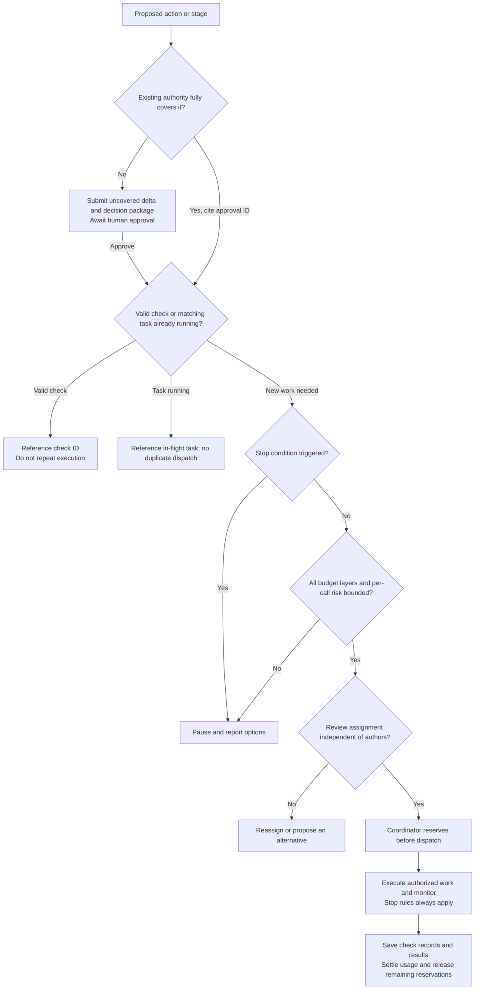

# Cross-stage controls: authority, gates, check reuse and task launch

v0.8: human-approved cross-stage amendments. Scientific objectives and human decision authority remain unchanged. This document defines shared semantics; stage documents retain their additional gates. Stage plans reference record IDs rather than copying approvals/checks. Configuration indexes policies; templates record them. Existing projects do not automatically require renewed approval or verification after a template update; fill actual information gaps only. The [Chinese version](../../docs/shared-controls.md) is authoritative.

## 1. Identify delivery constraints early

- Step 1: record recipient, known required outputs, deadlines, criteria, sources and unresolved requirements. Ask about gaps only; not every detail must be known upfront.
- Step 2: link design-affecting requirements to protocol, methods, inputs and acceptance criteria. Unknown requirements that may materially affect design remain material unresolved choices, not minor issues.
- Step 5: synthesize/finalize against known delivery requirements, recording changes and unresolved mismatches.
- Step 6: compare current requirements with existing outputs and finish adaptation/archive; do not defer all requirement discovery to this stage.

New requirements needing upstream work require a minimal impact/scope/budget proposal for human decision; no silent expansion of research goals.

## 2. Authorization reuse and bundled decisions

Use the [authorization record](../templates/authorization-record.yaml). Link the human decision text/record, approver, exact plan version, stages/actions, scope, budget, expected outcomes, repair bounds and conditions. The legacy `next_stage_explicitly_included` boolean is only a summary, not sufficient proof of next-stage authority.

Before a stage/action, match existing approval. If active, unrevoked, conditions met and covering version/scope/action/budget, cite it and proceed without asking again. Request approval only for uncovered differences, identifying preserved authority and affected pauses. New versions inherit authority only within explicitly approved nonmaterial-change bounds, with a change mapping. External submission still needs the changed exact version and action explicitly covered; do not infer it from old-version approval.

Bundle the method choice, bounded test, criteria, budget, review and fallback information needed for one decision. The human may select an option and approve its explicit plan together. One-question-at-a-time preference calibration does not require field-by-field execution approvals. Silence or elapsed waiting is never approval.

Human decisions remain required for goals/direction, material method/conclusion changes, quality-standard changes, unauthorized scope/budget expansion, prescribed stage selections/finalization/closure and external submission. Combined approvals must respect stage timing: formal execution still requires a decision after Step 3 results, not approval based on results that do not yet exist.

## 3. Separate quality, completion and authority

Each gate records its object and applicability condition/basis. `applicability` is `applicable / not_applicable / undetermined`, separate from `verdict` (`pending / pass / fail / not_verifiable`).

- Applicable mandatory gates must pass before the corresponding object is verified. Undetermined applicability is not a pass.
- `not_applicable` requires a reason based on approved scope/completion criteria; it cannot hide failure, missing evidence or exhausted resources. Scope/criterion changes that make a gate inapplicable need human approval first.
- Decision-package readiness, work completion, evidence verification and human authority are separate. A complete package may disclose scientific uncertainty; defective material cannot be ready.
- Material local issues block affected completion; passed portions without affected dependencies may be accepted separately. Exceptions cite human decisions and retain original verification status. Stage-specific material blockers still apply.
- In Step 6, with `materials_ready` and no submission action, submission authority is not applicable to current closure. Record no submission. If submission is later requested, its authorization gate becomes applicable.

Every Step 3 continuation path requires batch pass, meaningful progress, no stop condition and authorized remaining work. Ordinary rate warnings notify; they never waive batch quality gates.

## 4. Unified checks and local invalidation

Use a project-level [check registry](../templates/check-registry.yaml). A `check_id` identifies exact object/version/portion, method, criterion, evidence/run record, verifier, independence, result, applicability inputs/assumptions/use/dependencies, permitted uses and invalidation cause. The evidence ledger retains claim/source provenance and references check IDs rather than duplicating verification results.

Each reuse references original check ID, target object/version, applicability comparison, assessor and conclusion. Do not re-execute the original check. Nonmaterial file changes may map prior checks to unaffected portions instead of invalidating the whole file. Unchanged files do not justify reuse for changed purposes or dependencies.

Only valid checks covering current requirements/use and satisfying independence can support a pass. Keep invalid, failed and unverifiable records as history, never as current pass evidence. Add only missing/affected checks with authority confirmed first. Propagate invalidation along explicit dependencies; unaffected checks remain valid. Preserve replacement-check relationships.

## 5. Pre-dispatch budget and duplicate-work checks

Use a [task launch record](../templates/task-launch.yaml) for each task, review, repair or retry before calls/dispatch:

1. Check authority and input versions plus reusable checks. Reuse valid results; if the same objective/input/method/scope is in progress, reference or await it rather than duplicate dispatch.
2. Check stop conditions; these override remaining budget.
3. For each constrained resource dimension require `spent + remaining in-flight reservations + new reservation + stop/save/report reserve <= approved limit`. All project, stage and work-item/agent limits must permit launch.
4. Register a unique task ID and reserve before dispatch. The coordinator serializes shared reservations or uses a runtime with atomic operations. Parallel workers cannot independently authorize themselves against the same stale balance.
5. Separate spent usage from unspent reservations, settle measured or explicitly estimated usage and release remaining reservations on completion without double counting. Preserve cumulative project use across stage changes, rollback and restart; separately authorized follow-up budgets link to prior records rather than silently resetting them.
6. Distinguish cumulative execution time from elapsed time. Sum cumulative task time where appropriate; use clock/deadline and predicted latest finish for elapsed time, not the sum of overlapping task durations.

With missing telemetry, use human-approved conservative estimates and per-call limits; do not start unbounded work and estimate afterward. Disclose noninterruptible calls before dispatch, with approved small batches/timeouts/call caps. If risk still cannot reasonably be bounded, do not launch; present options for human decision. Estimates are not measurements or proof of hard enforcement.

## 6. Per-artifact role assignments and independence

Use [role assignments](../templates/role-assignments.yaml) to record object/portion/version, duties, agents, authors/material contributors, verifiers, review scope and stops.

| Duty | Combination and boundaries |
| --- | --- |
| Coordinator | May produce artifacts, but authored plans/summaries need a nonauthor verifier; cannot replace human direction choices |
| Producer / methods specialist | May combine; a designer cannot independently accept that design |
| Independent verifier | Cannot accept authored or materially repaired portions; identifying defects/repair conditions is not authorship, but directly writing repairs requires another verifier for affected portions |
| Challenger | May combine with verifier if not a contributor and both review results are recorded; contributor feedback is allowed but is not independent review |
| Walkthrough / audience suitability | Duties, not mandatory extra agents; walkthrough must remain uninvolved in design, and audience review follows its approved independence requirements |

Verifier handles requirements/evidence; challenger handles inference/rivals; audience review handles intended use. Reference each other's checks rather than repeat factual verification. Each review has scope, budget and completion conditions. Reopen resolved objections only for new evidence, relevant version changes or errors in prior checks, recording the reason. If independence is unavailable, disclose the limitation and agree an alternative with the human under existing rules; never fabricate independence.

## Shared launch flow

These documents/templates are policies, not a runtime controller. The [small-case walkthrough](control-walkthrough.md) uses fictitious inputs to inspect decision paths; it does not validate real research or real-time resource enforcement.

Reused records do not override a pause. Read-only lookup may continue, but new work or progression must satisfy the active stop and recovery rules. Existing CSV rows may retain blank verification_check_ids until mapped; never infer a passing check from a blank reference.
