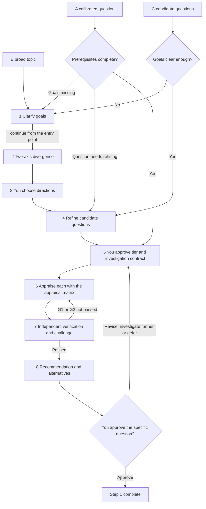

# Step 1 — Define and select a research question

Status: calibrated with the human on 2026-10-27; gates and team layer adjusted in v0.9; slimmed in v0.9.3. This is reusable policy, not a claim that any particular project has passed Step 1.

This document covers only what is specific to Step 1. Rules that apply everywhere — who makes the call, budgets and stopping, evidence reuse, verification independence — are in the [Division of labor](division-of-labor.md), [Shared controls](shared-controls.md) and [Gates, tiers and runtime conditions](gates.md); where they conflict with this document, the Division of labor prevails.

## Output and boundaries

Step 1 ends with: a specific research question you have approved, accepted goals, evidence limits and explicit authorization boundaries.

Detailed methodology belongs to Step 2. In this stage a methods specialist only performs a preliminary check (data, methods, resources and assumptions), stating limitations and what remains to be verified; it does not start detailed design.

## Where to enter

One sequence, entered at different points according to how developed the input is:

- **B broad topic**: starts with goal clarification and divergence.
- **C candidate questions**: starts with refinement and comparison; first check whether the goals are clear enough, returning to clarification only if they are not, and without automatically diverging again. C may include proposed synthesis questions; combinations are only options and do not change scope automatically.
- **A calibrated question**: starts with the feasibility contract; check prerequisites without redoing completed framing.

Return to an earlier point only for a missing prerequisite or a revision you request; after goal clarification, continue from the original entry point.

Every "you" node in the diagram comes with the four items under the [Division of labor](division-of-labor.md); revising, deferring and stopping are possible at any time and are not all drawn.

## Rules specific to this stage

### Goals

- Several goals may coexist without forced ranking. Describe them by project-specific intended outcomes, beneficiaries/context, observable evidence of success and boundaries, not labels such as "innovation" or "publication". Ask you to rank only when a specific decision needs a trade-off.
- The AI proactively suggests other outcomes and explains their value. Accepted, proposed, rejected and deferred outcomes are recorded separately; only you can make a suggestion a goal.

### Divergence and selection

- Before brainstorming, propose the divergence scope and budget for your approval; when a roundtable is used, its rounds and budget are approved at the same time.
- Diverge along the two axes of [Divergence and appraisal](divergence-and-appraisal.md): eight operators look for different directions, and five extension types grow the next question from a chosen direction. Account for coverage item by item rather than counting; "substantively different" is judged on subject, outcome, contrast and the decision the answer can inform. Every direction names who proposed it, and dropped directions stay in the [direction log](../templates/direction-log.md) with their reasons. A full roundtable may be used: specialists build on each other in one discussion from the start, speaking order rotates, each proposes directions every round using its assigned operators, and the challenger reports every round whether directions are converging; the verifier does not sit at the table. See [Divergence and appraisal](divergence-and-appraisal.md) section 8.
- Before any feasibility check, show goal fit and preliminary trade-offs and mark **feasibility not yet assessed**. You first choose one or more directions; then the question is refined and a bounded investigation approved.
- Appraise candidates separately first. Combinations are only proposals: state the added value, complexity and trade-offs, and get approval before widening the investigation.

### Appraisal

Use the [appraisal matrix](../templates/appraisal-matrix.md): every candidate first fills in the same argument base (A1–A8), then is scored on the same dimensions. Every score must point back to base items and carry an evidence level, or it is invalid; no weighted total is computed, ranking follows the published decision rules, and the sensitivity is stated.

### Evidence rules

All other stages follow the evidence rules here.

- Claims about existing research and data availability need sources read directly. A catalogue entry proves only that data is listed, not that it is actually obtainable, covers what is needed, or may be used.
- Abstract-level findings may be used to explore directions but must be labelled as such; they may not pass for full-text review.
- Research claims that drive a recommendation require verification of the relevant full-text passages and their limitations. If changing or removing a claim could change the recommendation, it is decision-critical: state the affected decision and its sensitivity. You may add verification targets.
- If the full text is unavailable, state the unverified claims, uncertainty, impact on the decision and alternatives. You may decide to proceed, but the claim stays unverified.
- Methodological feasibility may rest on clearly labelled inference, listing assumptions, uncertainty and follow-up verification needs.
- Keep sources item by item with their permitted uses. Agent consensus does not replace evidence, and "not found" is not proof of absence.
- Division of work: the researcher flags decision-critical claims, the challenger checks for omissions, and the independent verifier checks the supporting evidence.

## Quality gates

### G1 material ready

Also includes the cross-stage checklist item "decision material usable" (lite); see [Gates, tiers and runtime conditions](gates.md) section 7. The lowest tier is given in parentheses.

1. **Decision readiness** (lite). Goals are clear enough to compare options and confirmed by the principal, with no unilateral adoption of new outcomes; candidates and their goal fit are clear, only the approved set and scope were investigated, and unaccepted combinations remain proposals; preliminary appraisal is bounded and clearly marks unsupported content, inferences and assumptions; key claims list impact, evidence level, source locator, verification result and any added checks; recommendation, alternatives, trade-offs and uncertainty are presented truthfully without ranking goals unilaterally; disagreements list each side's evidence, assumptions and effect on the recommendation without requiring consensus; the budget report separates estimated, measured and unavailable measurements and shows unfinished work and next options.
2. **Divergence coverage accounted for** (lite). In the coverage table of the [direction log](../templates/direction-log.md), every one of the eight operators and five extension types is accounted for: which directions it produced, tried without result, or not tried with a reason; every direction names who proposed it; dropped directions keep their reasons. Counting directions does not count as accounting for them. See [Divergence and appraisal](divergence-and-appraisal.md) sections 2–4.

Material ready for an informed decision does not mean every scientific claim is verified, **nor that the project is feasible**.

### G2 independently verified

| Checklist item | Condition | Lowest tier |
| --- | --- | --- |
| Appraisal comparable and scores traceable | Every candidate fills in the same argument base (A1–A8) and is scored on the same dimensions; every score used in ranking points back to base items and carries an evidence level; verdicts follow the published rules and state their sensitivity. See [Divergence and appraisal](divergence-and-appraisal.md) section 5 | lite |

The verifier also checks the underlying sources, evidence labels, goal-approval records and contract compliance for the G1 items above, and separates **failed evidence checks** from **interpretive disagreement** — the latter is not a verification failure. In this stage the challenger concentrates on assumptions, whether the options are genuinely diverse, hidden priorities, which evidence the recommendation is most sensitive to, and missing critical dependencies.

### G3 human authorization

| Authorization point | What is approved | When |
| --- | --- | --- |
| Tier and feasibility contract | Project tier, investigation scope, time/token budget, expected outputs, list of [project specialists](agents.md) | Phase 5, before investigation |
| Specific research question | Select, revise, defer, reject or approve the specific question | After phase 8 |
| Next-stage authorization (may be combined) | Step 2 scope, time/token budget and expected outputs | With the previous point or separately |

When approving the specific question, record the goals, supporting evidence, assumptions, unverified claims, disagreements and exceptions. Approval does not mean consensus or complete evidence; approving a direction is not unlimited authority; the next stage is authorized together only if the authorization states Step 2's scope, budget and expected outputs.

## Outputs

Decision brief (opening with the four items), project brief, stage contract (with `profile`, and `gate` and `tier` on every acceptance criterion), direction log, appraisal matrix, evidence ledger, verification report and decision log; team projects add the work assignment. Record the entry point and the prerequisites filled in, so later sessions can resume without reframing the question.
