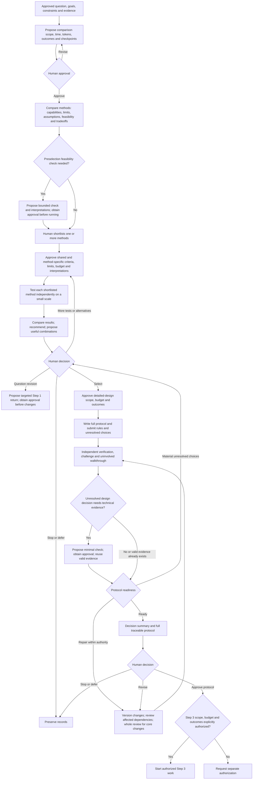

# Step 2 — Method comparison, bounded tests, and a research protocol

Status: calibrated and approved for publication. These are reusable policies, not authorization for a particular investigation, test, or implementation. Steps 1–6 are calibrated; Step 6 is calibrated. The [Chinese specification](../../docs/step-2.md) is authoritative; this is its English reference.

## Objective and boundary

Inputs are the Step 1 human-approved specific question, goals, constraints, evidence, and known limitations. The output is an independently reviewed, human-approved protocol ready for implementation. Protocol approval and implementation authorization are recorded separately; implementation can start only when approval explicitly covers its scope, budget, and expected outcomes.

Retain Step 1 rules for directly inspected sources, decision-criticality, full-text verification, labeled inference, and human decisions. A finalized protocol does not establish scientific conclusions.

Step 2 resolves method-selection, assumption, and protocol-design uncertainties. Step 3 implements the protocol and checks actual integration and uncovered end-to-end behavior. Necessary technical checks are not a quota requiring new runs. Reuse valid evidence and pilot artifacts, recording versions, inputs, assumptions, dependencies, and applicability. Only gaps or invalidated portions need rechecking. Protocol approval may include a proposed Step 3 scope, budget, expected outcomes, and pass criteria if the human agrees. Formal execution still requires the human's decision after Step 3 results.

## Workflow

All loops remain bounded by authority and stop conditions. Repair does not authorize new tests. Recheck only affected portions; do not rerun valid trials. The human may stop or defer at any approval point; revision arrows do not require endless iteration. The diagram incorporates the later Step 2/3 boundary clarification.

## Comparison and testing

1. Within the approved budget, compare multiple approaches, explaining what each can and cannot establish, required assumptions, checks, consequences of failed assumptions, feasibility, and tradeoffs. Recommend with reasons; the human chooses.
2. Let the human shortlist one or more approaches. Optional preselection feasibility checks require a stated objective, scope, budget, interpretations, and prior approval.
3. Propose and run approved small tests for shortlisted approaches independently, without full design or implementation.
4. Before testing, approve shared evaluation criteria and necessary approach-specific checks, their suitability, and limits to comparability.
5. Predefine how positive, negative, and inconclusive results affect recommendations, and what the test cannot establish. Report unexpected outcomes without pretending their interpretation was prespecified.
6. Compare results and uncertainty. Combinations must explain added value, complexity, and tradeoffs; separate expected from demonstrated benefits. Approve scope or budget expansion first.
7. Start detailed design only after the human selects an approach or combination and approves its scope, budget, and expected outcomes.

If every candidate fails, distinguish method defects, data limits, insufficient tests, and answerability. Offer additional tests, alternative methods, or a Step 1 return with reasons and tradeoffs. The human decides. Do not lower standards or infer impossibility from limited failures.

If pilot evidence undermines answerability, pause affected method development and propose a targeted Step 1 return: evidence, failed or uncertain assumptions, possible question revisions, and costs. Do not change the question or scope before approval. Preserve versions and recheck affected downstream work after approved changes.

## Roles and conduct

| Role | Responsibility | Principles and reactions |
| --- | --- | --- |
| Coordinator | Organize comparison, budgets, checkpoints, approvals, dependencies, summary and recommendations | Respect bounded authority; preserve dissent; diagnose stagnation while informing the human; pause at stop conditions |
| Researcher / producer | Inspect sources, run authorized tests, retain results, write and repair deliverables | Separate evidence and inference; retain failures; never silently amend criteria after seeing results |
| Methods specialist | Compare inferential capabilities and assumptions; design bounded tests and protocol | Methods follow the question; explain comparability and inference limits; justify complexity |
| Independent verifier | Check completeness, reproducibility, adherence, evidence, and affected dependencies | Never accept own work; successful operation is not scientific validity; material unresolved choices block readiness |
| Challenger | Examine support for conclusions, competing explanations, assumptions, and validation separation | Raise consequential concerns, not endless objections; retain unresolved positions and evidence |
| Independent walkthrough reviewer | An agent uninvolved in design walks through inputs, procedures, branches, and records | A desktop walkthrough does not run the research; an eligible independent verifier may perform it, without a mandatory extra agent |

## Evidence, amendments, and review

Specify which pilot evidence can support feasibility, debugging, or design decisions, and what it cannot independently establish after influencing method selection. Propose fresh validation data or other project-appropriate independent validation safeguards, explain residual limitations, and obtain approval.

Amendments after results require versions, preservation of original criteria and results, reasons, and interpretation consequences. Approve before applying changes or running further tests; label post-result revisions explicitly.

The full protocol includes data requirements, executable procedures, assumption checks, evaluation criteria, pilot/final-validation separation, stop rules, fallbacks, budget, input/dependency versions, and authorization boundaries.

Final review requires independent completeness/reproducibility verification, challenger review of conclusion support, an uninvolved desktop walkthrough, and explicitly proposed and approved minimal technical checks when design decisions need them. These checks address design feasibility, not end-to-end implementation validation or permission for full implementation. Reuse valid checks instead of repeating them.

Recheck changes and affected dependencies; core-method or conclusion-boundary changes require whole review. Preserve old versions and review records and identify invalidated evidence. New trials need explicit existing coverage or new approval.

Material unresolved choices affecting results, interpretation, or validity block protocol readiness. Minor issues may accompany submission with impact, permitted handling bounds, owner, deadline, and human approval. Core risks or unknown impacts are not minor by default. Present dissent with evidence, assumptions, and recommendation consequences; tolerated interpretive disagreement does not excuse a material design gap.

## Resources and escalation

Budget time, tokens, investigation/test scope, expected resolution, and review effort; distinguish estimates, measurements, and unavailable telemetry. Agents propose justified milestones plus budget/progress checkpoints for approval before work.

On stagnation, diagnose and repair within approved methods, scope, and budget while informing the human of the problem, repair, and progress. Propose repair rounds, time/token limits, and observable progress criteria for approval. Any approved stop condition pauses affected work for diagnosis/options, even if total budget remains.

Predefine human-approved fallback, pause, and upstream-review triggers and consequences for failed assumptions. Log preapproved fallback use and report at the next checkpoint; unexpected consequences notify immediately. Pause before exceeding scope or budget. New trials and budget expansion are never authorized merely by a repair loop.

## Gates and delivery

| Gate | Required condition | Human decision |
| --- | --- | --- |
| Comparison ready | Capabilities, limits, assumptions, feasibility, tradeoffs and grounded recommendation | Shortlist or request information |
| Small tests authorized | Shared/specific criteria, comparability, interpretations, scope and budget | Approve tests |
| Detailed design authorized | Independent test results compared, expected versus verified combination benefits separated, uncertainties visible | Select and approve design |
| Protocol ready | Complete procedures/checks and approved rules; independent review, walkthrough and required approved technical evidence; no material unresolved choices | Approve protocol and minor issues |
| Implementation authorized | Explicit implementation scope, budget and outcomes | Combined or separate approval |

Deliver the decision summary first: recommendation and reasons, assumptions, risks, unresolved choices, alternatives, dissent, and approval items. Attach the traceable executable protocol. Use [method comparison](../templates/method-comparison.md), [pilot check](../templates/pilot-check.md), and [research protocol](../templates/research-protocol.md), plus shared contracts, evidence, review, decision, and rollback records. Continue calibration one multiple-choice question at a time.
