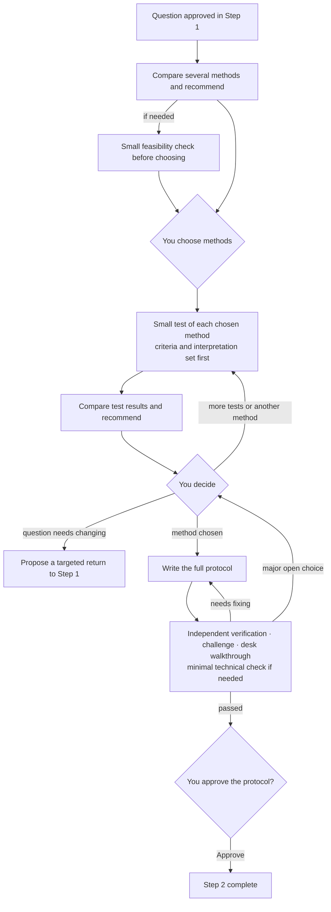

# Step 2 — Method comparison, bounded tests and an executable protocol

Status: calibrated and saved with the human's approval; gates and team layer adjusted in v0.9; slimmed in v0.9.3. This is reusable policy, not a claim that any study has been tested or authorized for implementation.

This document covers only what is specific to Step 2. General rules are in the [Division of labor](division-of-labor.md), [Shared controls](shared-controls.md) and [Gates, tiers and runtime conditions](gates.md); evidence rules follow [Step 1](step-1.md).

## Output and boundaries

The input is the research question, goals, constraints, evidence and known limitations approved in Step 1. The output is an executable research protocol, independently reviewed and approved by you.

- **Approving the protocol does not authorize implementation.** Implementation may start only if the approval states its scope, budget and expected outputs.
- **A final protocol does not prove a conclusion.**
- **Boundary with Step 3**: completing Step 2 means "the protocol is final and can be implemented", not that the implementation has been verified. Step 2's small tests only resolve uncertainty about method choice, assumptions or protocol design; Step 3 checks the actual implementation, interfaces and end-to-end behaviour. A minimal technical check is not a quota to rerun every time.

## Rules specific to this stage

### Comparing and choosing methods

1. Within the approved budget, propose several methods and state for each: which conclusions it can and cannot establish for the research question, the assumptions those conclusions rest on, how they are checked, what follows if they fail, feasibility and trade-offs. Give a grounded recommendation; the choice is yours.
2. You first choose one or more methods. If needed, a small feasibility check may be proposed before choosing; it must state its objective, scope, budget and how results will be interpreted, and runs only after your approval.
3. Run small tests of the chosen methods **separately**; do not go straight to full design or full implementation.
4. Before testing, set shared evaluation criteria and any necessary method-specific checks, explaining their suitability and the limits on comparability.
5. **Every test states beforehand** how positive, negative and inconclusive results would each affect the recommendation, and what it cannot establish. Report unexpected results as they are; do not repackage them afterwards as the planned interpretation.
6. Compare the test results and recommend the next step. A combination must state its added value, complexity and trade-offs, and separate **expected benefit** from **verified benefit**.
7. Detailed design starts only after you choose a method or combination and approve the scope and budget of the detailed design.

### When every candidate falls short

First analyse whether the cause is a flaw in the method, a data limitation, insufficient testing, or a question that is hard to answer, then propose further tests, an alternative method or a return to Step 1. **Do not lower the standard, and do not declare the question unanswerable on the strength of limited failures.**

When bounded-test evidence undermines whether the question can be answered, pause the affected method development and propose a targeted return to Step 1: what the evidence shows, which assumptions failed or remain uncertain, how the question could change and at what cost. The question and scope do not change until you approve.

### What bounded-test evidence can show

The protocol states which feasibility judgments, debugging or design choices bounded-test evidence may support, and **what it cannot independently show once it has influenced the choice of method**. Propose new validation data or other independent validation measures per project, and state the remaining limitations.

### Changing criteria after seeing results

This must be versioned: keep the original criteria and results, explain why they change and how that affects interpretation, and apply them or run more tests only after your approval; the revised analysis is labelled **post hoc**.

### What the protocol must contain

Data requirements, an executable procedure, assumption checks, evaluation criteria, separation of bounded tests from final validation, stop rules, **preapproved fallbacks** (what may be used if an assumption check fails, when work must pause, when to return to an earlier stage), budget, dependency versions and authorization boundaries.

Fallbacks may be used only within authorized bounds and are recorded and reported at the next checkpoint; unexpected consequences are reported to you immediately.

### Protocol review

Four parts: the independent verifier checks completeness and reproducibility; the challenger checks whether the design can support the intended conclusions, competing explanations and validation isolation; **someone who did not take part in the design performs a desk walkthrough**, tracing inputs, procedure, branches and result recording through the protocol to find ambiguities (without actually conducting the research); and, where needed, an approved minimal technical check, which checks only design feasibility and does not stand in for end-to-end validation.

After a fix, recheck the changed parts and affected dependencies; **review the whole protocol again when the core method or conclusion boundaries change.**

Fixes and loops do not automatically authorize new tests or budget expansion: a new trial run needs separate approval or must already be explicitly covered by an existing one; when only the affected parts need rechecking, unaffected trial runs are not rerun.

## Quality gates

Items below their lowest tier are marked `not_applicable`, with a reason based on approved scope.

### G1 material ready

Also includes the cross-stage checklist item "decision material usable" (lite); see [Gates, tiers and runtime conditions](gates.md) section 7.

| Checklist item | Condition | Lowest tier |
| --- | --- | --- |
| Comparison ready | Each method's inferential power and limits, assumptions, feasibility and trade-offs are clear; the recommendation is grounded | lite |

### G2 independently verified

| Checklist item | Condition | Lowest tier |
| --- | --- | --- |
| Protocol ready | Complete procedures and checks specified; rules approved; independent review, desk walkthrough and necessary technical checks done (valid evidence may be reused); no major open choice | lite |

A **major open choice** (one that could materially change results, interpretation or validity) blocks G2 even when disclosed. Allowing different interpretations to coexist does not allow a major design gap through. Minor issues may accompany the protocol, but must record impact, permitted handling scope, owner and resolution time, and be accepted by the approver; risks of unclear impact or affecting core results may not be classed as minor by default.

Independence of the desk walkthrough: in `strict` it must be done independently by someone who did not design; in `standard` it may be combined with a verifier who meets the independence requirement; in `lite` it may be done by another group member who did not take part in the design.

### G3 human authorization

| Authorization point | What is approved | Applies |
| --- | --- | --- |
| Small tests authorized | Shared and specific criteria, comparability limits, interpretation of results, scope and budget | When the action occurs (all tiers) |
| Detailed design authorized | Choice of approach, and the scope, budget and expected outputs of detailed design | All tiers |
| Implementation authorized | Implementation scope, budget and expected outputs | All tiers |

"Implementation authorized" is Step 3's start authorization and is not recorded again in Step 3. When the protocol is approved, Step 3's scope, budget, expected outputs and pass criteria may be submitted at the same time for you to decide whether to approve them together; formal execution is still decided by you after the Step 3 results are reported.

### Work units

Method comparison, each method's small test and protocol writing may be split into parallel units. Each method's test report is its own artifact; two people may not write the same comparison table at once.

## Outputs

Decision brief (opening with the four items): recommendation and reasons, key assumptions, risks, open questions, alternatives, objections and items awaiting approval. Attach the traceable, executable full protocol.

Templates: [method comparison](../templates/method-comparison.md), [pilot check plan and report](../templates/pilot-check.md), [research protocol](../templates/research-protocol.md). Hand valid evidence and small-test artifacts, with their versions, inputs, assumptions and scope of validity, to Step 3 for reuse.
