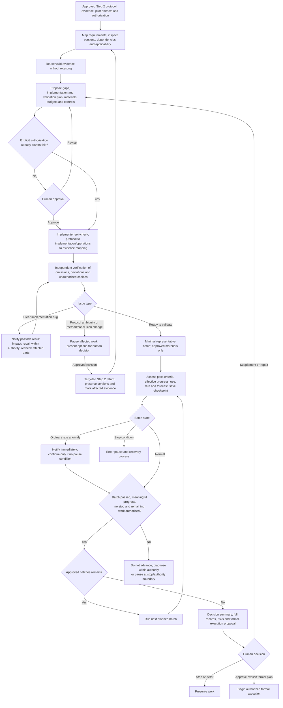
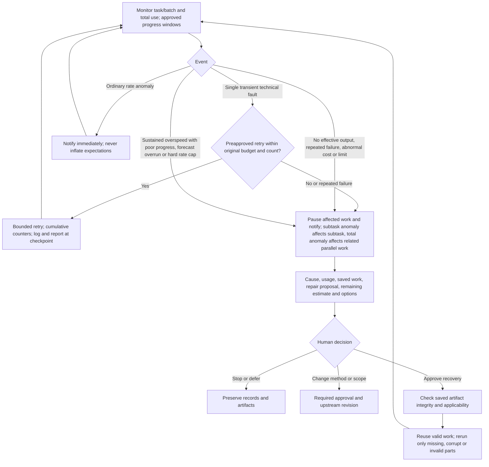

# Step 3 — Implementation preparation and small-scale end-to-end validation

Status: human-calibrated reusable policy, not authorization for a project run. Steps 1–6 are calibrated; Step 6 is calibrated. The [Chinese specification](../../docs/step-3.md) is authoritative; this is its English reference.

## Boundary and evidence reuse

| | Step 2 | Step 3 |
| --- | --- | --- |
| Core question | Is the method suitable and protocol explicit? | Does implementation follow the protocol and does the complete process operate? |
| Small tests | Resolve method-selection or protocol-design decisions | Check new implementation, integration and uncovered end-to-end behavior |
| Completion status | Protocol ready for implementation | Implementation validated; formal execution may be proposed |

Do not repeat tests because a new stage begins. Reuse Step 2 evidence and pilot artifacts when versions, inputs, assumptions, dependencies, and scope remain applicable. Checking applicability does not mean rerunning tests. New checks must identify a coverage gap or invalidation reason.

Record invalidation causes and affected scope. Perform minimal rechecks only when explicitly covered by approved scope and budget; otherwise explain the impact and plan for human approval. Recheck affected portions only. Protocol approval may jointly approve proposed Step 3 scope, budget, and pass criteria; do not request duplicate approval of explicitly authorized work.

## Main workflow

## Monitoring and recovery

Monitoring spans implementation, review, execution, retries, and repairs, not just batch endings. Interruption depends on tools. If a call cannot be interrupted, disclose blind spots and continuing-consumption risks beforehand and propose smaller batches or supported runtime limits for approval. Never claim unsupported real-time protection.

## Implementation and validation

- The implementer self-checks; an independent verifier checks the protocol requirement → implementation location or operating step → evidence mapping for omissions, deviations, and unauthorized decisions.
- Clear implementation errors may be fixed within approved repair scope and budget, with cause and verification records. Notify possible result-impacting problems first.
- Protocol ambiguity or changes to methods or conclusion boundaries pause affected work for human options and decision; do not silently amend the protocol.
- Combine synthetic and real materials as appropriate to the project. Explain what each validates, limitations, and reuse risk, and approve scope, budget, and pass criteria first. Do not access or use reserved final-validation data without authorization.
- Cover normal operation and decision-critical exceptions, such as missing inputs, failed assumptions, stop rules, and fallback triggers. Explain coverage; do not pursue exhaustive testing or repeat valid checks.
- Define reproducibility by project: deterministic workflows require consistent results; stochastic/manual workflows require justified, human-approved tolerances, repetition methods, and records.
- Successful validation establishes conformity under covered conditions, not scientific truth.

## Batches and resource controls

1. Agents propose batch scope, a minimal representative batch, pass and effective-progress criteria, stop thresholds, and rationale for approval. After the initial batch passes normally, continue the approved plan without redundant per-batch approval.
2. Effective progress means completed valid checks, usable outputs, or resolved defects. Logs, process survival, and repeated retries are not progress.
3. No effective output, repeated failure, abnormal costs, or approved limits pause affected work immediately and notify the human. Identify these through approved windows and thresholds; do not wait for total exhaustion.
4. Monitor consumption rates, cost per unit of effective progress, and forecast completion cost. Ordinary rate anomalies notify immediately. Sustained overspeed with insufficient progress, forecast overruns, or a hard-rate cap trigger a pause. Approve baselines, windows, durations, and thresholds first; distinguish startup costs and short peaks. Never raise expectations silently.
5. Approve total limits plus batch/agent subbudgets and triggers. Monitor separately and aggregate parallel use. Subtask anomalies pause corresponding work; total anomalies pause related parallel work. Never increase subbudgets silently.
6. Count implementation, review, retries, repair, saving, and recovery checks cumulatively with clear task/call attribution; avoid omissions and double counting, and never reset on restart. Separate measurements, estimates, and unavailable telemetry. Report actual electrical energy only if measured; tokens are not electricity measurements.
7. Inherit Step 2 diagnosis and bounded repair, but propose and approve Step 3-specific round/time/token limits, progress criteria, and triggers. Inform the human while repairing within authority. Every stop condition overrides continued repair.
8. Use preapproved fallbacks within bounds, log them, and report at the next checkpoint. Unexpected consequences notify immediately; pause and obtain approval before scope or budget expansion.

## Persistence and resumption

Approve save points and overhead: save results, configuration, versions, and cumulative usage at batch ends and after key expensive steps. Resource, rate, progress, and repeated-failure pauses require cause, consumption, saved work, repair proposal, remaining-budget estimate, and options, followed by human approval to resume.

A single transient technical fault may retry only under preapproved rules, original budget, and bounded retry count; log and report at the checkpoint. No unlimited retry or budget expansion. Before recovery, check integrity and applicability; rerun only missing, corrupted, or invalid portions. A pause does not expand recovery authority or justify rerunning valid artifacts.

## Roles

| Role | Responsibility |
| --- | --- |
| Coordinator | Approved plan, evidence reuse, batch/budget allocation, aggregate usage, monitoring/notification/pause/recovery, formal-execution proposal |
| Producer / implementer | Faithful implementation, self-check and mapping, execution/error/repair/checkpoint records, reserved-data boundaries |
| Independent verifier | Protocol conformity, evidence applicability, coverage, pass criteria, reproducibility; never self-approve or duplicate valid tests |
| Methods specialist / challenger, as needed | Assess method/conclusion impacts, evidence limits, result risks, and targeted upstream review; never silently alter the protocol |

## Gates and delivery

| Gate | Condition |
| --- | --- |
| Step 3 authorized | Scope, materials, time/token budget, pass criteria, batches/subbudgets, monitoring, stops, and save/recovery rules approved; reuse explicit existing authorization |
| Implementation conforms | Self-check and independent traceable mapping complete; no silent resolution of ambiguity or method changes |
| Appropriate coverage | Normal and critical exceptions covered or gaps disclosed; material uses and reserved-data isolation clear; no unjustified duplicate validation |
| Batch may continue | Batch pass criteria and effective progress met, no pause condition, remaining work authorized |
| Reproducibility | Approved consistency or tolerance/repetition/record requirements met, including valid reused evidence |
| Decision package ready | Passes, failures, unresolved issues and risks honestly reported; failures are not relabeled passes |
| Formal execution authorized | Human explicitly approves scope, scale, budget, checkpoints, stop rules, and unresolved-issue treatment; validation never automatically authorizes execution |

Deliver a decision summary plus complete records: recommendation on formal execution, passes/failures, risks, protocol mapping, reused evidence and new-check reasons, resource records, and a formal-execution plan. Record protocol finalized, implementation validated, and formal execution authorized as separate states.

Use the [Step 3 plan](../templates/step-3-plan.yaml) and [validation report](../templates/step-3-report.md). These are policies and templates, not an implemented runtime monitor.

## Shared controls (v0.8)

Follow [shared controls](shared-controls.md): reuse matching explicit authorization; request approval only for uncovered changes. Apply gate applicability, check IDs, pre-dispatch budget reservations and artifact-level role independence. A reused check never overrides a pause or authorizes new work.
