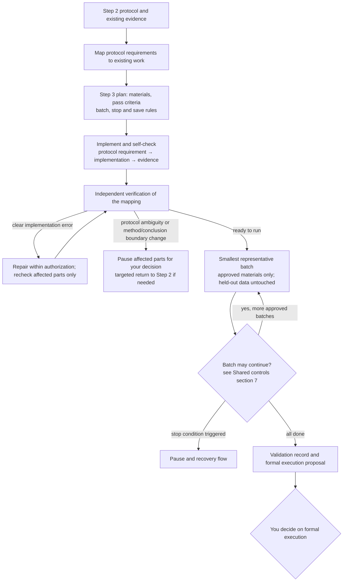

# Step 3 — Implementation readiness and small-scale end-to-end validation

Status: reusable policy saved with the human's approval; gates and team layer adjusted in v0.9; slimmed in v0.9.3. Not run authorization for any specific project.

This document covers only what is specific to Step 3. General rules are in the [Division of labor](division-of-labor.md), [Shared controls](shared-controls.md) and [Gates, tiers and runtime conditions](gates.md). **The rules for batches, rates, pauses, retries, saving and recovery are in [Shared controls](shared-controls.md) section 7** — they used to live here and are now shared by Steps 3, 4 and 6.

## Output and boundaries

| | Step 2 | Step 3 |
| --- | --- | --- |
| Core question | Is the method sound and the protocol clear? | Is the implementation faithful to the protocol, and does the whole pipeline run? |
| Small tests | Resolve issues that affect method choice or protocol design | Check new implementation, interfaces and uncovered end-to-end behaviour |
| Completion state | Protocol final, ready for implementation | Implementation validated, formal execution may be requested |

**Passing validation does not automatically start formal execution.** Protocol finalized, implementation validated and formal execution authorized are three different states, recorded separately. Successful validation shows only that the implementation meets requirements under the covered conditions; it does not prove a scientific conclusion.

**Do not repeat tests just because a new stage has begun.** Step 2 evidence and small-test artifacts are reused directly while their version, input conditions, assumptions, dependencies and scope of validity still hold; checking applicability is not rerunning. A new check must name the specific coverage gap or reason for invalidation. When evidence is invalidated, record the cause and the extent of impact; a minimal recheck may run if it is already within approved scope and budget, otherwise state the impact and a plan for your approval.

## Rules specific to this stage

### Implementation and verification

- The implementer self-checks. The independent verifier checks the mapping "protocol requirement → implementation location or operating step → validation evidence" for omissions, deviations and unapproved choices.
- Clear implementation errors may be fixed within the approved repair scope and budget, recording the cause and the validation result. **Problems that may affect results are reported to you first.**
- **Protocol ambiguity, or a change to method or conclusion boundaries**: pause the affected parts and submit options for your decision; do not modify the protocol unilaterally.

### Materials and held-out data

Combine synthetic and real materials as the project requires, stating what each can validate, its limitations and the risks of reusing evidence; scope, budget and criteria are approved first. **Held-out data reserved for formal validation may not be accessed or used without authorization.**

### Coverage and reproducibility

- Cover normal flows and decision-critical exceptions (for example missing inputs, failed assumptions, stop rules and fallbacks being triggered). Explain why each is needed; do not aim for exhaustiveness or repeat existing valid validation.
- Reproducibility is defined per project: deterministic pipelines must be consistent; stochastic or manual ones propose error tolerances, repetition and logging requirements, with their basis, for your approval.

### The first real run

Step 3 is the project's first end-to-end run: run the smallest representative batch first, and continue to plan only after it passes. Monitoring, pausing and recovery for resources, rates and progress follow [Shared controls](shared-controls.md) section 7; this stage's specific rounds, time/token limits, progress criteria and triggers are proposed per project and approved.

## Quality gates

Items below their lowest tier are marked `not_applicable`, with a reason based on approved scope.

### G1 material ready

Also includes the cross-stage checklist item "decision material usable" (lite); see [Gates, tiers and runtime conditions](gates.md) section 7.

| Checklist item | Condition | Lowest tier |
| --- | --- | --- |
| Decision package ready | Passed, failed and unresolved items and risks reported truthfully; nothing failed is marked as passed | standard |

### G2 independently verified

| Checklist item | Condition | Lowest tier |
| --- | --- | --- |
| Implementation conforms | Self-check and independent verification done, mapping traceable; protocol ambiguities and method changes not resolved unilaterally | lite |
| Appropriate coverage | Normal and decision-critical exceptional paths covered, or gaps reported; material use and held-out data isolation clear; no unjustified repeat validation | standard |
| Reproducibility | Meets the approved consistency or tolerance/repetition/logging requirements; valid evidence may be reused | standard |

A verifier does not accept parts it wrote **or substantially repaired**.

### G3 human authorization

| Authorization point | What is approved | Applies |
| --- | --- | --- |
| Formal execution authorized | Scope, scale, budget, checkpoints, stop rules and handling of unresolved issues for formal execution | All tiers |

This stage's start authorization is Step 2's "Implementation authorized" and is not recorded again here; "Formal execution authorized" is also Step 4's start authorization and is likewise recorded once.

### Runtime condition: batch may continue

Judged per batch, not at stage end: the batch met its pass criteria, made effective progress, triggered no pause condition, and further work remains within the approved scope. Rules are in [Shared controls](shared-controls.md) section 7.

### Work units

Implementation, batch runs, maintaining the mapping, and verification may be split into parallel units. Run records, the mapping and verification reports are owned separately. Limits on held-out data use are written into the unit's `allowed_inputs`; it may not be used without authorization.

## Outputs

Decision brief (opening with the four items) plus the full validation record: whether formal execution is recommended, passed/failed items, risks, the protocol mapping, reused evidence and the reasons for any new checks, the full resource record, and the formal execution plan.

Templates: [Step 3 plan](../templates/step-3-plan.yaml), [Step 3 validation record](../templates/step-3-report.md). They are rules and templates, not an implemented runtime monitor.
