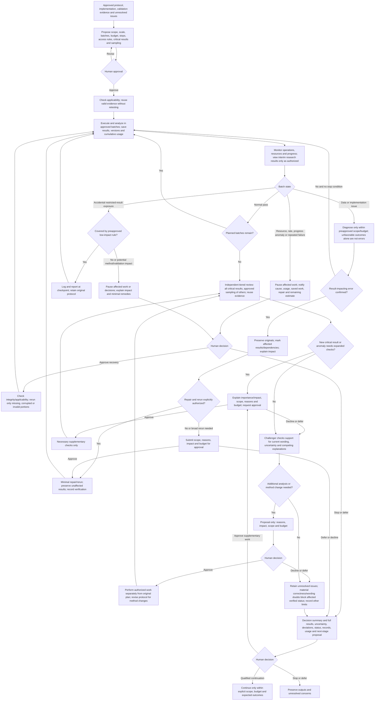

# Step 4 — Formal execution and prespecified analysis

Status: calibrated and approved for publication. This reusable policy does not authorize a specific research run. Step 6 remains pending. The [Chinese specification](../../docs/step-4.md) is authoritative; this is its English reference.

## Objective and boundary

Complete formal execution and prespecified analyses under the approved protocol, and check results and the interpretation boundaries of current statements. Comprehensive synthesis belongs to the next stage. Report negative, nonsignificant, and inconclusive findings honestly; desirable outcomes are not an execution-quality criterion.

Inputs are the approved protocol, Step 3 implementation version, valid validation evidence, unresolved issues, and formal-execution authorization. Reuse applicable evidence rather than repeat checks because of a stage transition. Applicability review does not mean rerunning the original test.

## Workflow

Every loop obeys approved scope, budget, and stop rules; it grants no new authority. Early stopping may still produce a results package, clearly identifying incomplete work. An unconfirmed error is not a resolved concern: retain unresolved issues and pause whenever a stop condition applies.

## Execution and interim access

- Follow approved procedures and analyses. Do not change methods, criteria, or stopping rules because of interim outcomes, effect direction, or significance.
- Additional exploration or method adjustments require reasons, impact, scope, budget, and approval before work. Record separately from planned analysis; preserve original standards/results, and use the appropriate protocol amendment process for method changes.
- Inherit Step 3 batching, monitoring, saving, and pause/recovery rules, but propose and approve formal-scale batches, budgets, and thresholds. Do not assume small-scale thresholds fit formal execution.
- Normal batches continue as planned. Operational quality and resource metrics may be monitored continuously. Research interim results are viewed only at approved times, through approved metrics, use boundaries, and actions; operational monitoring cannot bypass viewing limits.
- Do not seal all research results by default. Explain project-specific early-viewing risks and propose rules for human approval.
- Accidental exposure covered by preapproved low-impact rules may continue, with logging and checkpoint reporting. Potential method-selection or validation impact pauses affected decisions/work; explain impact and minimal remedies for human choice. Do not automatically invalidate the study or rerun it. Do not erase exposure history or assume unknown impact is low impact.

## Resources, reuse, and errors

Apply [Step 3](step-3.md) rules for total and batch/agent budgets, rate baselines/windows, effective progress, forecast completion cost, bounded repairs/retries, fallbacks, checkpoint integrity, and recovery approval. Count review, retry, repair, saving, and recovery without omission or double counting. Formal-scale limits need approval; never raise baselines silently or reset cumulative usage.

Ordinary rate anomalies notify immediately. Approved pause conditions stop affected work and notify the human. Resource/rate/progress anomalies or repeated failures require cause, usage, saved work, repair proposal, remaining estimate, and human approval before recovery. A single transient fault retries only under bounded preapproval. Disclose actual monitoring and interruption capabilities; never claim nonexistent real-time protection.

Reuse evidence when versions, inputs, dependencies, assumptions, and scope remain applicable; review is not automatic recomputation. For confirmed errors, preserve originals, mark affected portions and dependencies, and explain impact. Repair/rerun within explicitly approved scope and budget; otherwise propose a minimal plan. Broad impact may justify a broad rerun with human approval. Preserve unaffected results. Notify possible result-impacting issues first; never silently change the protocol.

Negative, nonsignificant, or inconclusive findings must be reported and the original protocol completed unless approved stop rules apply. Bounded data or implementation diagnosis is allowed only within preapproval. Do not alter standards to obtain favorable results.

## Tiered verification

Before execution, agents propose a protocol-derived critical-results list and sampling plan for other results, explain reasons, and obtain approval.

An independent verifier fully checks results supporting major conclusions; other results use the approved sampling plan. Criticality follows consequence for main conclusions, never outcome desirability. If additional consequential results emerge, explain why and approve supplementary scope and budget before new checks. Anomalies requiring expanded checks also need impact, scope, reasons, budget, and prior approval. Reuse valid evidence; do not repeat checks.

## Interpretation and unresolved issues

The challenger checks whether results support current wording and whether important uncertainty and competing explanations are explicit. Use only evidence authorized for viewing; do not automatically add analyses. Request approval for additional analysis. Comprehensive synthesis is outside this stage.

Keep three statuses separate: execution completion, individual result verification, and authorization for the next stage. Unresolved concerns affecting critical-result correctness or the validity of major statements block affected results being marked verified. Record other limitations. Agents explain impact, additional-work options, and budget; the human decides further verification, stopping, or qualified continuation. Approval to proceed does not turn a concern into a pass.

## Roles

| Role | Responsibility |
| --- | --- |
| Coordinator | Protocol versions, formal authorization, resource/batch/access plans, anomaly response, review requests, results package and three distinct statuses |
| Producer / executor | Approved execution/analysis, self-checks, versions and original results, honest adverse/inconclusive outcomes and deviations; authorized repairs only |
| Independent verifier | Approved critical-result review and sampling, evidence applicability, error dependencies; no self-approval or duplicate valid checks |
| Challenger | Current wording's evidence boundaries, uncertainty, and competing explanations; no access bypass or unapproved analysis |
| Methods specialist, as needed | Explain deviations, errors and method-change impacts; propose minimal diagnosis/amendment; never adjust criteria according to outcome desirability |

## Gates and delivery

| Gate | Condition |
| --- | --- |
| Formal execution authorized | Protocol/implementation versions clear; formal batches, budgets, monitoring/stops, viewing rules, critical list and sampling approved |
| Execution/analysis conform | Approved procedures, criteria and access rules followed; deviations recorded; adverse/inconclusive results neither hidden nor used to justify criterion changes |
| Appropriate review | Independent critical-result review and approved sampling complete; supplementary checks authorized; valid evidence reused |
| Interpretation bounded | Current wording supported, uncertainty and competing explanations explicit; authorized evidence only, no unapproved new analysis |
| Accurate unresolved status | Material concerns block affected verified status; other limitations retained |
| Next stage authorized | Human chooses further checks, stop, or qualified continuation from the package; continuation has explicit scope, budget and outcomes |

Present a decision summary first: major results, uncertainty, protocol deviations, verification status, unresolved issues, and required decisions. Attach full traceable results, tiered review and interpretation records, reused evidence, execution/resource records, and a proposed next-stage scope, budget, and expected outcomes. Use the [execution/review plan](../templates/step-4-plan.yaml) and [results package](../templates/step-4-results.md).

## Handoff to Step 5

Pass the exact results-package version, protocol, evidence and verification states, open issues, goals and intended use to [Step 5](step-5.md). Step 5 adds cross-result synthesis and delivery-suitability review, not duplicate verification of valid results. Additional analysis or return to this stage requires explicit authorization. Continuation does not verify unresolved results; Step 5 finalization does not authorize external publication.
