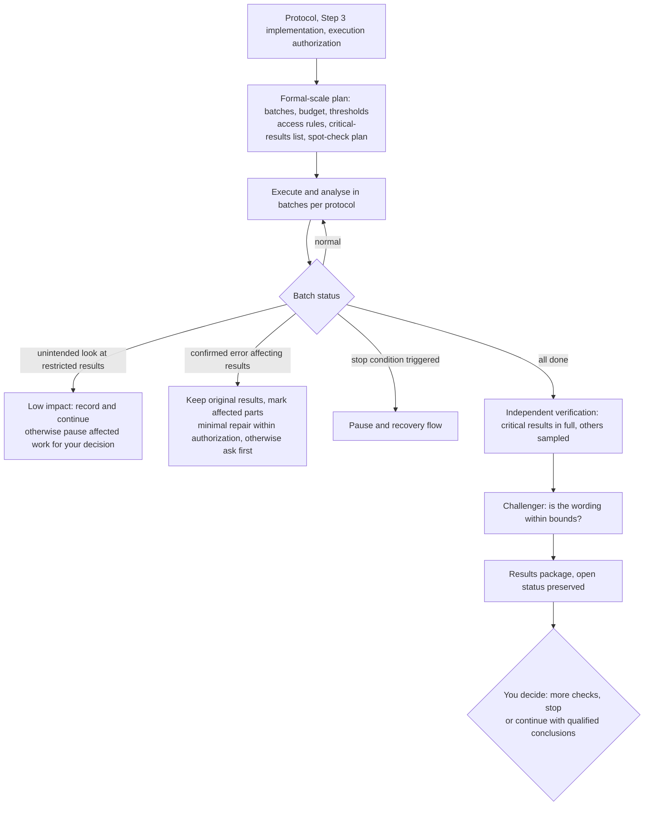

# Step 4 — Formal execution and prespecified analysis

Status: calibrated and saved with the human's approval; gates and team layer adjusted in v0.9; slimmed in v0.9.3. This is reusable policy, not authorization for any specific research run.

This document covers only what is specific to Step 4. General rules are in the [Division of labor](division-of-labor.md), [Shared controls](shared-controls.md) and [Gates, tiers and runtime conditions](gates.md). Batches, pauses and recovery follow [Shared controls](shared-controls.md) section 7.

## Output and boundaries

Carry out formal execution and the prespecified analysis under the approved protocol, and check the results and the interpretive bounds of the current wording. **Full synthesis is left to Step 5.**

The input is the approved protocol, the Step 3 implementation version, valid validation evidence, open questions and the formal execution authorization. Evidence that still applies is reused directly; checking validity is not rerunning the original test.

**Report negative, non-significant and uncertain results as they are. Whether a result is welcome is not a pass criterion for execution quality.**

## Rules specific to this stage

### Execution and interim results

- Execution and analysis follow the approved protocol. **Interim results, the direction of an effect or its significance never change the method, criteria or stop conditions.**
- Extra exploration or method adjustment is explained first — reasons, impact, scope, budget — and runs only after your approval; it is recorded separately from the planned analysis, with the original criteria and results kept; method changes go through protocol revision.
- **Re-set the numbers for formal scale**: batches, budget and stop thresholds are re-proposed for the scale of formal execution and approved by you; Step 3's small-scale thresholds may not simply be assumed to apply.
- Run quality and resource metrics may be monitored continuously; **interim research results** may be looked at only under the preapproved timing, metrics, use boundaries and handling rules. Quality monitoring may not be used to get around access limits.
- Results are not sealed by default. The AI explains the specific risks of early access for the project and proposes rules for your approval.
- **Unintended looks**: when they meet the preapproved low-impact rules, record them and continue, reporting at the checkpoint; when they could affect method choice or validation validity, pause the related decisions or affected work and set out the impact and a minimal remedy for you to decide. Do not automatically declare the study void or rerun it; do not erase a look that has happened; do not class an unclear impact as low by default.

### After an error is confirmed

Keep the original results, mark the affected parts and their dependencies, and explain the error and its impact. An explicitly approved repair or rerun is done within the original scope and budget; otherwise submit a minimal plan. When the impact really is broad, a large rerun may be proposed for your approval; unaffected results are kept. An unwelcome result is not in itself an error; **an unconfirmed error does not mean the problem is solved** either, and the related doubts must stay among the open questions.

### Critical results and tiered review

- **Before** execution, the AI proposes from the protocol a list of critical results and a spot-check plan for the others, with reasons, for your approval.
- The independent verifier checks in full the critical results that support the main conclusions, and spot-checks the others under the approved plan. **Criticality depends on the effect on the main conclusions, not on whether the result is welcome.**
- When other results turn out to matter materially, or a spot-check anomaly calls for wider checking, first explain why, the scope and the budget, and check only after approval.

### Interpretive bounds

The challenger uses only evidence it is authorized to see, checking whether the results support the current wording and whether important uncertainty and competing explanations are stated adequately; it does not add analyses on its own, and further analysis is requested first.

Keep three states apart: whether execution is complete; whether specific results are verified; whether the next stage is authorized to start. Doubts that could affect the correctness of critical results or the validity of the main wording prevent the related results from being marked verified.

## Quality gates

Items below their lowest tier are marked `not_applicable`, with a reason based on approved scope.

### G1 material ready

Also includes the cross-stage checklist item "decision material usable" (lite); see [Gates, tiers and runtime conditions](gates.md) section 7.

| Checklist item | Condition | Lowest tier |
| --- | --- | --- |
| Accurate unresolved status | Results with material doubts are not marked verified; other limitations are stated | lite |

### G2 independently verified

| Checklist item | Condition | Lowest tier |
| --- | --- | --- |
| Execution/analysis conform | Procedures, criteria and access rules follow the protocol, deviations recorded; negative, non-significant and uncertain results are not hidden or used as grounds to change criteria | lite |
| Appropriate review | Independent checks of critical results and approved spot-checks done, extra checks approved; valid evidence reused | lite |
| Interpretation bounded | Current wording is supported; uncertainty and competing explanations stated; only authorized evidence used, no unapproved new analysis | lite |

### G3 human authorization

| Authorization point | What is approved | Applies |
| --- | --- | --- |
| Next stage authorized | From the results package, decide on further checks, stopping, or continuing with qualified conclusions; continuing needs an explicit scope, budget and expected outputs | All tiers |

This stage's start authorization is Step 3's "Formal execution authorized"; "Next stage authorized" is also Step 5's start authorization. Each is recorded once. Approving continuation does not turn unresolved evidence into a pass.

### Runtime condition: batch may continue

As in Step 3, judged per batch; rules are in [Shared controls](shared-controls.md) section 7.

### Work units

Execution, prespecified analysis, critical-result verification and challenge may be split into parallel units. Raw results, analysis outputs and verification reports are owned separately, and **the executor does not write its own verification report**. Limits on access timing and metrics are written into the unit's `allowed_inputs`.

## Outputs

Decision brief (opening with the four items): main results, uncertainty, protocol deviations, verification status, open questions and items awaiting decision. Attach complete traceable results, the tiered review and interpretive-bounds records, reused evidence, execution and resource records, and a proposed scope, budget and expected outputs for the next stage. Stopping early still allows a results package, with the unfinished work marked.

Templates: [execution and review plan](../templates/step-4-plan.yaml), [results package](../templates/step-4-results.md).

What passes to [Step 5](step-5.md): the exact version of the results package, the protocol, the evidence and its verification status, open questions, goals and intended use. Step 5 adds only cross-result synthesis and fitness-for-delivery review; it does not repeat valid result verification.
