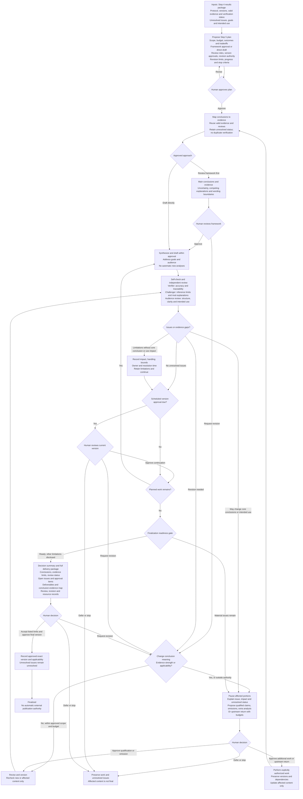
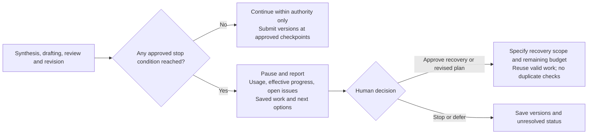

# Step 5 — Research synthesis and delivery finalization

Status: human-calibrated and approved for publication as reusable policy, not authorization for a project run or external publication. Steps 1–6 are calibrated; project controls require approval. The [Chinese specification](../../docs/step-5.md) is authoritative; this is its English reference.

## Objective and Step 4/5 boundary

Synthesize existing results and produce project-appropriate deliverables for human-approved finalization. Agents propose scope, budget, expected outcomes and tradeoffs based on project goals; obtain approval before starting.

| | Step 4 | Step 5 |
| --- | --- | --- |
| Core work | Formal execution, prespecified analyses, result verification and boundaries of current statements | Cross-result synthesis, answering the research question and producing audience-appropriate deliverables |
| Input/output | Traceable results package retaining verification status and unresolved issues | Receive that package and produce synthesized conclusions and delivery package |
| Review scope | Full review of critical results and approved sampling of others | New synthesis and wording, evidence mapping and delivery suitability |
| Evidence reuse | Reuse valid validation evidence | Do not reverify valid results; new analyses or checks require prior authorization |

Inputs include the Step 4 package, protocol and versions, valid evidence, verification status, unresolved issues, goals and intended use. Inherited issues retain their status: permission to synthesize is not verification of results. Reuse evidence and reviews whose versions, inputs, assumptions, dependencies and scope remain applicable; applicability review is not rerunning original checks. For gaps or invalidation, explain impact and a minimal supplementary plan and work only under authorization. Never automatically add analyses or repeat valid checks.

## Complete workflow

All work and loops obey approved budgets, revision limits, progress criteria and stop rules. Arrows do not authorize new analyses, checks or budget expansions. The human may stop or defer at approval points even where not drawn explicitly; revision is never endless.

## Project plan and version approvals

Based on conclusion complexity, disagreement and intended use, recommend framework review before drafting or direct drafting, explain costs and tradeoffs, and obtain approval in the stage plan. Frameworks include main conclusions, evidence, uncertainty, rival explanations and wording boundaries; direct drafts must address the same requirements.

Specify which versions need human approval and which may be revised continuously within authority, with reasons. Propose scope, time/token budget, expected outcomes, review scope and assignments, revision rounds, effective-progress criteria and stopping conditions for joint approval. Do not request duplicate approval for explicitly authorized work.

## Review roles and principles

| Role/duty | Work and reactions | Why present |
| --- | --- | --- |
| Coordinator | Plan, approved versions, evidence dependencies, budgets/stops, issue classification and delivery | Prevent scope drift; separate verification, finalization and publication authority |
| Researcher / producer | Synthesize existing results, draft faithfully, self-check and revise within authority; retain limits and open status | Produce a traceable deliverable that answers project goals |
| Independent verifier | Check accuracy, citations, result correspondence and material limitations of new synthesis/wording; reuse valid review records | Prevent distortion or omission during synthesis; never accept own authored content |
| Challenger | Check whether synthesis exceeds evidence, fairly represents rival explanations and responds to goals; retain supported dissent | Detect cross-result inference and wording overreach; no automatic new analysis |
| Target-audience suitability review | Review structure, clarity and fitness for approved use; do not exaggerate claims for persuasion | Ensure usefulness to intended readers |

The human approves review scope, budget and rationale. Audience review is a duty, not a mandatory permanent additional agent; assignments belong in the approved plan. Review new synthesis/wording and affected dependencies only; reuse valid result verification. Additional analysis/checks require authorization. Independent review does not require eliminating every interpretive disagreement.

## Impact-based handling

- Evidence gaps not affecting core conclusions or intended use may be recorded as limitations while synthesis continues. Other nonmaterial issues require impact, handling bounds, owner and resolution time for human acceptance.
- Gaps that may change core conclusions or intended use pause affected portions. Explain impact and offer qualified conclusions, additional analysis or an upstream return, with budgets, for human decision.
- Revisions that preserve conclusion meaning, evidence strength and applicability may proceed within approved scope/budget and must be recorded. Material changes to main conclusions, qualifications or intended use pause affected work; explain reasons, options and budgets for human decision.
- Issues affecting core correctness, evidential support or intended use block affected content being marked final. Propose omission or qualified conclusions when appropriate, for human decision. Rewording alone must not disguise an unresolved issue as resolved.
- Preserve prior versions, verification states and dependencies. Approved additional work returns to the appropriate stage and updates affected portions only. Permission to continue or accept a limitation never converts unverified evidence to a pass or an unresolved issue to resolved.

## Resource and pause controls throughout

Pause at any approved stop condition and explain unresolved work and next options. Remaining budget does not override other stops. Recovery or plan changes require explicit authority and remaining budget. Count synthesis, drafting, review, revision and recovery costs; distinguish measurements, estimates and unavailable telemetry. Never claim unsupported precise enforcement.

Define meaningful progress per project, for example resolving substantive review issues, completing traceable synthesis or meeting approved delivery requirements. More words or revision rounds alone are not progress. The reusable template does not impose project thresholds.

## Quality gates

| Gate | Condition |
| --- | --- |
| Start authorized | Scope, budget, outcomes, tradeoffs, work approach, reviews, version approvals and stops approved |
| Evidence/status traceable | Conclusions map to source/result versions; valid evidence reused; inherited unresolved/unverified status preserved |
| Synthesis and wording supported | Answer the question; state evidence strength, applicability, uncertainty and rival explanations; no unapproved analysis |
| Delivery suitable | Approved review of structure, clarity and intended use; no exaggeration |
| Revision authority clear | Nonmaterial revisions within authority; material changes pause affected portions for human decision |
| Issues classified accurately | Material issues block affected finalization; other issues have impact, bounds, owner and deadline for human acceptance |
| Finalization package ready | Summary and full package accurately report reviews, unresolved status, revisions and usage |
| Finalization/publication separate | Human approves exact version and qualifications; no automatic authority to publish externally |

## Final package and continuity

Present main conclusions, evidence boundaries, review status, unresolved issues and approval items first. Attach deliverables, conclusion-to-evidence mapping, review/revision records and resource use. Use the [Step 5 plan](../templates/step-5-plan.yaml) and [delivery package](../templates/step-5-delivery.md).

Record evidence verification, content finalization and external-publication authority separately. Finalization approves an exact version, applicability boundaries and accepted limitations, not publication. Retain accepted versions, open issues, usage and next actions for continuity. Follow [Step 6](step-6.md) for required delivery/archive; actual submission and optional follow-up need explicit authority.
