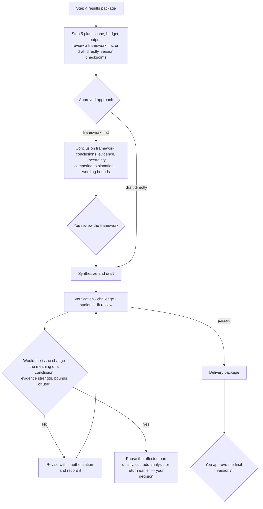

# Step 5 — Research synthesis and finalizing the deliverable

Status: calibrated and saved with the human's approval; gates and team layer adjusted in v0.9; slimmed in v0.9.3. This is reusable policy; it does not authorize any specific project run or external release.

This document covers only what is specific to Step 5. General rules are in the [Division of labor](division-of-labor.md), [Shared controls](shared-controls.md) and [Gates, tiers and runtime conditions](gates.md).

## Output and boundaries

| | Step 4 | Step 5 |
| --- | --- | --- |
| Core work | Formal execution, prespecified analysis, result verification and bounds checking of current wording | Synthesis across results, answering the research question, producing a deliverable fit for its readers |
| Scope of checking | Critical results checked in full, others sampled under the plan | Only new synthesis and wording, evidence mapping and fitness for delivery |
| Evidence | Valid validation evidence reused directly | Valid results are not re-verified; new analysis or extra checks need authorization first |

The input is the Step 4 results package, the protocol and its version, valid evidence, verification status, open questions, project goals and intended use. **Open questions from Step 4 keep their status; being allowed to synthesize does not mean the results are verified.**

**Finalization does not authorize external release.** Evidence verification, content finalization and external release authorization are recorded separately.

## Rules specific to this stage

### Plan and versions

- Depending on how complex and contested the conclusions are and how the deliverable will be used, recommend either **reviewing a conclusion framework first** or **drafting directly**, with the costs and trade-offs, and let you choose in the plan. A framework review presents the main conclusions, evidence, uncertainty, competing explanations and wording bounds; direct drafting must meet the same requirements.
- The plan states **which versions must come to you for approval and which may be revised continuously within authorization**, with reasons, together with the scope and division of review, the number of revision rounds, the criteria for effective progress and the stop conditions, all approved at once.
- Effective progress in writing is defined per project, for example resolving substantive review issues, completing traceable synthesis, or meeting approved delivery requirements. **It cannot be measured by words added or by the number of revisions.**

### Three reviews

- **Independent verifier**: accuracy of the new synthesis and wording, citations, correspondence with results and important limitations; reuses valid verification records and does not accept its own writing.
- **Challenger**: whether the synthesized conclusions go beyond the evidence, whether competing explanations are treated fairly, and whether the project goals are addressed; keeps well-founded disagreement.
- **Audience-fit review**: structure, clarity and fit against the approved use, without overstating conclusions to persuade. This is a duty, not a requirement for an extra permanent agent.

The scope, budget and reasons for the three reviews are approved by you first. Independent review does not require all interpretive disagreement to be resolved.

### Handling issues by impact

- Evidence gaps that do not affect the core conclusions or the intended use are recorded as limitations, and synthesis may continue. Other non-substantive issues record impact, handling bounds, owner and resolution time, and you decide whether to accept them.
- Revisions that **do not change the meaning of conclusions, the strength of evidence or the bounds of application** may be made within the approved scope and budget and recorded.
- Issues that **would change** the main conclusions, qualifications, evidence strength, bounds of application or intended use: pause the affected part, explain the impact, and propose qualifying the conclusion, cutting, further analysis or a return to an earlier stage, with options and budget, for your decision.
- Issues affecting the correctness of core conclusions, evidential support or the intended use prevent the related content from being marked final. **Rewording does not turn an open question into a resolved one.**
- Keep the original versions, verification status and dependencies; approved further work is done in the relevant stage, updating only the affected content. Your permission to continue, or your acceptance of a limitation, does not turn unverified into passed.

### Pausing

When any approved stop condition is reached, pause and report usage, effective progress, open questions, retained outputs and next options; remaining budget does not cancel a stop condition. Resumption needs explicit authorization of scope and remaining budget; the procedure is in [Shared controls](shared-controls.md) section 7.

## Quality gates

Items below their lowest tier are marked `not_applicable`, with a reason based on approved scope.

### G1 material ready

Also includes the cross-stage checklist item "decision material usable" (lite); see [Gates, tiers and runtime conditions](gates.md) section 7.

| Checklist item | Condition | Lowest tier |
| --- | --- | --- |
| Finalization package ready | Summary and full delivery package present review results, open status, revisions and resource records accurately | lite |
| Issues classified accurately | Substantive issues block finalization of the related content; other issues record impact, bounds, owner and time, and the approver decides whether to accept them | standard |

### G2 independently verified

| Checklist item | Condition | Lowest tier |
| --- | --- | --- |
| Evidence/status traceable | Conclusions map to sources or result versions; valid evidence reused; open status inherited, nothing unverified marked verified | lite |
| Synthesis and wording supported | Answers the research question; evidence strength, bounds of application, uncertainty and competing explanations stated; no unapproved new analysis | lite |
| Delivery suitable | Structure, clarity and fit reviewed against the approved scope, without overstating conclusions | standard |

### G3 human authorization

| Authorization point | What is approved | Applies |
| --- | --- | --- |
| Revision authority clear | Which versions need approval, which may be revised continuously within authorization, and the number of revision rounds and stop conditions | All tiers |
| Finalization/publication separate | The exact delivery version and its qualifications | All tiers |

This stage's start authorization is Step 4's "Next stage authorized" and is not recorded again here.

### Work units

Synthesis drafting, verification, challenge and audience-fit review may be split into parallel units. Sections of the deliverable are owned separately, and verification and challenge records are not written into the body of the deliverable.

## Outputs

Decision brief (opening with the four items): main conclusions, evidence bounds, review status, open questions and items awaiting approval. Attach the deliverable, the conclusion-to-evidence map, review and revision records and resource usage.

Templates: [Step 5 plan](../templates/step-5-plan.yaml), [Step 5 delivery package](../templates/step-5-delivery.md). Actual submission and optional follow-up are in [Step 6](step-6.md) and need separate explicit authorization.
