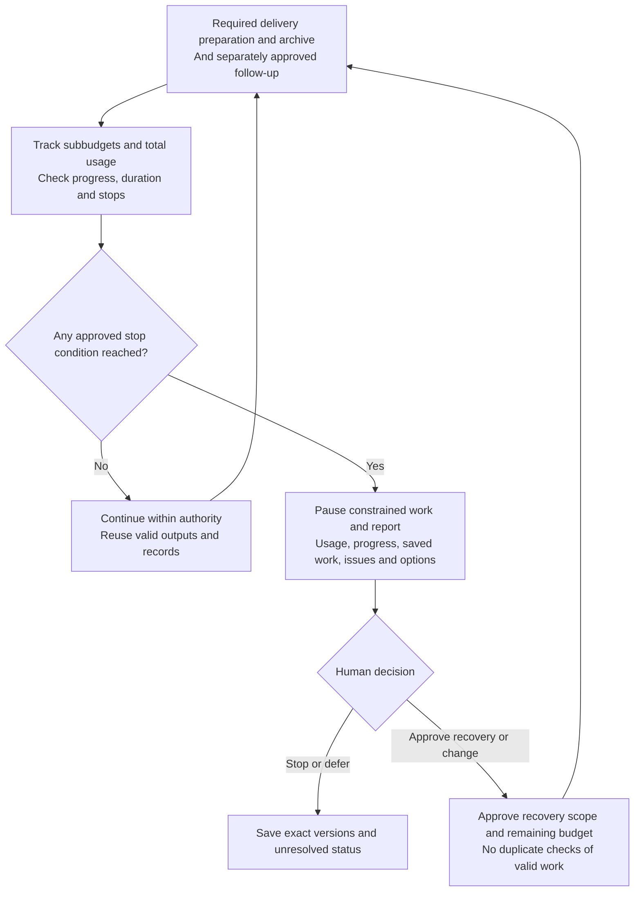

# Step 6 — Required delivery, archiving and project closure

Status: human-calibrated and approved as reusable policy, not authorization for a project run, submission, publication or maintenance. The main sequence is required-delivery requirements → necessary delivery and archive → closure against the approved criterion, then optional follow-up suggestions. Optional work must not block closure. The [Chinese specification](../../docs/step-6.md) is authoritative.

## Objective and Step 5/6 boundary

Step 5 approves content, conclusion boundaries and exact deliverable versions. Step 6 uses project type and recipient requirements to identify required submissions, adapt materials, prepare delivery, perform explicitly authorized submission and archive necessary records.

Inputs include approved Step 5 versions, project type/goals, recipient requirements, material restrictions, valid outputs/reviews and unresolved issues. Read existing information and clarify gaps only; do not re-ask settled questions. Identify required items, formats, submission method, deadlines and acceptance requirements, then map requirements to outputs.

Reuse outputs and records whose versions, inputs, assumptions, dependencies and scope remain valid. Applicability review is not rerunning checks. Check only new, changed, invalidated or affected portions, with reasons; no default research reverification or new analysis. Inherit unresolved status unchanged.

## Complete workflow

```mermaid
flowchart TD
    IN["Approved Step 5 version, project type and recipient requirements<br/>Valid outputs, records and open issues"]
    REQ["Identify required items, formats, submission method and deadline<br/>Necessary archive and acceptance requirements<br/>Reuse known information; clarify gaps only"]
    PLAN["Propose delivery/archive plan and completion criterion<br/>Scope, outcomes, reasons and tradeoffs<br/>Total/subbudgets, independent review, progress and stops"]
    AP{"Human approves plan"}
    MAP["Map requirements to outputs<br/>Reuse valid artifacts and verification<br/>Identify gaps and mismatches"]
    GAP{"Delivery mismatch?"}
    AUTH{"Repair within preapproved scope and budget?"}
    FIX["Adjust and record exact version; preserve original<br/>Check changed and affected portions only"]
    ASK["Pause affected work<br/>Minimal completion plan, impact, options and budget"]
    DECIDE{"Human decision"}
    BACK["Return to Step 5 or relevant stage after approval<br/>No automatic new analysis or reruns"]
    HOLD["Preserve work and open status<br/>Do not mark unfinished items complete"]
    PREP["Prepare required delivery and archive<br/>Save approved-depth versions, index<br/>Dependencies, access limits and resumption instructions"]
    SELF["Executor self-check"]
    VERIFY["Independent verifier follows approved plan<br/>Required delivery, archive usability and continuity<br/>Exact-version and authorization correspondence<br/>Reuse valid evidence without duplicate checks"]
    ISSUE{"Classify acceptance issues"}
    BLOCK["Affected portions cannot be complete<br/>Impact, minimal remedy and budget"]
    MINOR["Record impact, handling bounds, owner and deadline<br/>Human decides acceptance"]
    READY["Record preparation and acceptance states<br/>Passed unaffected portions may be accepted separately"]
    CRITERION{"Approved completion criterion"}
    SUBAUTH{"Explicit authority covers exact version and submission action?"}
    WAIT["Remain prepared / awaiting authority<br/>No submission or claim of submission completion"]
    SUBMIT["Perform authorized submission<br/>Record actual outcome and receipt"]
    RESULT{"Submission outcome"}
    REPORT["Report failure or unknown outcome honestly<br/>Propose minimal options<br/>No unauthorized resubmission or expanded authority"]
    RECEIVE["Track recipient confirmation only<br/>Within approved scope, duration and budget"]
    PACKAGE["Decision summary and full handoff package<br/>Requirements met, acceptance and actual submission state<br/>Versions, archive, authority and receipts<br/>Open issues, resources and resumption"]
    CLOSE{"Approved completion criterion met and human closes project?"}
    PENDING["Retain incomplete status and offer options<br/>Never relax criteria automatically"]
    DONE["Current project closed<br/>Retain accepted limits and open status"]
    OPTIONS["Offer optional follow-up ideas<br/>Value, costs and tradeoffs<br/>No automatic adoption or execution"]
    CHOOSE{"Human selects follow-up work?"}
    END["Retain suggestions; current project remains closed"]
    NEW["Start only after separate scope, budget and outcome approval<br/>And applicable publication/maintenance rules"]
    IN --> REQ
    REQ --> PLAN
    PLAN --> AP
    AP -->|Revise| PLAN
    AP -->|Approve| MAP
    MAP --> GAP
    GAP -->|None| PREP
    GAP -->|Nonmaterial mismatch| AUTH
    AUTH -->|Yes; no stop condition| FIX
    AUTH -->|No| ASK
    GAP -->|New analysis or conclusion, qualification, authorship or disclosure change| ASK
    ASK --> DECIDE
    DECIDE -->|Approve bounded adjustment| FIX
    DECIDE -->|Approve upstream return| BACK
    BACK --> MAP
    DECIDE -->|Change requirements or scope| PLAN
    DECIDE -->|Defer or stop| HOLD
    FIX --> PREP
    PREP --> SELF
    SELF --> VERIFY
    VERIFY --> ISSUE
    ISSUE -->|Material issue| BLOCK
    BLOCK --> AUTH
    ISSUE -->|Other issues| MINOR
    MINOR --> READY
    ISSUE -->|Pass| READY
    READY --> CRITERION
    CRITERION -->|Materials ready| PACKAGE
    CRITERION -->|Successful submission or recipient confirmation| SUBAUTH
    SUBAUTH -->|No| WAIT
    WAIT --> PACKAGE
    SUBAUTH -->|Yes| SUBMIT
    SUBMIT --> RESULT
    RESULT -->|Failed or unknown| REPORT
    REPORT --> DECIDE
    RESULT -->|Success; criterion is submission success| PACKAGE
    RESULT -->|Success; confirmation required| RECEIVE
    RECEIVE --> PACKAGE
    PACKAGE --> CLOSE
    CLOSE -->|Not met or additions requested| PENDING
    PENDING --> DECIDE
    CLOSE -->|Met and confirmed| DONE
    DONE --> OPTIONS
    OPTIONS --> CHOOSE
    CHOOSE -->|No or defer| END
    CHOOSE -->|Yes| NEW
```

All work and loops obey approved scope, budget and stop rules. Approval points allow stopping or deferral, not endless revision. Prepared is not authorized; authorized is not successful. Arrows never grant automatic submission, analysis, rerun or budget-expansion authority.

## Required delivery and archive plan

Agents propose required scope, budget, outcomes, reasons and tradeoffs based on project type, recipient requirements and material restrictions for human approval. Scale prepublication/submission checks to channel, audience and material restrictions; propose checks, depth, budget and decision items for approval. Reuse valid records without repeating research verification.

Propose archive depth from future reuse/resumption needs, storage cost and material restrictions, with scope, budget and acceptance criteria for approval. At the approved depth, retain exact versions, archive index, data/material locations, access restrictions, configuration/environment dependencies, execution/review records and resumption instructions. These are selectable according to need, not a mandatory maximal archive checklist; do not rerun validation by default.

Propose materials-ready, successful-submission, recipient-confirmation or another explicit project state as the completion criterion, explaining why for approval. Record unachieved states honestly. Materials-ready may permit closure without submission if approved, but record that no submission occurred. If recipient confirmation is required, submission success alone is insufficient. Only the human may change the criterion; budget exhaustion or delay never automatically relaxes it.

## Mismatches, revisions and issue classification

- Formatting, layout and file-organization changes preserving content meaning may be made within preapproved scope/budget with records. Preserve original versions and check changed/affected portions only.
- New analysis or changes to conclusions, qualifications, authorship or disclosure scope pause affected work. Explain the minimal completion plan, impact, options and budget for human decision, returning to Step 5 or earlier if approved. Other repairs outside authority also require approval first.
- Issues affecting required delivery, archive usability, submission/publication authorization accuracy or maintenance boundaries block affected portions being marked complete. Other issues require impact, handling bounds, owner and deadline for human acceptance.
- Passed, unaffected portions may be accepted separately. Local issues never justify rechecking everything. Preserve unresolved status; an accepted exception is not a verification pass.

## Self-check and independent verification

After executor self-check, an independent verifier checks against approved criteria. Agents propose project-specific scope, depth, assignments, reasons and budget for human approval. Cover required-delivery compliance, archive completeness/usability/resumability, exact-version/authorization correspondence and approved maintenance scope, budget, duration and activation boundaries.

Review new, changed or affected content only and reuse valid checks. A verifier never accepts work it authored. Plans, review records and handoffs identify exact versions.

| Role/duty | Responsibilities and reactions | Why present |
| --- | --- | --- |
| Coordinator | Requirements, closure criterion, plan/assignments/budgets, authority and actual states; pause and report at triggers | Prioritize required delivery; prevent optional work consuming closure authority/budget |
| Executor | Prepare delivery, archive, self-check, perform explicitly authorized actions only; record versions, usage and actual outcomes | Traceable delivery without confusing intent with completion |
| Independent verifier | Approved checks of requirements, archive, authority and maintenance boundaries; reuse records; no self-approval | Detect handoff gaps and authority/version mismatches |
| Methods specialist / challenger, as needed | Assess whether mismatches affect conclusions, evidence or methods; propose minimal upstream repair | Prevent delivery adaptation from silently changing research; no automatic research work |

## Actual submission and separate states

Actual submission or external publication requires explicit authority covering the changed exact version, action, recipient/channel and applicable scope. Reuse explicit authorization that still applies; preparation, finalization or approval of a closure criterion alone does not authorize submission.

Record actual outcomes and receipts. Failed or unknown outcomes cannot be marked successful; report minimal options rather than resubmit or expand authority without permission. Track recipient confirmation only within approved scope, duration and budget; never infer it from submission success. Do not automatically retract or republish.

| State | Required basis |
| --- | --- |
| Prepared | Specified materials are ready; acceptance and open issues recorded separately |
| Authorized | Human explicitly approved version, action, scope and conditions |
| Submitted / published | Actual success records or receipts; failure/unknown is not success |
| Recipient confirmed | Relevant recipient confirmation, not inferred from successful submission |
| Current project closed | Approved completion criterion met and human confirmed closure |
| Maintenance started | Approved maintenance actually began; update state on expiry or pause |

Record these states separately; none substitutes for or implies another.

## Budgets, stopping and recovery

Propose separate subbudgets, effective-progress criteria and stop conditions for required delivery/publication preparation, archiving and approved maintenance, together with a total budget for human approval. Subtask conditions pause corresponding work; total conditions pause work constrained by that limit. Any approved stop condition pauses work and triggers reporting; remaining budget does not override other stops.

Cumulatively count preparation, self-check, independent review, repairs, recovery and maintenance with clear attribution and no omissions/double counting. Separate measured actuals, estimates and unavailable telemetry; disclose monitoring/interruption limitations and never claim unsupported precise or real-time enforcement. Report use, progress, saved work, open issues and options; obtain explicit recovery scope and remaining-budget authority while reusing valid work.

Optional follow-up requires separate approval, must not consume required-delivery budget, and is not an extra closure gate.

## Optional follow-up and maintenance after closure

After closing against the approved criterion, offer bounded suggestions such as adapting outputs, other publication channels, further research or maintenance, explaining value, costs and tradeoffs. Suggestions do not automatically become goals or start investigation, analysis, monitoring or execution. The human selects and separately approves scope, budget and outcomes. Declining or deferring follow-up does not undo closure.

If maintenance is selected, compare none, on-demand and bounded periodic maintenance and propose scope, triggers, frequency, duration, budget and stop rules for approval. Plan approval is not activation; record started only after actual work begins.

Periodic maintenance counts usage cumulatively and stops at expiry. Renewal requires prior approval; a new run never resets the total budget. Nonmaterial maintenance may follow preapproved rules with records. Potential effects on conclusions, evidence validity, authorship or disclosure pause affected work with impact, minimal remedy and budget for human decision. Preserve originals; no automatic reruns, retractions, republication, new analysis or duplicate valid checks.

## Quality gates

| Gate | Condition |
| --- | --- |
| Required delivery explicit | Project/recipient-based items, format, method, deadline and acceptance; clarify missing information only |
| Plan and completion criterion approved | Scope, budget, outcomes, verification and stops clear; human selects materials-ready, submission-success, recipient-confirmation or equivalent criterion |
| Valid outputs reused | Reuse valid records/outputs; new checks target mismatches, invalidation or affected portions, not duplicate checks |
| Mismatches handled by impact | Nonmaterial adaptation recorded within preapproval; new analysis/material changes pause for human decision |
| Necessary archive suitable | Depth, scope, budget and standards approved; usability and continuity requirements met |
| Independent verification complete | Self-check then independent review under approved scope/depth/assignments/budget; no accepting own work |
| Unresolved issues retained | Material issues block affected completion; other issues have impact, bounds, owner and deadline for human acceptance |
| Submission explicitly authorized | Covers changed exact version and action; preparation/finalization does not substitute for authority |
| Resources and duration controlled | Total/subbudgets and stops apply; maintenance expires and renews only with approval, retaining cumulative usage |
| Optional follow-up does not block closure | Summary/full handoff provided; human closes against approved criterion; follow-up selected and authorized separately |

## Final handoff

Present completion, acceptance status, open issues and decision items first. Attach exact versions, requirement-output mapping, archive index, authorization records, actual submission/publication and recipient receipts where applicable, reviews, usage and resumption instructions. Record states separately; the human confirms completed portions, accepted limitations and closure or subsequent arrangements. Use the [Step 6 plan](../templates/step-6-plan.yaml) and [handoff package](../templates/step-6-handoff.md).

Publishing this policy creates no scheduled maintenance and authorizes no project submission or publication. The reusable six-stage core is calibrated; project budgets, thresholds and authorizations remain project-specific.
