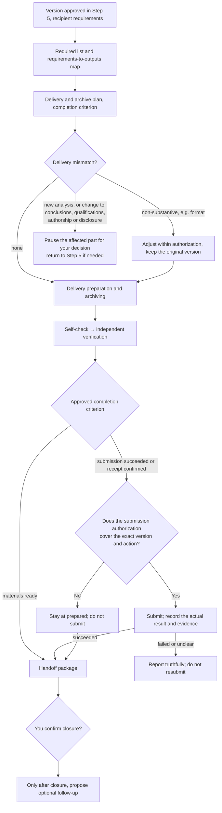

# Step 6 — Required delivery, archiving and project closure

Status: calibrated and saved with the human's approval; gates and team layer adjusted in v0.9; slimmed in v0.9.3. This is reusable policy; it does not authorize any specific project run, actual submission, publication or maintenance. Publishing these rules creates no automatic maintenance task.

This document covers only what is specific to Step 6. General rules are in the [Division of labor](division-of-labor.md), [Shared controls](shared-controls.md) and [Gates, tiers and runtime conditions](gates.md).

## Output and boundaries

Main line: make the required deliverables explicit → complete the required delivery and archive → close under the approved criteria → only then propose optional follow-up. **Optional follow-up does not block closure of the current project and does not take budget from the required delivery.**

Step 5 approves the content, conclusion bounds and exact version of the deliverable; Step 6 sets the submission list from the nature of the project and the recipient's requirements, and completes the necessary adaptation, delivery preparation, authorized actual submission and archiving.

The input is the version approved in Step 5, the nature and goals of the project, recipient requirements, material constraints, valid outputs and review records, and open questions. Read existing information first and clarify only what is missing. From the recipient's requirements, make explicit the list of outputs, format, submission method, deadline and acceptance criteria, and build a **requirements-to-outputs map**. Check only new, changed, invalidated or affected parts; do not redo research verification or add analysis by default; open questions keep their status.

## Rules specific to this stage

### Delivery and archive plan

- The AI proposes the required scope, budget, expected outputs, reasons and trade-offs from the nature of the project, the recipient's requirements and material constraints. **Pre-release/pre-submission checks are graded by channel, audience and material constraints**, proposing check items, depth, budget and open points; valid records are reused and research verification is not redone.
- **Archive depth** is proposed from future reuse and continuation needs, storage cost and material constraints, with explicit scope, budget and acceptance criteria. As needed it may keep: exact versions, an archive index, data/material locations, access restrictions, configuration and environment dependencies, run and review records, recovery instructions. Not every project needs the largest list, and validation is not rerun by default.
- **Completion criterion**: materials ready, submission succeeded, receipt confirmed or another explicit state, with reasons, approved by you. Materials ready may be the closure criterion without submission, but "not submitted" must be recorded; if receipt confirmation is required, a successful submission is not enough. **Criteria are never relaxed automatically because the budget ran out or waiting took too long.**
- Preparation, archiving and approved maintenance each have their **own** sub-budget, effective-progress criteria and stop conditions, under an overall budget. A sub-item trigger pauses the corresponding work; an overall trigger pauses the work it constrains. Pausing and recovery follow [Shared controls](shared-controls.md) section 7.

### Delivery mismatches and issue classification

- Adjustments to format, layout or file organization that do not change meaning may be completed within the preapproved scope and budget and recorded, keeping the original version and checking only the changes.
- **New analysis, or changes to conclusions, qualifications, authorship or the scope of material disclosure**: pause the affected part and set out the minimal plan to close the gap, its impact, options and budget for your decision, returning to Step 5 or earlier if needed.
- Issues affecting required deliverables, archive usability, the accuracy of release/submission authorization or maintenance boundaries prevent the related part from being marked complete. Other issues record impact, handling scope, owner and resolution time, and you decide whether to accept them. Parts that passed and are unaffected may be confirmed separately.

### Actual submission and six states

Actual submission or external release requires explicit authorization covering **the exact revised version, the specific action, the recipient/channel and the scope**. Approval of material preparation, of the final text or of the closure criterion does not grant submission permission.

Record the actual result and evidence. **A failed or unclear result may not be marked as success; do not resubmit on your own, and do not automatically withdraw or republish.** Receipt confirmation is tracked only within the approved scope, deadline and budget.

| State | Basis required |
| --- | --- |
| Prepared | Materials of the specified version ready; acceptance results and open items listed separately |
| Authorized | You explicitly approved the version, action, scope and conditions |
| Submitted / published | Record or evidence of actual success; a failed or unclear result does not count |
| Receipt confirmed | The recipient's corresponding confirmation, never inferred from a successful submission |
| Project closed | Approved completion criterion met and confirmed by you |
| Maintenance started | Approved maintenance has actually begun; updated on expiry or pause |

The six states are recorded separately; none substitutes for or is inferred from another.

### Optional follow-up and maintenance after closure

- **After** closing under the approved criteria, propose bounded follow-up (rewriting outputs, release in another channel, extended research or maintenance), stating value, cost and trade-offs. Suggestions do not become goals automatically and start no investigation, analysis, monitoring or execution on their own; once you choose, scope, budget and outputs are approved separately. Declining or deferring follow-up does not affect a confirmed closure.
- If maintenance is chosen, compare no maintenance, on-demand maintenance and bounded periodic maintenance, proposing scope, triggers, frequency, duration, budget and stop rules. **Approving the plan does not start it**; the started state is recorded only when it actually begins.
- Bounded periodic maintenance accumulates usage, **stops at expiry, and renewal is approved first**; a new run never resets the overall budget. Non-substantive maintenance may be completed and recorded under preapproved rules; maintenance issues that could affect conclusions, evidential validity, authorship or the scope of disclosure pause the affected work for your decision; keep the original version, and do not automatically rerun, withdraw, republish or add analysis.

## Quality gates

Items below their lowest tier are marked `not_applicable`, with a reason based on approved scope.

### G1 material ready

Also includes the cross-stage checklist item "decision material usable" (lite); see [Gates, tiers and runtime conditions](gates.md) section 7.

| Checklist item | Condition | Lowest tier |
| --- | --- | --- |
| Required delivery explicit | Outputs, format, method, deadline and acceptance requirements made explicit from the nature of the project and the recipient's requirements; only missing information clarified | lite |
| Unresolved issues retained | Substantive issues block completion of the related part; other issues list impact, bounds, owner and time for the approver to accept | lite |
| Optional follow-up does not block closure | Summary and full handoff package submitted; closure confirmed by the approver under the approved criteria; follow-up chosen and authorized separately | standard |

### G2 independently verified

v0.8's "independent verification complete" gate is G2 itself. In this stage G2 verifies the following checklist items:

| Checklist item | Condition | Lowest tier |
| --- | --- | --- |
| Mismatches handled by impact | Non-substantive adjustments completed and recorded within preapproved scope; new analysis or substantive change paused for the approver to decide | standard |
| Necessary archive suitable | Depth, scope, budget and criteria approved; usability and continuation requirements met | standard |
| Valid outputs reused | Valid outputs and records reused; new checks target mismatches, invalidated or affected parts, without redoing valid checks | strict |

Verification covers: whether the required deliverables are met, archive completeness and continuity, correspondence between exact versions and submission/release authorization, and the scope, budget, duration and start boundaries of approved maintenance. The scope, depth, division and budget of verification are approved first.

### G3 human authorization

| Authorization point | What is approved | Applies |
| --- | --- | --- |
| Plan and completion criterion approved | Scope, budget, outputs, verification and stop rules, and a closure criterion such as materials ready / submission succeeded / receipt confirmed | All tiers |
| Submission explicitly authorized | The exact revised version, specific action, recipient channel and scope | All tiers |

When the approved closure criterion is `materials_ready` and no submission is planned, "Submission explicitly authorized" is recorded as `not_applicable` for this closure with its basis; that does not authorize a later actual submission. Maintenance-related checklist items apply only to the maintenance chosen. Failure of required deliverables or the archive may not be re-recorded as not applicable.

### Runtime condition: resources and duration controlled

Judged separately for preparation, archiving and approved maintenance: overall and sub-budgets valid, stop rules valid, maintenance stops at expiry, renewal approved first and cumulative usage never reset. Rules are in [Shared controls](shared-controls.md) section 7.

### Work units

Material preparation, archive organization, verification and the submission action may be split into parallel units. **The submission action must be its own work unit**, its `g3_authorization_id` pointing to "Submission explicitly authorized"; without that authorization it may not start. Parts of the handoff package, the archive index and submission evidence are owned separately.

## Outputs

Decision brief (opening with the four items): completion, acceptance status, open questions and items awaiting decision. Attach the exact versions, the requirements-to-outputs map, the archive index, authorization records, actual submission/release results and receipt evidence (if any), review records, resource usage and continuation notes. You confirm the completed parts, the accepted limitations, and closure or follow-up arrangements.

Templates: [Step 6 plan](../templates/step-6-plan.yaml), [handoff package](../templates/step-6-handoff.md).
