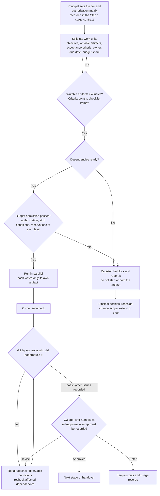

# Team research: people, authorization and work assignment

Status: new in v0.9, introduced by the human's direction decision of 2026-10-31 (a work-assignment system, medium depth). Open assumption: the `principal` is a single final decision-maker; the case of several people sharing the principal role is left for a later decision. Formal arbitration rules and a contribution taxonomy are not included; they belong to the heavier "full collaborative governance" direction.

## 1. People and agents are two layers

v0.8 had one human "user" and five agent roles. "Role assignment and independence" in the templates meant division between agents by artifact, not between people. This document makes the people layer explicit. Agent roles (coordinator / researcher / verifier / challenger / methods_specialist) and their independence rules are unchanged; see [Shared controls](shared-controls.md) section 6.

| Person role | Authority | Boundary |
| --- | --- | --- |
| `principal` | Final decision-maker: research direction, quality standards, tier, budget, actual external submission | These powers are not delegated by default; delegation must be recorded explicitly |
| `approver` | Approves within the gate classes and scope the principal has explicitly delegated | May not approve a work unit they are responsible for producing |
| `collaborator` | Owns work units, produces and self-checks | May not approve their own output or change a frozen contract |
| `reviewer` | Performs G2 verification or challenge for named artifacts | May not accept parts they wrote or substantially repaired |
| `observer` | Read-only access | Their views do not constitute authorization |

One person may hold several roles. But for **the same artifact**, G2 and G3 may not be performed by the same person (see the lite-tier exception at the end of section 2).

## 2. Authorization matrix

In Step 1 the principal fills in an authorization matrix — approvers by "gate class × scope" — recorded in the [authorization record](../templates/authorization-record.yaml).

- The default G3 approver is the principal. A delegation must state the gate class, scope, budget ceiling and expiry.
- **Decisions that cannot be delegated** (inherited from [Shared controls](shared-controls.md) section 2): research goals and direction, substantive changes to method or conclusion boundaries, changes to quality standards, unauthorized expansion of scope or budget, lowering the tier, and actual external submission.
- An absent approver is not an authorization. A timeout, silence or tacit verbal acquiescence is not approval.
- **Lite-tier self-approval exception**: in a group of two or fewer, the principal may also own a work unit. The principal may then self-approve G3, but the overlap must be recorded in the decision log, and G2 must still be performed by another person or by an agent that did not take part in producing the artifact. This is a recorded exception, not a gate pass.

## 3. Work units

A work unit is the smallest unit of assignment; fields are in the [work assignment](../templates/work-assignment.yaml) template. Required: objective, allowed inputs and their versions, allowed outputs, writable artifacts, acceptance criteria, owner, due date, budget share, dependencies.

1. **Writable artifacts are mutually exclusive.** Two concurrent work units may not write the same part of the same artifact. This rule previously bound only concurrent agents; it now binds people too.
2. **A work unit has exactly one owner.** Joint output is split into several units, or one person owns it and the others are recorded under `material_contributors`.
3. **Acceptance criteria must be checkable and point to the checklist item they serve** (a specific G1 or G2 item; see [Gates and tiers](gates.md)). If you cannot point to one, the unit's boundary is not yet clear: do not dispatch it.
4. **Budget admission before starting.** Follow the [task launch record](../templates/task-launch.yaml) and [Shared controls](shared-controls.md) section 5. People's time is a constrained resource too, reserved under the same rules; "we are all on the same team" is no reason to skip registration.
5. **Do not start before dependencies are ready.** Report a block immediately; do not idle, and do not start half the work to hold the artifact.

## 4. Handover

A handover record contains: artifact version, checklist items already passed with their check IDs, open questions, remaining budget, and the next owner.

- The new owner **does not inherit** the previous owner's G2 responsibility. If the new owner took part in production, verification must be assigned to someone else.
- When a person leaves, the principal reassigns their unfinished units and records it. Checks already passed remain valid; reuse rules are in [Shared controls](shared-controls.md) section 4.
- **Authorship and contribution**: Step 6 forbids silently changing authorship. Contribution records are generated from each work unit's `owner` and `material_contributors`, so they are traceable; author order is the principal's decision, and agents may not infer or fill it in. A full contribution taxonomy is left for a later version.

## 5. Blocks and disagreements

- **Blocks**: the owner reports the cause, impact, budget spent and options; the principal or an authorized approver decides. A missed deadline does not extend itself.
- **Disagreements between people**: keep each side's evidence, assumptions and effect on the recommendation, and let the principal decide. Consensus is not forced, and a majority vote does not replace evidence. This matches the rule for keeping unresolved objections between agents.

## 6. Assignment flow

## 7. Relation to the stages

Each stage's work units are listed in that stage's contract. Long-running units that cross stages must state their version dependencies and invalidation conditions. Stage gates are set by [Gates and tiers](gates.md); this document only settles who does the work, who approves it, and how artifacts avoid collisions.
